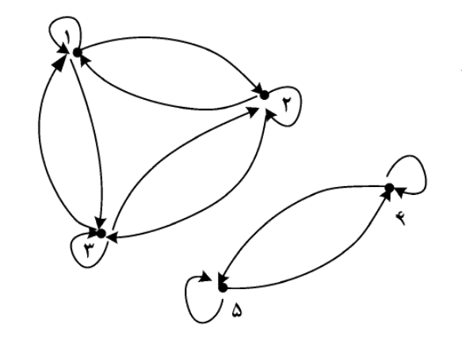

# فصل ۵: روابط، هم‌ارزی و ترتیب جزئی

> **سهم در کنکور:** ۵ سؤال در ارشد ۱۳۹۸ تا ۱۴۰۴. تیپ‌ها: تشخیص خواص یک رابطه از روی گراف، شمردن رابطه‌ها، «اگر R فلان خاصیت را داشته باشد، S هم دارد؟»، و مشبکه.
> **زمان مطالعه:** یک بلوک ۹۰ دقیقه‌ای.

---

## درس ۱: خواص روابط و شمردن آن‌ها

رابطهٔ R روی A یعنی زیرمجموعه‌ای از `A×A`. در **گراف جهت‌دار** رابطه، یال `i → j` یعنی `iRj`.

| خاصیت | تعریف | در گراف |
|---|---|---|
| بازتابی | برای هر a: `aRa` | همهٔ گره‌ها طوقه دارند |
| ضدبازتابی | برای هیچ a: `aRa` | هیچ طوقه‌ای نیست |
| تقارنی | `aRb ⇒ bRa` | هر یال برگشت دارد |
| پادتقارنی | `aRb ∧ bRa ⇒ a = b` | هیچ یال دوطرفه‌ای بین دو گرهٔ **متمایز** نیست |
| تعدی | `aRb ∧ bRc ⇒ aRc` | هر مسیر دوتایی میان‌بُر دارد |

⚠️ «پادتقارنی» نقیض «تقارنی» **نیست**. رابطهٔ تهی هم تقارنی است، هم پادتقارنی، هم تعدی.

### شمردن روی مجموعهٔ n عضوی
| نوع | تعداد |
|---|---|
| همهٔ رابطه‌ها | `2^(n²)` |
| بازتابی | `2^(n²−n)` |
| تقارنی | `2^(n(n+1)/2)` |
| پادتقارنی | `2ⁿ · 3^(n(n−1)/2)` |
| بازتابی و تقارنی | `2^(n(n−1)/2)` |
| بازتابی و پادتقارنی | `3^(n(n−1)/2)` |

**منطق شمارش:** قطر (n خانه) و جفت‌های `{a,b}` با `a ≠ b` را جدا ببین. در پادتقارنی هر جفت سه حالت دارد: هیچ، `a→b`، یا `b→a`.

---

## درس ۲: بستارها

| بستار | ساخت |
|---|---|
| بازتابی | `R ∪ Δ` (اضافه کردن قطر) |
| تقارنی | `R ∪ R⁻¹` |
| تعدی | `R⁺` (الگوریتم وارشال در `O(n³)`) |

⚠️ بستار تقارنی یک رابطهٔ **تعدی**، الزاماً تعدی نیست. مثال: `R = {(1,2), (3,2)}` تعدی است (به‌طور تهی)، ولی در بستار تقارنی‌اش `1~2` و `2~3` داریم بدون `1~3`.

---

## درس ۳: رابطهٔ هم‌ارزی و افراز

- **هم‌ارزی** = بازتابی + تقارنی + تعدی. هر هم‌ارزی دقیقاً یک **افراز** از A است (کلاس‌ها).
- تعداد زوج‌های رابطه = `Σ kᵢ²` (kᵢ اندازهٔ کلاس‌هاست). چون `kᵢ² ≡ kᵢ (mod 2)`، **زوجیت |R| همان زوجیت |A|** است.
- تعداد هم‌ارزی‌ها روی n عضو = عدد بل: `1, 2, 5, 15, 52` برای n = ۱ تا ۵.
- در گراف: مؤلفه‌هایی که درونشان **همه‌به‌همه** (با طوقه) وصل‌اند.

---

## درس ۴: ترتیب جزئی و مشبکه

- **ترتیب جزئی** = بازتابی + پادتقارنی + تعدی. **نمودار هاسه** طوقه‌ها و یال‌های تعدی را حذف می‌کند.
- **کمینه** (minimal): کسی از آن کوچک‌تر نیست. **کوچک‌ترین** (minimum): از همه کوچک‌تر است. ممکن است چند کمینه باشد ولی کوچک‌ترین وجود نداشته باشد.
- تعداد زوج‌های یک ترتیب جزئی = `|A|` (قطر) + تعداد زوج‌های اکید. پس زوجیتش **به ساختار بستگی دارد**.
- **مشبکه:** هر دو عضو کوچک‌ترین کران بالا (`∨`) و بزرگ‌ترین کران پایین (`∧`) دارند.
  - **هر مشبکهٔ متناهی کران‌دار است**: بزرگ‌ترین عضو (۱) و کوچک‌ترین عضو (۰) دارد.
  - **متمم a:** عضوی مثل b با `a ∧ b = 0` و `a ∨ b = 1`. **همهٔ مشبکه‌های کران‌دار متممی نیستند.** مثلاً در زنجیر `0 < a < 1`، عضو a متمم ندارد.
  - مشبکهٔ بخش‌پذیری روی مقسوم‌علیه‌های n: `∧ = ب.م.م` و `∨ = ک.م.م`.

### تمرین فصل ۵
1. روی مجموعهٔ ۳ عضوی چند رابطهٔ تقارنی و چند رابطهٔ بازتابی-تقارنی هست؟
2. `{(1,1), (2,2), (3,3), (1,2), (2,1)}` روی `{1,2,3}` چه رابطه‌ای است؟
3. در مشبکهٔ مقسوم‌علیه‌های ۱۲ با بخش‌پذیری، متمم ۴ و متمم ۲ چیست؟

جواب‌ها

1. `2⁶ = 64` و `2³ = 8`.
2. هم‌ارزی با کلاس‌های `{1,2}` و `{3}`؛ اندازه `2² + 1² = 5`.
3. متمم ۴ عدد ۳ است (`gcd = 1` و `lcm = 12`). عدد ۲ متمم ندارد (هیچ x ای نیست که `gcd(2,x) = 1` و `lcm(2,x) = 12`).

---

## 📝 آزمون فصل ۵ (سؤال‌های واقعی کنکور ارشد کامپیوتر)
**زمان: ۱۲ دقیقه.**

**۱. (ارشد ۱۴۰۴، سؤال ۴۳)** فرض کنید `A = {1, 2, 3, 4, 5}` و R یک رابطه روی A باشد که با گراف جهت‌دار زیر نشان داده شده است. کدام مورد درخصوص R صحیح است؟ (چنانچه یالی از گرهٔ i به گرهٔ j وجود داشته باشد، i با j رابطهٔ R دارد.)

۱) R خاصیت پادتقارنی دارد. ۲) R یک رابطهٔ هم‌ارزی است. ۳) R یک رابطهٔ ترتیب است. ۴) R خاصیت تعدی ندارد.

**۲. (ارشد ۱۴۰۱، سؤال ۴۹)** رابطهٔ R را روی مجموعهٔ A در نظر بگیرید. با استفاده از R رابطهٔ S را به شکل `xSy ⟺ xRy ∨ yRx` تعریف می‌کنیم. کدام مورد در خصوص گزاره‌های زیر به‌ترتیب درست است؟
- الف) اگر R ترایایی باشد، آنگاه S نیز لزوماً ترایایی است.
- ب) اگر R هم‌ارزی باشد، آنگاه S نیز لزوماً هم‌ارزی است.

۱) نادرست، نادرست ۲) درست، نادرست ۳) نادرست، درست ۴) درست، درست

**۳. (ارشد ۱۴۰۰، سؤال ۴۹)** با توجه به دو گزارهٔ زیر، کدام گزینه صحیح است؟
- الف) هر مشبکهٔ متناهی دارای حداقل یک عضو ماکزیمم و یک عضو مینیمم است.
- ب) در هر مشبکهٔ کران‌دار، هر عضو دارای حداقل یک متمم است.

۱) الف نادرست، ب نادرست ۲) الف نادرست، ب درست ۳) الف درست، ب نادرست ۴) الف درست، ب درست

**۴. (ارشد ۱۳۹۹، سؤال ۴۸)** روی مجموعهٔ `{a, b, c}` چند رابطه می‌توان تعریف کرد که نه بازتابی باشد و نه پادمتقارن؟
۱) ۲۵۹ ۲) ۱۲۸ ۳) ۳۲ ۴) ۷

**۵. (ارشد ۱۳۹۸، سؤال ۵۰)** فرض کنید R یک رابطه روی مجموعهٔ متناهی S باشد. با توجه به دو گزارهٔ زیر کدام گزینه صحیح است؟
- الف) اگر R یک رابطهٔ هم‌ارزی و تعداد اعضای آن فرد باشد، آنگاه اندازهٔ S نیز فرد است.
- ب) اگر R یک رابطهٔ ترتیب جزئی و تعداد اعضای آن زوج باشد، آنگاه اندازهٔ S نیز زوج است.

۱) الف درست، ب درست ۲) الف نادرست، ب درست ۳) الف درست، ب نادرست ۴) الف نادرست، ب نادرست

جواب‌ها و راه‌حل (کلید رسمی سازمان سنجش)

| سؤال | ۱ | ۲ | ۳ | ۴ | ۵ |
|---|---|---|---|---|---|
| کلید | ۲ | ۳ | ۳ | ۱ | ۳ |

**۱. گزینهٔ ۲.** همهٔ گره‌ها طوقه دارند؛ بین هر دو گره از `{1,2,3}` یال در هر دو جهت هست؛ و بین ۴ و ۵ هم یال دوطرفه هست. این یک هم‌ارزی با کلاس‌های `{1,2,3}` و `{4,5}` است. یال‌های دوطرفه پادتقارنی را رد می‌کنند، پس ترتیب هم نیست.

**۲. گزینهٔ ۳.**
- الف: با `R = {(1,2), (3,2)}` (تعدی)، S شامل `1S2` و `2S3` است ولی `1S3` ندارد. پس **نادرست**.
- ب: اگر R تقارنی باشد، `S = R ∪ R⁻¹ = R`. پس **درست**.

**۳. گزینهٔ ۳.**
- الف: در مشبکهٔ متناهی، `∨` همهٔ اعضا بزرگ‌ترین و `∧` همه کوچک‌ترین است. **درست**.
- ب: در زنجیر سه‌عضوی، عضو وسط متمم ندارد. **نادرست**.

**۴. گزینهٔ ۱.** کل `2⁹ = 512`. بازتابی `2⁶ = 64`. پادتقارنی `2³·3³ = 216`. هر دو `3³ = 27`. جواب: `512 − (64 + 216 − 27) = 259`.

**۵. گزینهٔ ۳.**
- الف: `|R| = Σkᵢ² ≡ Σkᵢ = |S| (mod 2)`. **درست**.
- ب: مثال نقض: `S = {a,b,c}` و R = قطر + `(a,b)`. اینجا `|R| = 4` زوج است ولی `|S| = 3` فرد. **نادرست**.

---

## 🗂 کارت خلاصهٔ فصل ۵
- بازتابی: همه طوقه. تقارنی: همه دوطرفه. پادتقارنی: هیچ دوطرفه‌ای بین متمایزها. تعدی: مسیر دوتایی میان‌بُر دارد.
- شمارش: کل `2^(n²)`؛ بازتابی `2^(n²−n)`؛ تقارنی `2^(n(n+1)/2)`؛ پادتقارنی `2ⁿ·3^(n(n−1)/2)`.
- بستار تقارنی، تعدی را حفظ نمی‌کند. هم‌ارزی یعنی افراز؛ `|R| = Σkᵢ²`؛ عدد بل `1, 2, 5, 15, 52`.
- مشبکهٔ متناهی کران‌دار است. کران‌دار الزاماً متممی نیست (زنجیر). بخش‌پذیری: `∧ = gcd` و `∨ = lcm`.
