# فصل ۱: مفاهیم پایهٔ سیستم‌عامل، فرایند و ریسمان

> **سهم در کنکور:** ۱۲ سؤال در ارشد ۱۳۹۸ تا ۱۴۰۴ (۶ مفاهیم پایه و ۶ فرایند و ریسمان). بیشتر مفهومی‌اند. تیپ محاسبه‌ای ثابت: شمردن خروجی‌های `fork()`.
> **زمان مطالعه:** یک بلوک ۹۰ دقیقه‌ای.

---

## درس ۱: مفاهیم پایه

- **حالت دوگانه (Dual Mode):** یک بیت حالت **در سخت‌افزار پردازنده**. هدفش حفاظت از **منابع سیستم** در برابر فرایندهای مخرب است. دستورهای ممتاز (تنظیم ساعت، I/O، تغییر جدول صفحه، غیرفعال کردن وقفه) فقط در حالت هسته اجرا می‌شوند.
  - **خواندن ساعت** نیاز به حالت هسته ندارد. **تنظیم ساعت** دارد.
- **فراخوانی سیستمی:** راه کنترل‌شدهٔ رفتن از حالت کاربر به حالت هسته (با trap).
- **بهره‌وری CPU در چندبرنامگی:** اگر ورودی، پردازش و خروجی روی پردازنده‌های جدا موازی شوند، گلوگاه طولانی‌ترین مرحله است:
  `بهره‌وری CPU = زمان پردازش / بیشترین زمان مرحله‌ها`.
  اگر انتقال با DMA هم‌زمان با پردازش انجام شود و زمانش از پردازش بیشتر نباشد، بهره‌وری **۱۰۰٪** است.
- **RAID:** سطح ۰ تقسیم (striping) بدون افزونگی؛ **سطح ۱ آینه‌سازی (mirroring)**؛ سطح ۵ توازن توزیع‌شده.

---

## درس ۲: فرایند

- حالت‌ها: جدید، آماده، در حال اجرا، منتظر، پایان‌یافته. اطلاعات هر فرایند در PCB نگه داشته می‌شود.
- **زامبی:** فرزند تمام شده ولی والد هنوز `wait` نکرده است.
- **یتیم:** والد تمام شده و فرزند زنده است. اگر والد بدون `wait` تمام شود، زامبی هم یتیم می‌شود و `init` آن را برمی‌دارد.

### شمردن `fork()`
- هر `fork()` تعداد فرایندها را **دو برابر** می‌کند. n فراخوانی پشت‌سرهم یعنی `2ⁿ` فرایند.
- `fork()` در فرزند صفر و در والد عددی مثبت برمی‌گرداند.
- **`&&` و `||` اتصال کوتاه دارند:** در `fork() && fork()`، دومی فقط در **والد** اجرا می‌شود (۳ فرایند، که شرط فقط در یکی درست است).
- **`&` و `|` بیتی‌اند و اتصال کوتاه ندارند:** هر دو fork همیشه اجرا می‌شوند (۴ فرایند). با فرض اینکه جواب `&` یا `|` مثل منطقی رفتار کند، `fork()&fork()` در ۱ حالت از ۴ درست است و `fork()|fork()` در ۳ حالت از ۴.

---

## درس ۳: ریسمان

| | سطح کاربر | سطح هسته |
|---|---|---|
| مدیریت | کتابخانه، بدون پشتیبانی هسته | هسته |
| تعویض متن | سریع (سربار کم) | کندتر |
| مسدود شدن یکی | در مدل چند به یک، کل فرایند مسدود می‌شود | فقط همان ریسمان |
| چندپردازنده | در مدل چند به یک بهره نمی‌برد | بهره می‌برد |

- **مدل‌های نگاشت:** چند به یک (همهٔ ریسمان‌های کاربر روی **یک** ریسمان هسته)، یک به یک، چند به چند.
- **شمردن ریسمان‌های هسته:** ریسمان‌های هسته‌ای را مستقیم بشمار. برای ریسمان‌های کاربر در مدل چند به یک، هر فرایند فقط **یک** ریسمان هسته دارد (اگر ریسمان هسته نداشته باشد).
- **همروندی (concurrency):** چندوظیفگی و چندریسمانی هر دو نوعی همروندی‌اند.

### تمرین فصل ۱
1. چند Hello چاپ می‌شود؟ `fork(); fork(); fork(); printf("Hello");`
2. با `if (fork() && fork()) fork(); printf("Hi");` چند Hi چاپ می‌شود؟
3. ورودی ۱۰، پردازش ۳۰ و خروجی ۲۰ میلی‌ثانیه (پردازنده‌های جدا). بیشترین بهره‌وری CPU؟

جواب‌ها

1. `2³ = 8`
2. `fork() && fork()` سه فرایند می‌سازد و شرط فقط در یکی درست است. آن یکی fork می‌کند، پس `3 + 1 = 4`.
3. گلوگاه خود پردازش است، پس **۱۰۰٪**.

---

## 📝 آزمون فصل ۱ (سؤال‌های واقعی کنکور ارشد کامپیوتر)
**زمان: ۲۵ دقیقه برای ۱۲ سؤال.**

**۱. (ارشد ۱۴۰۴، سؤال ۹۶)**
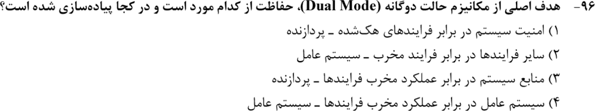

**۲. (ارشد ۱۴۰۳، سؤال ۹۸)**
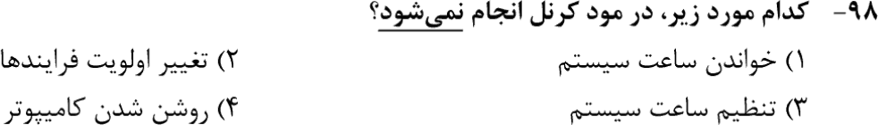

**۳. (ارشد ۱۴۰۱، سؤال ۱۰۱)**
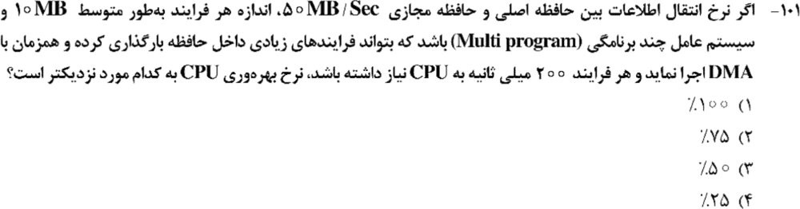

**۴. (ارشد ۱۴۰۱، سؤال ۱۰۶)**
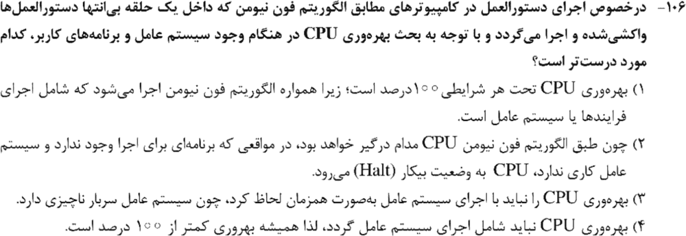

**۵. (ارشد ۱۴۰۰، سؤال ۱۰۱)**
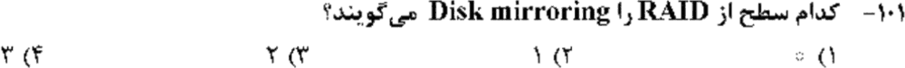

**۶. (ارشد ۱۳۹۸، سؤال ۷۶)**
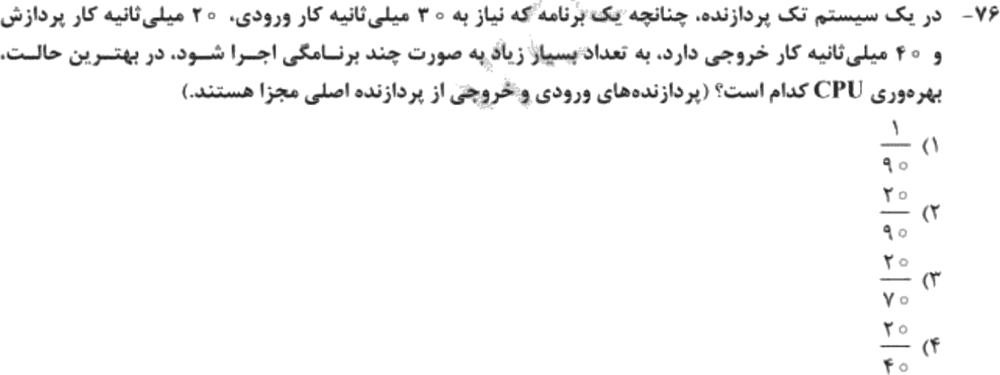

**۷. (ارشد ۱۴۰۴، سؤال ۹۸)**
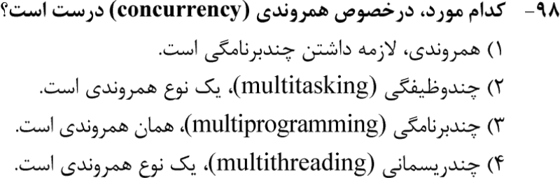

**۸. (ارشد ۱۴۰۴، سؤال ۹۹)**
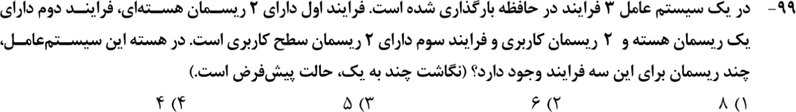

**۹. (ارشد ۱۴۰۳، سؤال ۹۶)**
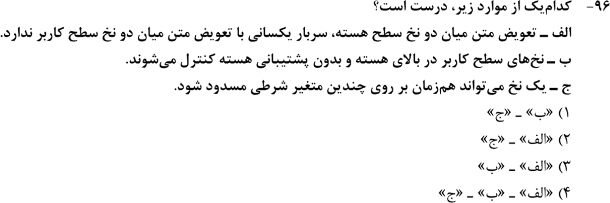

**۱۰. (ارشد ۱۴۰۲، سؤال ۱۰۱)**
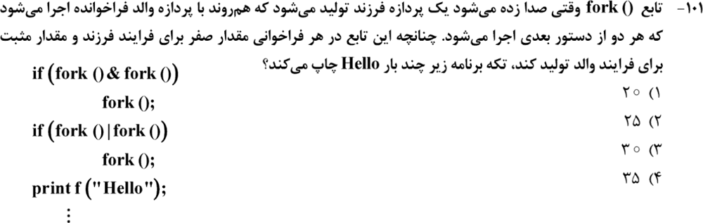

**۱۱. (ارشد ۱۴۰۱، سؤال ۱۰۷)**
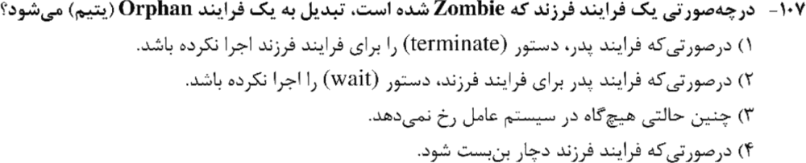

**۱۲. (ارشد ۱۳۹۹، سؤال ۱۰۱)**
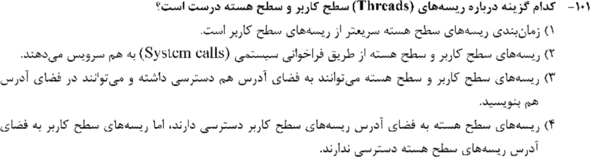

جواب‌ها و راه‌حل (کلید رسمی سازمان سنجش)

| سؤال | ۱ | ۲ | ۳ | ۴ | ۵ | ۶ | ۷ | ۸ | ۹ | ۱۰ | ۱۱ | ۱۲ |
|---|---|---|---|---|---|---|---|---|---|---|---|---|
| کلید | ۳ | ۱ | ۱ | ۲ | ۲ | ۴ | ۲ و ۴ | ۴ | ۳ | ۱ و ۴ | ۲ | ۳ |

**۱. گزینهٔ ۳.** حالت دوگانه از **منابع سیستم** در برابر فرایندهای مخرب محافظت می‌کند و در **پردازنده** (بیت حالت) پیاده می‌شود.

**۲. گزینهٔ ۱.** خواندن ساعت ممتاز نیست. تنظیم ساعت، تغییر اولویت و راه‌اندازی در حالت هسته‌اند.

**۳. گزینهٔ ۱.** بارگذاری هر فرایند `10/50 = 0.2` ثانیه = ۲۰۰ میلی‌ثانیه طول می‌کشد، که دقیقاً برابر نیاز CPU است. با DMA هم‌زمان، بارگذاری بعدی موازی با اجرای فعلی است. پس بهره‌وری **۱۰۰٪**.

**۴. گزینهٔ ۲.** وقتی کاری نیست، CPU به حالت بیکار (Halt یا حلقهٔ بیکار) می‌رود. پس بهره‌وری ۱۰۰٪ نیست. اجرای خود سیستم‌عامل هم جزو بهره‌وری حساب می‌شود.

**۵. گزینهٔ ۲.** RAID 1.

**۶. گزینهٔ ۴.** گلوگاه مرحلهٔ خروجی (۴۰) است. پس بهره‌وری `20/40`.

**۷. گزینه‌های ۲ و ۴ (هر دو پذیرفته شده).** چندوظیفگی و چندریسمانی هر دو نوعی همروندی‌اند. همروندی لازمهٔ چندبرنامگی نیست و این دو یکی هم نیستند.

**۸. گزینهٔ ۴.** فرایند ۱: ۲ ریسمان هسته. فرایند ۲: یک ریسمان هسته (ریسمان‌های کاربرش روی همان نگاشت می‌شوند). فرایند ۳: چند به یک یعنی ۱. جمع **۴**.

**۹. گزینهٔ ۳.**
- الف درست است: تعویض متن ریسمان هسته پرهزینه‌تر است.
- ب درست است.
- ج غلط است: یک ریسمان در هر لحظه فقط روی یک متغیر شرطی منتظر می‌ماند.

**۱۰. گزینه‌های ۱ و ۴ (۴ با تأثیر مثبت).**
- با فرض «مثل عملگر منطقی»: مرحلهٔ اول ۴ فرایند می‌سازد و شرط فقط در یکی درست است، پس ۵ فرایند. مرحلهٔ دوم هر کدام را به ۴ تبدیل می‌کند و در ۳ تا شرط درست است، پس `5 × 7 = 35`.
- با بیتی واقعی، `&` دو PID مثبت ممکن است صفر شود. برای همین کلید ۲۰ را هم پذیرفته.

**۱۱. گزینهٔ ۲.** والد بدون `wait` تمام شود.

**۱۲. گزینهٔ ۳.** ریسمان‌های یک فرایند (چه سطح کاربر چه هسته) فضای آدرس مشترک دارند و می‌توانند در آن بنویسند.

---

## 🗂 کارت خلاصهٔ فصل ۱
- حالت دوگانه: منابع سیستم و بیت پردازنده. خواندن ساعت ممتاز نیست؛ تنظیمش هست. RAID 1 = آینه.
- بهره‌وری CPU = پردازش / گلوگاه. DMA هم‌زمان ⇐ همپوشانی.
- `fork`: n تا پشت‌سرهم یعنی `2ⁿ`. `&&` و `||` اتصال کوتاه دارند؛ `&` و `|` ندارند. زامبی بدون wait والد ⇐ یتیم.
- ریسمان کاربر سریع است ولی چند به یک با مسدود شدن کل فرایند را می‌خواباند. چند به یک ⇐ یک ریسمان هسته برای هر فرایند.
