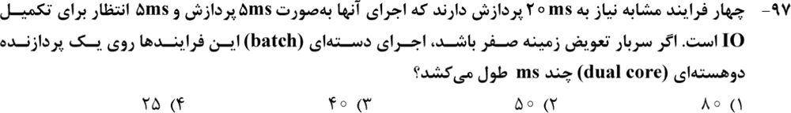
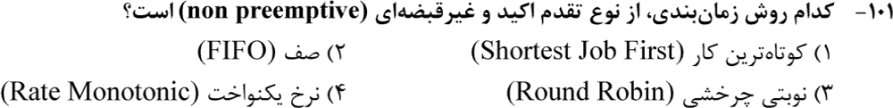
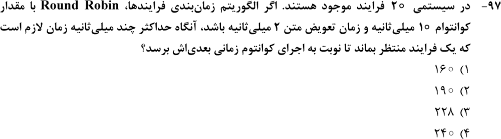
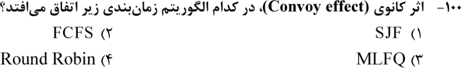
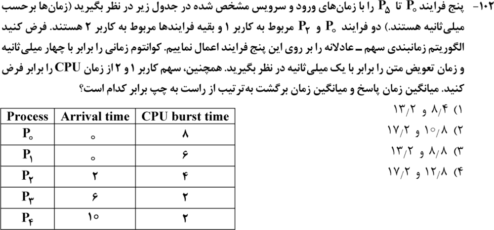
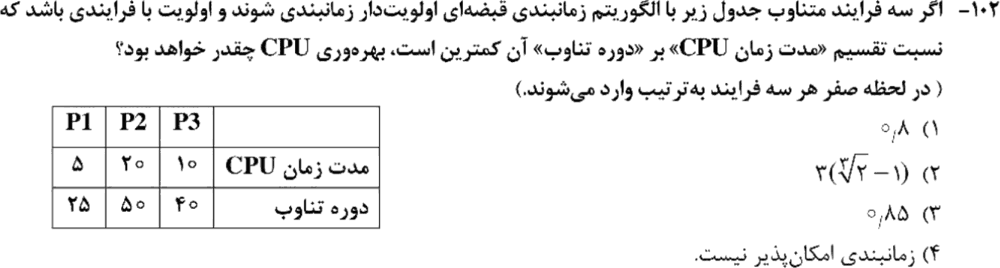
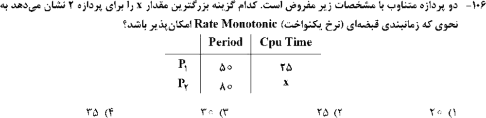
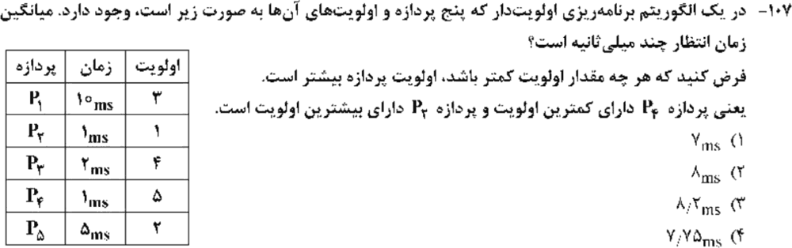
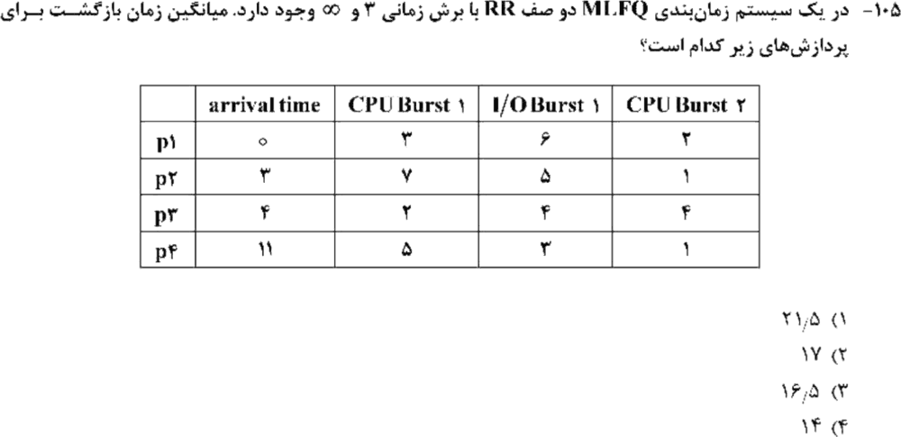

# فصل ۲: زمان‌بندی پردازنده

> **سهم در کنکور:** ۹ سؤال در ارشد ۱۳۹۸ تا ۱۴۰۴. تیپ‌ها: نمودار گانت و میانگین زمان انتظار یا بازگشت، زمان‌بندی بی‌درنگ (RM و EDF)، و ویژگی الگوریتم‌ها.
> **زمان مطالعه:** یک بلوک ۹۰ دقیقه‌ای.

---

## درس ۱: معیارها و الگوریتم‌های پایه

- **زمان بازگشت** = پایان − ورود. **زمان انتظار** = بازگشت − زمان CPU (− زمان I/O). **زمان پاسخ** = اولین اجرا − ورود.

| الگوریتم | قبضه‌ای؟ | ویژگی |
|---|---|---|
| FCFS (FIFO) | ❌ | **اثر کاروانی**: یک کار طولانی همه را پشت سر خودش نگه می‌دارد |
| SJF | ❌ (SRTF قبضه‌ای است) | کمترین میانگین زمان انتظار؛ گرسنگی ممکن است |
| اولویت‌دار | هر دو | گرسنگی؛ درمان: پیر شدن (aging) |
| RR (کوانتوم q) | ✅ | کوانتوم بزرگ به FCFS نزدیک می‌شود |
| MLFQ | ✅ | کاری که کوانتومش را تمام کند به صف پایین‌تر می‌رود |
| سهم عادلانه | ✅ | CPU بین **کاربرها** (یا گروه‌ها) مساوی تقسیم می‌شود و بعد بین فرایندهای هر کاربر |

**بیشترین انتظار در RR** (n فرایند، کوانتوم q، تعویض متن s): `(n − 1)(q + s)`.

**روش گانت:** زمان‌ها را روی یک خط بکش. در هر لحظه صف آماده را بنویس و قاعدهٔ شکستن تساوی را از صورت سؤال بخوان (معمولاً اول کسی که زودتر وارد شده).

---

## درس ۲: زمان‌بندی بی‌درنگ (فرایندهای متناوب)

- **بهره‌وری** `U = Σ Cᵢ/Tᵢ`. اگر `U > 1` هیچ زمان‌بندی‌ای امکان ندارد.
- **EDF:** امکان‌پذیر است ⇔ `U ≤ 1`.
- **RM (نرخ یکنواخت):** دورهٔ کوتاه‌تر اولویت بالاتر دارد.
  - شرط کافی: `U ≤ n(2^(1/n) − 1)` (برای n = ۲: حدود ۰٫۸۲۸).
  - شرط **دقیق:** در دورهٔ اول فرایند با اولویت کمتر، شبیه‌سازی کن (تحلیل زمان پاسخ).

**مثال (RM):** P1 با `T = 50` و `C = 25`، P2 با `T = 80`. P1 در بازه‌های `[0, 25]` و `[50, 75]` اجرا می‌شود. زمان آزاد قبل از ۸۰ برابر `25 + 5 = 30` است، پس بیشینهٔ x برابر **۳۰**.

### تمرین فصل ۲
1. P1 (۶)، P2 (۳)، P3 (۸) همه در صفر وارد می‌شوند. میانگین انتظار با SJF؟
2. سه فرایند با `C/T` برابر `1/4`، `1/5` و `2/10`. با EDF امکان‌پذیر است؟

جواب‌ها

1. ترتیب P2، P1، P3: انتظارها `0`، `3` و `9`، پس میانگین **۴**.
2. `U = 0.25 + 0.2 + 0.2 = 0.65 ≤ 1`، پس بله.

---

## 📝 آزمون فصل ۲ (سؤال‌های واقعی کنکور ارشد کامپیوتر)
**زمان: ۲۵ دقیقه برای ۹ سؤال.**

**۱. (ارشد ۱۴۰۴، سؤال ۹۷)**

**۲. (ارشد ۱۴۰۴، سؤال ۱۰۱)**

**۳. (ارشد ۱۴۰۳، سؤال ۹۷)**

**۴. (ارشد ۱۴۰۳، سؤال ۱۰۰)**

**۵. (ارشد ۱۴۰۳، سؤال ۱۰۲)**

**۶. (ارشد ۱۴۰۱، سؤال ۱۰۲)**

**۷. (ارشد ۱۴۰۰، سؤال ۱۰۶)**

**۸. (ارشد ۱۴۰۰، سؤال ۱۰۷)**

**۹. (ارشد ۱۳۹۹، سؤال ۱۰۵)**

جواب‌ها و راه‌حل (کلید رسمی سازمان سنجش)

| سؤال | ۱ | ۲ | ۳ | ۴ | ۵ | ۶ | ۷ | ۸ | ۹ |
|---|---|---|---|---|---|---|---|---|---|
| کلید | ۱ و ۳ | ۲ | ۳ | ۲ | ۲ | ۳ | ۳ | ۳ | ۲ |

**۱. گزینه‌های ۱ و ۳ (هر دو پذیرفته شده).** در اجرای دسته‌ای، I/O با پردازش هم‌پوشانی ندارد.
- اگر «۲۰ میلی‌ثانیه» فقط پردازش باشد: هر فرایند `20 + 20 = 40`، و دو فرایند روی هر هسته: **۸۰**.
- اگر کل زمان باشد: **۴۰**.

**۲. گزینهٔ ۲.** FIFO.

**۳. گزینهٔ ۳.** `19 × (10 + 2) = 228`.

**۴. گزینهٔ ۲.** FCFS.

**۵. گزینهٔ ۲ (کلید رسمی).** روش: CPU را بین کاربر ۱ و ۲ نوبتی تقسیم کن و درون هر کاربر RR با کوانتوم ۴ اجرا کن؛ بعد از هر کوانتوم ۱ میلی‌ثانیه تعویض متن. عددهای دقیق به قرارداد شروع (کاربر اول) و شکستن تساوی بستگی دارند. شبیه‌سازی من با دو قرارداد رایج به عددهای نزدیک (میانگین بازگشت حدود ۱۷) رسید ولی نه دقیقاً عددهای کلید. **روش را یاد بگیر، نه عدد را.**

**۶. گزینهٔ ۳.** `U = 5/25 + 20/50 + 10/40 = 0.85`. با شبیه‌سازی، اولویت بر اساس `C/T` امکان‌پذیر است. پس بهره‌وری ۰٫۸۵.

**۷. گزینهٔ ۳ (۳۰).** مثال درس ۲.

**۸. گزینهٔ ۳.** ترتیب اجرا P2(1)، P5(5)، P1(10)، P3(2)، P4(1). انتظارها `0 + 1 + 6 + 16 + 18 = 41`، پس میانگین `8.2`.

**۹. گزینهٔ ۲ (۱۷).** MLFQ: صف اول RR با کوانتوم ۳ و صف دوم FCFS؛ کاری که کوانتومش تمام شود پایین می‌رود و صف اول بر صف دوم مقدم است. شبیه‌سازی من میانگین بازگشت را **۱۷٫۲۵** داد (پایان‌ها: p1=11، p3=23، p2=26، p4=27). نزدیک‌ترین گزینه و کلید رسمی ۱۷ است. اختلاف کوچک از قرارداد ترتیب ورود هم‌زمان به صف می‌آید.

---

## 🗂 کارت خلاصهٔ فصل ۲
- بازگشت = پایان − ورود؛ انتظار = بازگشت − CPU. FCFS: اثر کاروانی. SJF: کمترین انتظار.
- بیشترین انتظار RR: `(n − 1)(q + s)`.
- بی‌درنگ: `U = ΣC/T`. EDF: `U ≤ 1`. RM: شبیه‌سازی دورهٔ اول کم‌اولویت.
- اولویت غیرقبضه‌ای با ورود هم‌زمان: به ترتیب اولویت اجرا کن و انتظارها را جمع بزن.
