# فصل ۳: همگام‌سازی و بن‌بست

> **سهم در کنکور:** ۱۳ سؤال در ارشد ۱۳۹۸ تا ۱۴۰۴ (۷ همگام‌سازی و ۶ بن‌بست). تیپ‌ها: بررسی سه شرط ناحیهٔ بحرانی در یک الگوریتم، ترتیب‌دهی با سمافور، الگوریتم بانکدار، و کمترین تعداد منبع.
> **زمان مطالعه:** دو بلوک ۹۰ دقیقه‌ای.

---

## درس ۱: مسئلهٔ ناحیهٔ بحرانی

سه شرط:
1. **انحصار متقابل:** حداکثر یک فرایند در ناحیهٔ بحرانی.
2. **پیشرفت:** اگر ناحیه خالی است، انتخاب نفر بعد فقط بین متقاضیان انجام شود و بی‌نهایت عقب نیفتد.
3. **انتظار محدود:** بعد از درخواست یک فرایند، دیگران تعداد محدودی بار جلوتر از او وارد شوند.

| راه‌حل | نکته |
|---|---|
| پترسون، دکر | هر سه شرط را برای ۲ فرایند برآورده می‌کنند |
| فقط `turn` | پیشرفت نقض می‌شود (نوبت اجباری) |
| فقط `flag` | ممکن است بن‌بست یا نقض پیشرفت شود |
| TestAndSet ساده | انتظار محدود ندارد |
| TestAndSet با آرایهٔ `waiting` | هر سه شرط، به شرط نسخهٔ درست کد (حلقهٔ `j != i` و `waiting[j] = false`) |

⚠️ **کد را خط‌به‌خط با کد استاندارد مقایسه کن.** یک خط جاافتاده (مثل `else waiting[j] = false`) کل الگوریتم را خراب می‌کند.

---

## درس ۲: سمافور، مانیتور و قفل چرخشی

- `wait(S)`: S را یکی کم کن؛ اگر منفی شد، مسدود شو. `signal(S)`: S را یکی زیاد کن و یک منتظر را بیدار کن.
- **ترتیب‌دهی با سمافور (مقدار اولیه ۰):** برای «Sᵢ قبل از Sⱼ»، بعد از Sᵢ یک `signal(x)` و قبل از Sⱼ یک `wait(x)` بگذار. **زنجیره:** `S1 → signal(a) → wait(a) S2 signal(b) → wait(b) S3 …`.
- **مانیتور:** ساختار سطح بالا که شامل قفل انحصار متقابل و **متغیرهای شرطی** (برای انتظار) است.
- **قفل چرخشی (spinlock):** انتظار فعال. وقتی مفید است که زمان نگه‌داشتن قفل **کمتر از دو تعویض متن** باشد (هزینهٔ مسدود شدن و بیدار شدن).

**خروجی‌های ممکن:** با سمافور فقط قیدهای ترتیبی ایجادشده را بنویس (مثلاً `C → signal → B`) و بقیه آزادند.

---

## درس ۳: بن‌بست

- **چهار شرط لازم:** انحصار متقابل، نگه داشتن و انتظار، عدم قبضه، و انتظار چرخشی.
- **رفتار با بن‌بست:**
  - **پیشگیری:** یکی از چهار شرط را حذف کن.
  - **اجتناب:** الگوریتم بانکدار.
  - **تشخیص:** گراف انتظار.
  - **ترمیم:** کشتن یا قبضه.
- **بانکدار:** `Need = Max − Allocation`. فرایندی پیدا کن که `Need ≤ Work` باشد، اجرایش کن و `Work += Allocation`. اگر همه تمام شوند، حالت امن است.
  - **پیچیدگی:** `O(m · n²)` (m نوع منبع و n فرایند).
- **کمترین تعداد منبع برای اجتناب قطعی از بن‌بست** (k فرایند با بیشترین نیاز `nᵢ` از یک نوع منبع):
  `m ≥ Σ (nᵢ − 1) + 1`

**مثال:** سه فرایند با بیشترین نیاز ۳، ۴ و ۶: `2 + 3 + 5 + 1 = 11`.

### تمرین فصل ۳
1. پنج فرایند هر کدام حداکثر ۳ منبع. کمترین تعداد منبع بدون بن‌بست؟
2. P1: `print A; signal(s); print B`. P2: `wait(s); print C`. آیا خروجی `CAB` ممکن است؟

جواب‌ها

1. `5 × 2 + 1 = 11`
2. خیر. C فقط بعد از signal (یعنی بعد از A) چاپ می‌شود.

---

## 📝 آزمون فصل ۳ (سؤال‌های واقعی کنکور ارشد کامپیوتر)
**زمان: ۳۵ دقیقه برای ۱۳ سؤال.**

**۱. (ارشد ۱۴۰۴، سؤال ۱۰۰)**
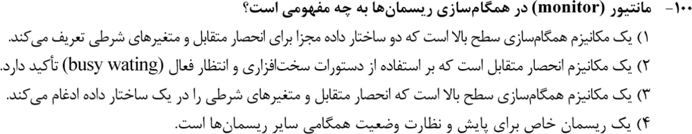

**۲. (ارشد ۱۴۰۲، سؤال ۱۰۰)**
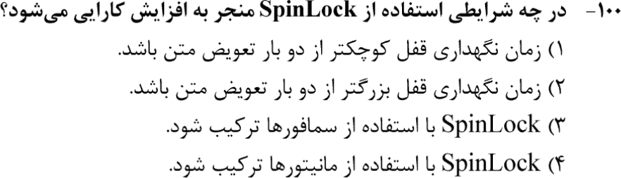

**۳. (ارشد ۱۴۰۱، سؤال ۱۰۳)**
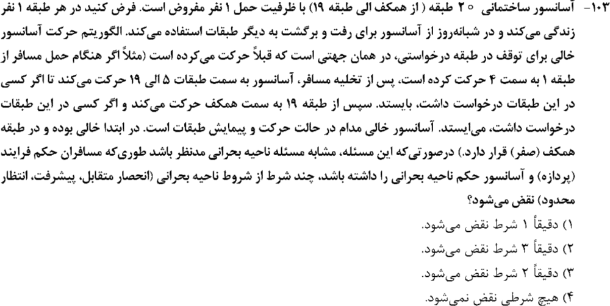

**۴. (ارشد ۱۴۰۰، سؤال ۱۰۲)**
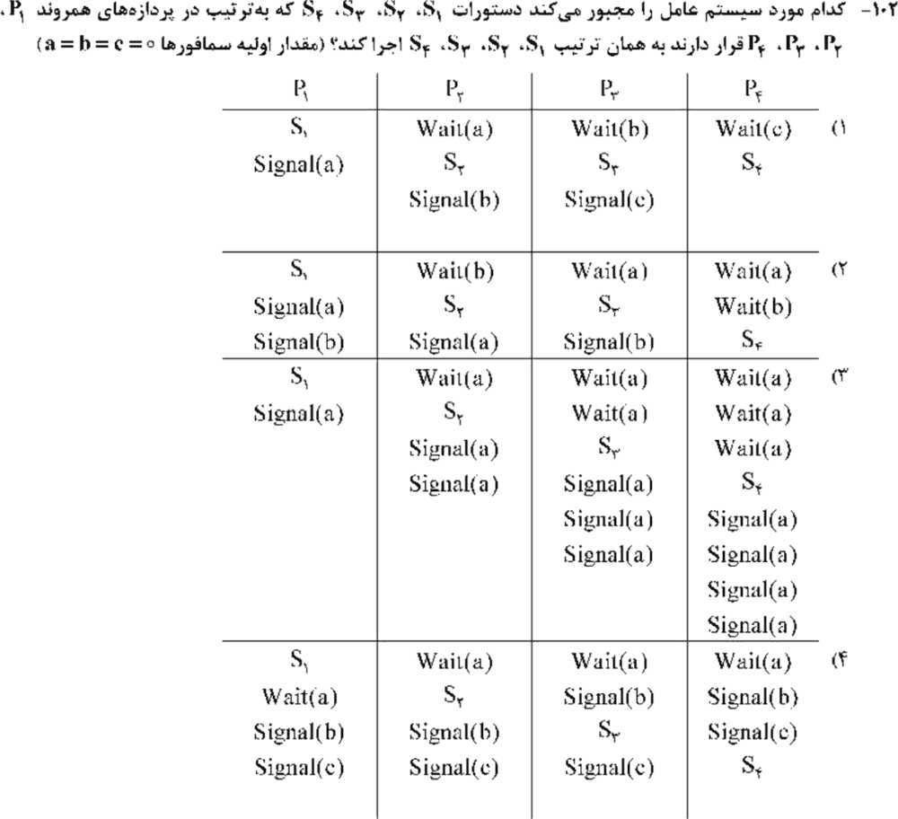

**۵. (ارشد ۱۴۰۰، سؤال ۱۰۴)**
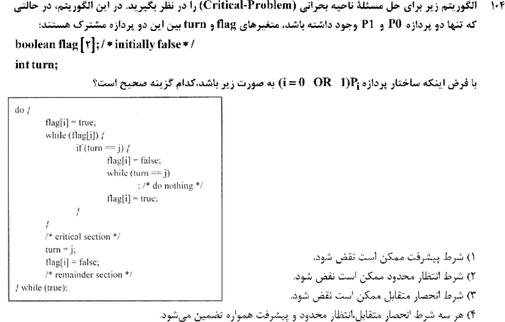

**۶. (ارشد ۱۳۹۹، سؤال ۹۹)**
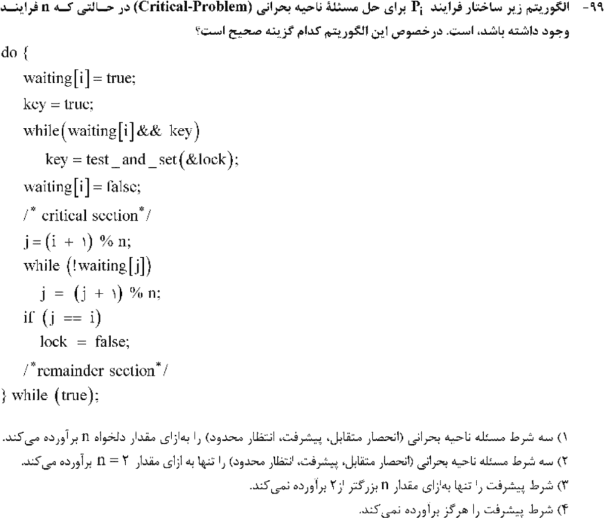

**۷. (ارشد ۱۳۹۹، سؤال ۱۰۸)**
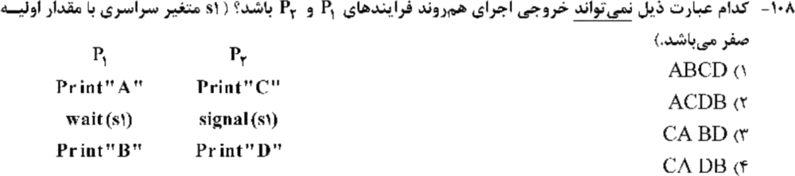

**۸. (ارشد ۱۴۰۳، سؤال ۱۰۱)**
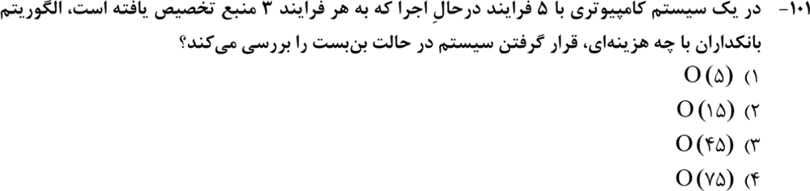

**۹. (ارشد ۱۴۰۲، سؤال ۹۹)**
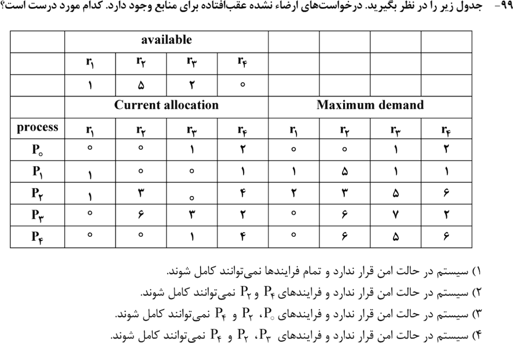

**۱۰. (ارشد ۱۴۰۱، سؤال ۱۰۵)**
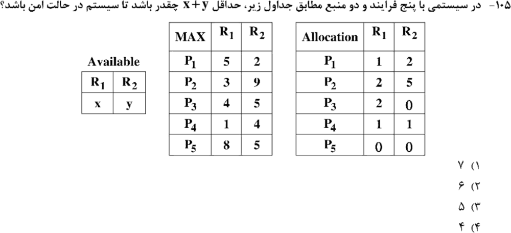

**۱۱. (ارشد ۱۴۰۰، سؤال ۱۰۵)**
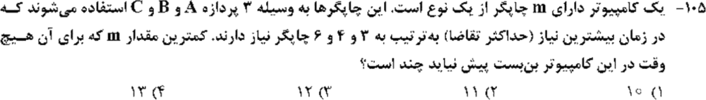

**۱۲. (ارشد ۱۳۹۹، سؤال ۱۰۰)**
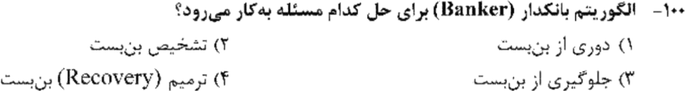

**۱۳. (ارشد ۱۳۹۸، سؤال ۷۵)**
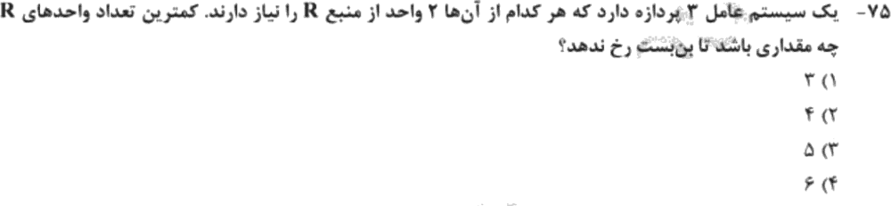

جواب‌ها و راه‌حل (کلید رسمی سازمان سنجش)

| سؤال | ۱ | ۲ | ۳ | ۴ | ۵ | ۶ | ۷ | ۸ | ۹ | ۱۰ | ۱۱ | ۱۲ | ۱۳ |
|---|---|---|---|---|---|---|---|---|---|---|---|---|---|
| کلید | ۱ | ۱ | ۱ | ۱ | ۴ | ۴ | ۱ | ۴ | ۴ | ۴ | ۲ | ۱ | ۲ |

**۱. گزینهٔ ۱ (کلید رسمی).** مانیتور قفل انحصار متقابل و متغیرهای شرطی را به‌عنوان دو جزء جدا در خود دارد. (گزینهٔ ۳ هم به ذهن نزدیک است، ولی کلید ۱ را زده.)

**۲. گزینهٔ ۱.** وقتی زمان نگه‌داشتن قفل کمتر از دو تعویض متن باشد.

**۳. گزینهٔ ۱ (یک شرط).** انحصار متقابل (ظرفیت ۱) و انتظار محدود (آسانسور همهٔ طبقات را دوره‌ای جارو می‌کند) برقرارند. **پیشرفت** نقض می‌شود، چون ورود نفر بعد به جهت حرکت آسانسور بستگی دارد، نه فقط به متقاضیان. ممکن است متقاضی باشد و آسانسور خالی از کنارش رد شود.

**۴. گزینهٔ ۱.** زنجیرهٔ `signal(a) → wait(a)، signal(b) → wait(b)، signal(c) → wait(c)`.

**۵. گزینهٔ ۴.** این الگوریتم **دکر** است و هر سه شرط را تضمین می‌کند.

**۶. گزینهٔ ۴.** کد با نسخهٔ استاندارد فرق دارد:
- حلقهٔ `while (!waiting[j])` شرط `j != i` ندارد. چون `waiting[i]` قبلاً false شده، اگر کسی منتظر نباشد حلقه بی‌پایان می‌شود.
- اگر کسی پیدا شود، `waiting[j] = false` نمی‌شود و `lock` هم آزاد نمی‌شود. پس آن فرایند هیچ‌وقت وارد نمی‌شود.

در هر دو حالت **پیشرفت هرگز** برقرار نیست.

**۷. گزینهٔ ۱.** B فقط بعد از signal یعنی بعد از C می‌آید. در `ABCD`، B قبل از C است، پس ممکن نیست.

**۸. گزینهٔ ۴.** `m·n² = 3 × 25 = 75`.

**۹. گزینهٔ ۴.** `Need`: P0 `(0,0,0,0)`، P1 `(0,5,1,0)`، P2 `(1,0,5,2)`، P3 `(0,0,4,0)`، P4 `(0,6,4,2)`. با `Work = (1,5,2,0)`: P0 و بعد P1 تمام می‌شوند و Work می‌شود `(2,5,3,3)`. هیچ‌کدام از P2، P3 و P4 نمی‌توانند ادامه دهند (شبیه‌سازی رایانه‌ای).

**۱۰. کلید رسمی: گزینهٔ ۴ (یعنی ۴). محاسبهٔ من: ۵ (گزینهٔ ۳).** `Need`: P1 `(4,0)`، P2 `(1,4)`، P3 `(2,5)`، P4 `(0,3)`، P5 `(8,5)`.
- کل R1 تخصیص‌یافته ۶ است و P5 به ۸ واحد R1 نیاز دارد. پس `x ≥ 2`.
- با `x = 2`، کمترین y برای امن بودن ۳ است (ترتیب P4، P2، P1، P3، P5).
- یک جست‌وجوی رایانه‌ای روی همهٔ `(x, y)` هم کمینه را ۵ داد (`(2,3)` یا `(4,1)`).

به نظر می‌رسد کلید این سؤال اشتباه است یا جدول در دفترچه طور دیگری بوده. **سر جلسه از کلید پیروی نکن، محاسبه کن.**

**۱۱. گزینهٔ ۲ (۱۱).** `2 + 3 + 5 + 1`.

**۱۲. گزینهٔ ۱.** بانکدار برای **اجتناب** از بن‌بست است.

**۱۳. گزینهٔ ۲ (۴).** `3 × 1 + 1`.

*(سؤال ۷۷ ارشد ۱۳۹۸ در این مبحث حذف شده است.)*

---

## 🗂 کارت خلاصهٔ فصل ۳
- سه شرط: انحصار، پیشرفت، انتظار محدود. پترسون و دکر هر سه را دارند. کد را با نسخهٔ استاندارد مقایسه کن.
- ترتیب با سمافور صفر: `signal` بعد از قبلی و `wait` قبل از بعدی. spinlock: نگه‌داشتن کمتر از ۲ تعویض متن.
- بانکدار: `Need = Max − Alloc` و `O(mn²)`، برای اجتناب. کمترین منبع: `Σ(nᵢ − 1) + 1`.
