# فصل ۴: مدیریت حافظه (صفحه‌بندی و حافظهٔ مجازی) و زمان‌بندی دیسک

> **سهم در کنکور:** ۱۳ سؤال در ارشد ۱۳۹۸ تا ۱۴۰۴ (۹ صفحه‌بندی، ۲ حافظهٔ مجازی، ۲ دیسک) + ۱ سؤال حذف‌شده. تقریباً همه محاسبه‌ای‌اند.
> **پیش‌نیاز:** معماری فصل ۳ (حافظهٔ نهان؛ تقسیم آدرس شبیه است).
> **زمان مطالعه:** یک بلوک ۹۰ دقیقه‌ای.

---

## درس ۱: صفحه‌بندی

`آدرس مجازی = شمارهٔ صفحه | آفست`، که `آفست = log₂(اندازهٔ صفحه)`.

| کمیت | فرمول |
|---|---|
| تعداد صفحه‌ها | `2^(بیت آدرس مجازی − آفست)` |
| تعداد قاب‌ها | `اندازهٔ حافظهٔ فیزیکی / اندازهٔ صفحه` |
| مدخل جدول صفحه | دست‌کم `log₂(تعداد قاب‌ها)` بیت |
| اندازهٔ جدول تک‌سطحی | `تعداد صفحه‌ها × اندازهٔ مدخل` |
| تعداد سطح‌ها (هر جدول در یک صفحه) | `⌈(بیت شمارهٔ صفحه) / log₂(مدخل‌ها در هر صفحه)⌉` |
| تکه‌تکه شدن داخلی | به‌طور میانگین **نصف صفحه** برای هر فرایند (پایان آخرین صفحه)؛ تکه‌تکه شدن خارجی **صفر** |

**مثال:** آدرس ۴۷ بیتی، صفحهٔ ۱۶ کیلوبایتی (آفست ۱۴)، مدخل ۸ بایتی.
- هر صفحه `2¹⁴/8 = 2¹¹` مدخل دارد.
- شمارهٔ صفحه ۳۳ بیت است، پس `⌈33/11⌉ = 3` سطح.

**جدول دوسطحی:** سطح اول همیشه یک جدول است؛ تعداد جدول‌های سطح دوم برابر تعداد مدخل‌های **استفاده‌شده** در سطح اول. **بدترین حالت:** هر صفحهٔ استفاده‌شده در یک جدول سطح دوم جدا باشد.

**جدول صفحهٔ وارون:** یک جدول **سراسری** با یک مدخل برای هر **قاب**، که بر اساس شمارهٔ قاب مرتب است.

---

## درس ۲: TLB و زمان دسترسی

- **زمان مؤثر** (TLB ناچیز، جدول k سطحی، دسترسی حافظه m):
  `EAT = (1 − miss)·m + miss·(k + 1)·m`
- **خطای صفحه:** `EAT = (1 − p)·m + p·(زمان سرویس خطا)`. برای `EAT < حد`، p را حل کن.

**مثال:** با `m = 150`، جدول دوسطحی و نرخ خطای TLB برابر ۲٪:
`0.98 × 150 + 0.02 × 450 = 156` نانوثانیه.

---

## درس ۳: حافظهٔ مجازی و جایگزینی صفحه

- FIFO ممکن است **ناهنجاری بلیدی** نشان دهد (قاب بیشتر، خطای بیشتر). OPT و LRU (الگوریتم‌های پشته‌ای) ندارند.
- **کوبیدگی (thrashing):** زمان بیشتر صرف جابه‌جایی صفحه‌ها می‌شود تا اجرا. «CPU کم‌کار + دیسک پرکار» **نشانه** است، نه اثبات قطعی.
- **مجموعهٔ کاری:** صفحه‌های استفاده‌شده در پنجرهٔ اخیر. در حلقه یا تابع بازگشتی‌ای که به همان صفحه‌ها رجوع می‌کند، **ممکن است ثابت بماند**.

---

## درس ۴: زمان‌بندی دیسک

| الگوریتم | رفتار |
|---|---|
| FCFS | به ترتیب ورود |
| SSTF | نزدیک‌ترین درخواست بعدی |
| SCAN (آسانسور) | تا انتهای دیسک در یک جهت و بعد برگشت |
| LOOK | تا **آخرین درخواست** در آن جهت و بعد برگشت |
| C‑SCAN و C‑LOOK | فقط در یک جهت سرویس می‌دهد و بعد به ابتدا می‌پرد |

⚠️ در تست‌های کنکور، «آسانسور» معمولاً مثل **LOOK** حساب شده (تا آخرین درخواست، نه تا انتهای دیسک). اگر عدد در گزینه‌ها نبود، SCAN را هم امتحان کن.

**فاصلهٔ LOOK** با شروع از `pos` به سمت بالا: `(max − pos) + (max − min)`.

### تمرین فصل ۴
1. آدرس ۳۲ بیتی، صفحهٔ ۴ کیلوبایتی، مدخل ۴ بایتی. اندازهٔ جدول تک‌سطحی؟
2. درخواست‌های `10, 40, 20, 5` با شروع از ۱۵ به سمت بالا. فاصلهٔ LOOK؟

جواب‌ها

1. `2²⁰ × 4 = 4` مگابایت.
2. `(40 − 15) + (40 − 5) = 60`

---

## 📝 آزمون فصل ۴ (سؤال‌های واقعی کنکور ارشد کامپیوتر)
**زمان: ۳۰ دقیقه برای ۱۳ سؤال.**

**۱. (ارشد ۱۴۰۳، سؤال ۹۹)**
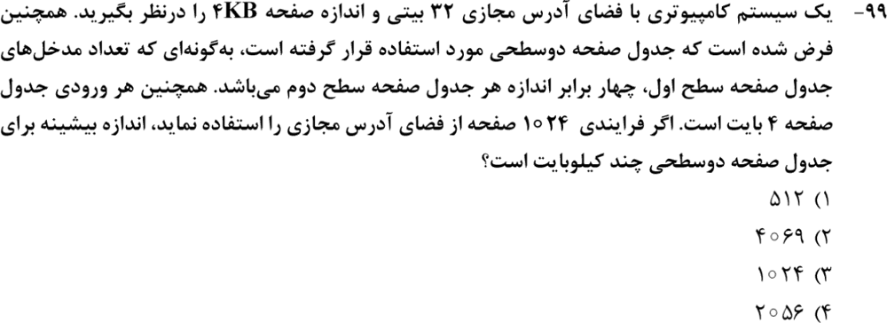

**۲. (ارشد ۱۴۰۲، سؤال ۹۷)**
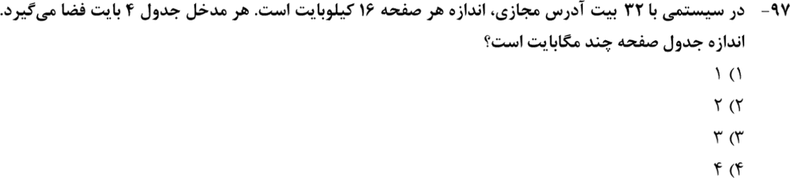

**۳. (ارشد ۱۴۰۲، سؤال ۱۰۲)**
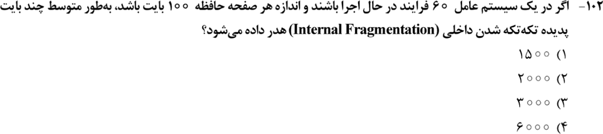

**۴. (ارشد ۱۴۰۱، سؤال ۱۰۴)**
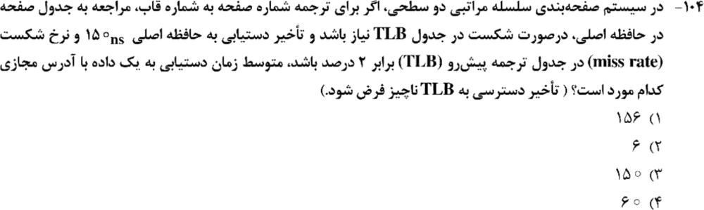

**۵. (ارشد ۱۴۰۰، سؤال ۱۰۳)**
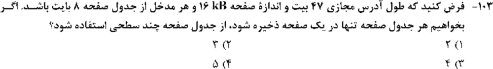

**۶. (ارشد ۱۳۹۹، سؤال ۱۰۲)**
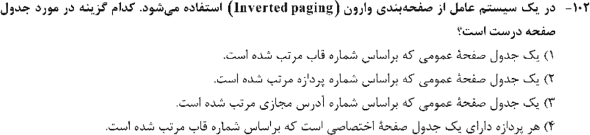

**۷. (ارشد ۱۳۹۹، سؤال ۱۰۳)**
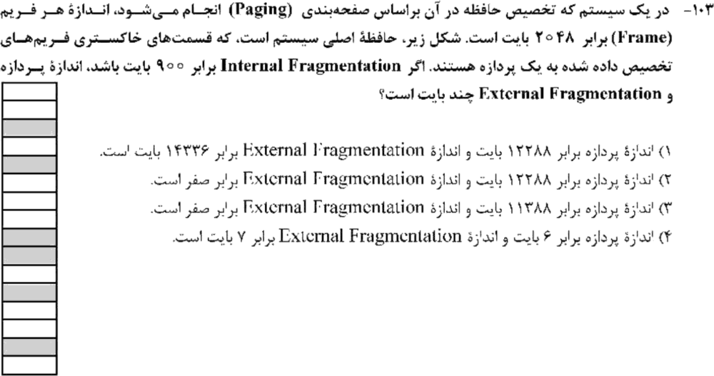

**۸. (ارشد ۱۳۹۹، سؤال ۱۰۴)**
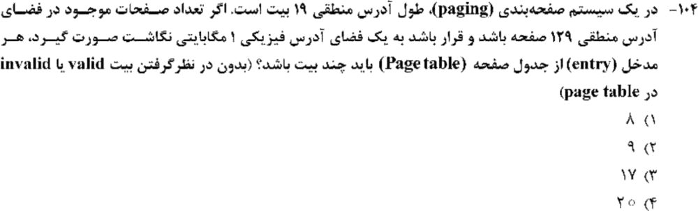

**۹. (ارشد ۱۳۹۸، سؤال ۷۴)**
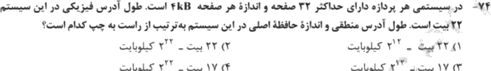

**۱۰. (ارشد ۱۴۰۴، سؤال ۱۰۲)**
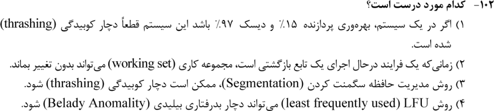

**۱۱. (ارشد ۱۴۰۲، سؤال ۹۸)**
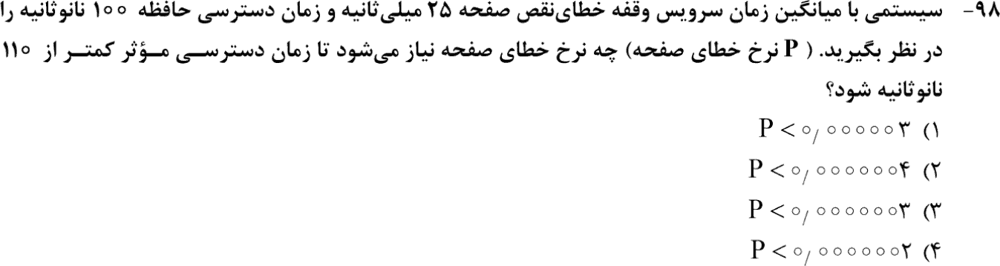

**۱۲. (ارشد ۱۴۰۲، سؤال ۹۶)**
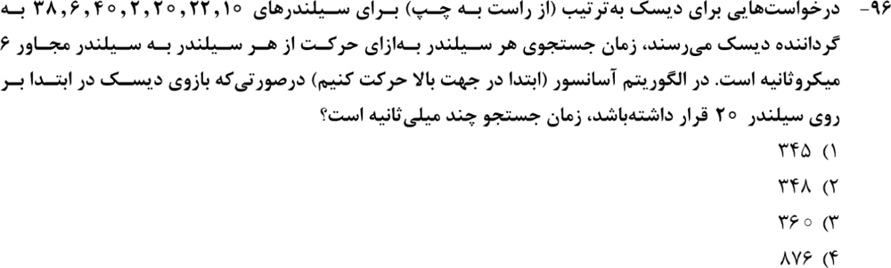

**۱۳. (ارشد ۱۳۹۹، سؤال ۱۰۷)**
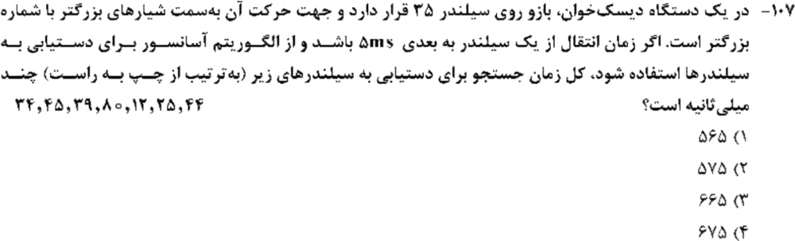

جواب‌ها و راه‌حل (کلید رسمی سازمان سنجش)

| سؤال | ۱ | ۲ | ۳ | ۴ | ۵ | ۶ | ۷ | ۸ | ۹ | ۱۰ | ۱۱ | ۱۲ | ۱۳ |
|---|---|---|---|---|---|---|---|---|---|---|---|---|---|
| کلید | ۴ | ۱ | ۳ | ۱ | ۲ | ۱ | ۳ | ۲ | ۳ | ۲ | ۲ | ۲ | ۱ |

**۱. گزینهٔ ۴ (۲۰۵۶).** شمارهٔ صفحه ۲۰ بیت است. از `2ᵃ = 4·2ᵇ` و `a + b = 20` نتیجه می‌شود `a = 11` و `b = 9`.
- سطح اول: `2¹¹ × 4 = 8` کیلوبایت.
- بدترین حالت: ۱۰۲۴ جدول سطح دوم، هر کدام `2⁹ × 4 = 2` کیلوبایت، یعنی `2048` کیلوبایت.
- جمع **۲۰۵۶** کیلوبایت.

**۲. گزینهٔ ۱.** `2¹⁸ × 4 = 1` مگابایت.

**۳. گزینهٔ ۳.** `60 × 100/2 = 3000`.

**۴. گزینهٔ ۱.** `0.98 × 150 + 0.02 × 3 × 150 = 156`.

**۵. گزینهٔ ۲ (۳).** مثال درس ۱.

**۶. گزینهٔ ۱.** جدول سراسری، مرتب‌شده بر اساس شمارهٔ قاب.

**۷. گزینهٔ ۳.** ۶ قاب خاکستری: `6 × 2048 − 900 = 11388`. صفحه‌بندی تکه‌تکه شدن خارجی ندارد.

**۸. گزینهٔ ۲ (۹).** ۱۲۹ صفحه ۸ بیت شمارهٔ صفحه می‌خواهد، پس آفست `19 − 8 = 11`. تعداد قاب‌ها `2²⁰/2¹¹ = 2⁹`، پس مدخل **۹** بیت.

**۹. گزینهٔ ۳.** آدرس منطقی `5 + 12 = 17` بیت. حافظهٔ اصلی `2²²` بایت که برابر `2¹²` کیلوبایت است.

**۱۰. گزینهٔ ۲.** مجموعهٔ کاری در یک تابع بازگشتی که به همان صفحه‌ها رجوع می‌کند، می‌تواند ثابت بماند. «قطعاً کوبیدگی» (گزینهٔ ۱) غلط است، چون فقط نشانه است.

**۱۱. گزینهٔ ۲.** `100 + p·25×10⁶ < 110`، پس `p < 4 × 10⁻⁷`.

**۱۲. گزینهٔ ۲ (۳۴۸).** از ۲۰ به سمت بالا تا ۴۰ و بعد پایین تا ۲: `(20 + 38) × 6 = 348` میکروثانیه.

**۱۳. گزینهٔ ۱ (۵۶۵).** از ۳۵ بالا تا ۸۰ و بعد پایین تا ۱۲: `(45 + 68) × 5 = 565`.

*(سؤال ۱۰۶ ارشد ۱۳۹۹ در این مبحث حذف شده است.)*

---

## 🗂 کارت خلاصهٔ فصل ۴
- آفست = log صفحه؛ مدخل = log تعداد قاب‌ها؛ سطح‌ها = `⌈بیت صفحه / log(مدخل در صفحه)⌉`. تکه‌تکه شدن داخلی = نصف صفحه برای هر فرایند.
- دوسطحی بدترین حالت: سطح اول + یک جدول سطح دوم برای هر صفحه. وارون: سراسری، بر اساس قاب.
- `EAT = (1−miss)m + miss(k+1)m`. خطای صفحه: p را از نامساوی حل کن.
- آسانسور در تست‌ها همان LOOK است: `(max − pos) + (max − min)`.
