# فصل ۱: نمایش اعداد، جبر بول، جدول کارنو و مخاطره

> **سهم در کنکور:** ۱۴ سؤال در ارشد ۱۳۹۸ تا ۱۴۰۴ (۲ نمایش اعداد، ۳ جبر بول، ۹ کارنو و مخاطره). سؤال‌های کارنو و مخاطره هر سال می‌آیند.
> **زمان مطالعه:** دو بلوک ۹۰ دقیقه‌ای.

---

## درس ۱: نمایش اعداد

| نمایش (n بیت) | بازه |
|---|---|
| بی‌علامت | `0` تا `2ⁿ − 1` |
| علامت و مقدار، مکمل ۱ | `−(2ⁿ⁻¹ − 1)` تا `+(2ⁿ⁻¹ − 1)` (دو صفر دارند) |
| **مکمل ۲** | **`−2ⁿ⁻¹` تا `+(2ⁿ⁻¹ − 1)`** |

**کد گری:**
- **دودویی به گری:** `gᵢ = bᵢ ⊕ bᵢ₋₁` (بیت اول همان می‌ماند).
- **گری به دودویی:** `b₁ = g₁` و `bᵢ = bᵢ₋₁ ⊕ gᵢ`. یعنی هر بیت دودویی، XOR بیت دودویی قبلی و بیت گری فعلی است.

---

## درس ۲: جبر بول و پیاده‌سازی با گیت

- **دمورگان:** `(xy)′ = x′ + y′` و `(x + y)′ = x′y′`. برای مکمل کردن یک عبارت، `+` و `·` را جابه‌جا کن و همهٔ لیترال‌ها را نقیض کن.
- **اجماع (consensus):** `xy + x′z + yz = xy + x′z`. جملهٔ `yz` اضافه است، ولی **مخاطره را حذف می‌کند** (درس ۴).
- **NAND و NOR جهانی‌اند.** `SOP ⇐ NAND-NAND` و `POS ⇐ NOR-NOR`.
- **فقط با NAND دوورودی:** OR دو سیگنال `X + Y = NAND(X′, Y′)` است و برای X′ و Y′ یک NAND اضافه به‌عنوان معکوس‌کننده لازم است.
- **تحلیل مدار:** از ورودی به خروجی برو و عبارت هر گیت را بنویس. جعبهٔ سیاهی که با جدول درستی داده شده را اول ساده کن.

---

## درس ۳: جدول کارنو

- **پیاده‌سازی اول (PI):** بزرگ‌ترین گروه ممکن (توانی از ۲) از خانه‌های ۱ و X.
- **PI اساسی (EPI):** PI ای که حداقل یک مینترم ۱ را **فقط خودش** می‌پوشاند. در هر جواب کمینه حتماً هست.
- **کمینه‌سازی:** اول EPI ها را بردار. بعد با کمترین تعداد PI بقیهٔ ۱ ها را بپوشان. X ها فقط اگر کمک کنند استفاده می‌شوند.
- **POS:** صفرها را گروه کن، جملهٔ SOP مکمل را بنویس و دمورگان بزن.
- **جدول ۵ متغیره:** دو جدول ۴ متغیره کنار هم. خانه‌های متناظر (با اختلاف در متغیر پنجم) هم مجاورند.

---

## درس ۴: مخاطره (Hazard)

- **مخاطرهٔ ایستای ۱ (در SOP):** وقتی ورودی بین دو خانهٔ ۱ مجاور عوض می‌شود که در **یک جملهٔ مشترک** نیستند، خروجی لحظه‌ای ۰ می‌شود (glitch).
  - **درمان:** جملهٔ اجماع آن دو را اضافه کن.
  - **شمارش:** همهٔ جفت جمله‌هایی را پیدا کن که فقط در یک متغیر متضادند و اجماعشان را هیچ جملهٔ موجودی نمی‌پوشاند.
- **با تأخیر واحد:** ببین کدام جمله زودتر خاموش می‌شود و کدام دیرتر روشن. اگر روشن شدن مسیر طولانی‌تر (مثلاً از یک NOT اضافه می‌گذرد) بعد از خاموش شدن مسیر کوتاه‌تر باشد، glitch داریم.
- **ماهیت مخاطره:**
  - در مدار **همگام** با دورهٔ کلاک درست، منطق را عوض نمی‌کند.
  - در مدار **ناهمگام** با فیدبک **ممکن است** منطق را عوض کند.
  - همیشه مصرف انرژی را زیاد می‌کند.
  - تأخیر مدار را زیاد نمی‌کند.

### تمرین فصل ۱
1. بازهٔ مکمل ۲ هشت بیتی؟
2. دودویی `1011` در کد گری؟
3. `f = Σm(0, 2, 8, 10)` (چهار متغیره) را ساده کن.
4. `f = ab + a′c` را بدون مخاطره بنویس.

جواب‌ها

1. `−128` تا `127`
2. `1110`
3. `b′d′` (چهار گوشهٔ جدول)
4. `ab + a′c + bc`

---

## 📝 آزمون فصل ۱ (سؤال‌های واقعی کنکور ارشد کامپیوتر)
**زمان: ۳۵ دقیقه برای ۱۴ سؤال.**

**۱. (ارشد ۱۴۰۲، سؤال ۸۳)**
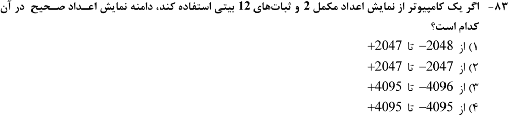

**۲. (ارشد ۱۳۹۹، سؤال ۶۱)**
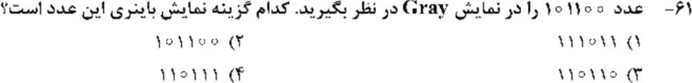

**۳. (ارشد ۱۴۰۴، سؤال ۷۶)**
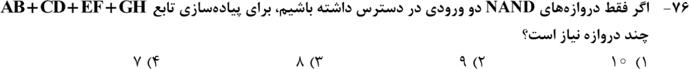

**۴. (ارشد ۱۴۰۳، سؤال ۷۹)**
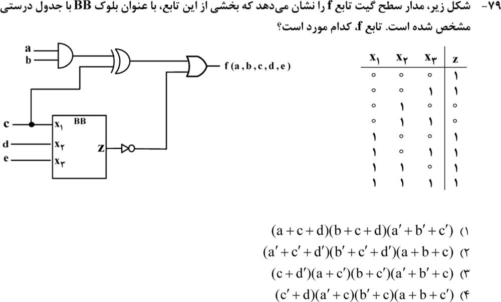

**۵. (ارشد ۱۳۹۹، سؤال ۶۷)**
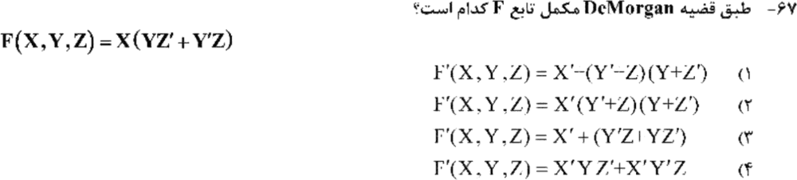

**۶. (ارشد ۱۴۰۴، سؤال ۷۹)**
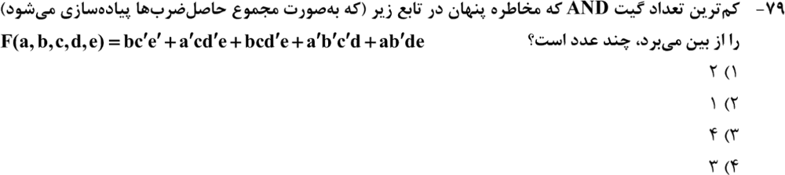

**۷. (ارشد ۱۴۰۳، سؤال ۷۶)**
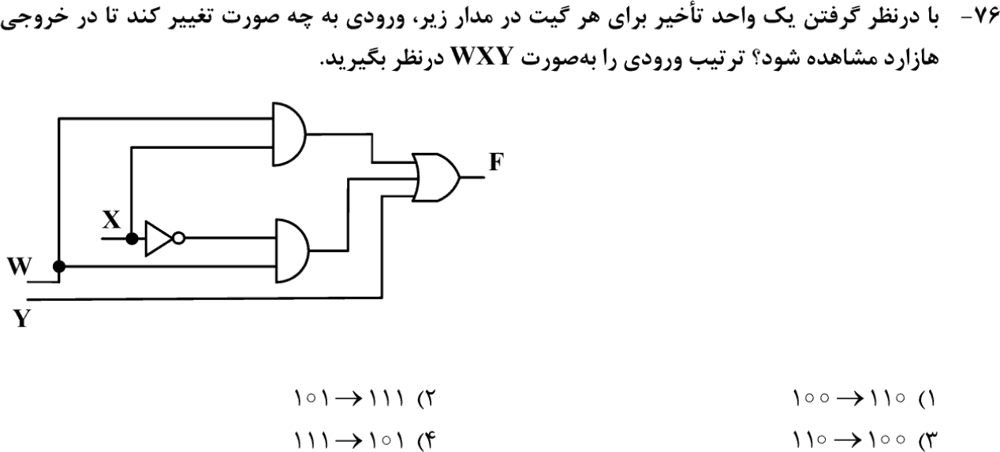

**۸. (ارشد ۱۴۰۲، سؤال ۷۸)**
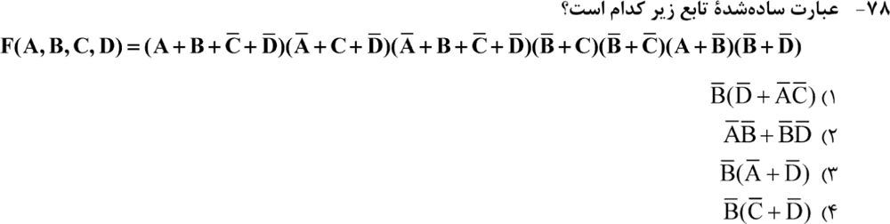

**۹. (ارشد ۱۴۰۱، سؤال ۸۵)**
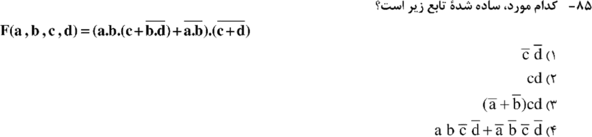

**۱۰. (ارشد ۱۴۰۱، سؤال ۸۷)**
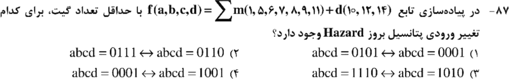

**۱۱. (ارشد ۱۴۰۰، سؤال ۸۲)**
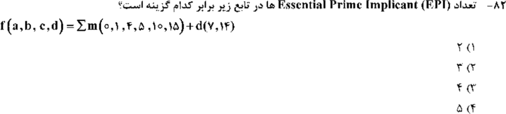

**۱۲. (ارشد ۱۳۹۹، سؤال ۶۲)**
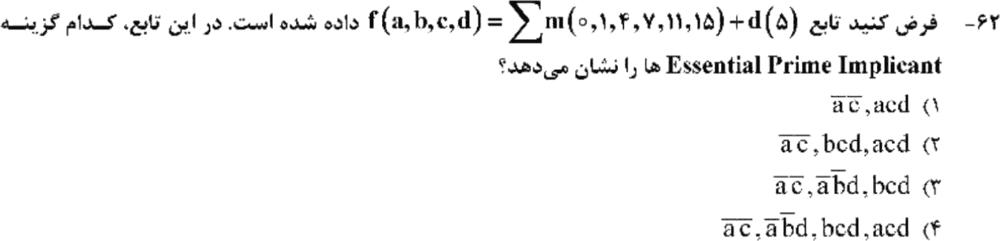

**۱۳. (ارشد ۱۳۹۹، سؤال ۶۶)**
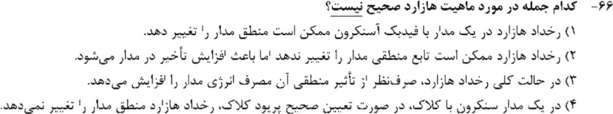

**۱۴. (ارشد ۱۳۹۸، سؤال ۶۶)**
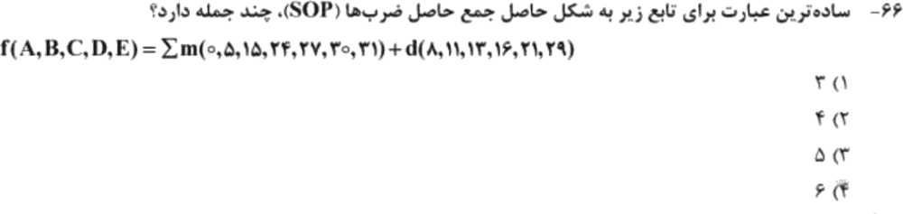

جواب‌ها و راه‌حل (کلید رسمی سازمان سنجش)

| سؤال | ۱ | ۲ | ۳ | ۴ | ۵ | ۶ | ۷ | ۸ | ۹ | ۱۰ | ۱۱ | ۱۲ | ۱۳ | ۱۴ |
|---|---|---|---|---|---|---|---|---|---|---|---|---|---|---|
| کلید | ۱ | ۴ | ۲ | ۱ | ۱ | ۱ | ۳ | ۱ | ۱ | ۴ | ۱ | ۱ | ۲ | ۲ |

**۱. گزینهٔ ۱.** مکمل ۲ دوازده بیتی: `−2048` تا `+2047`.

**۲. گزینهٔ ۴.** گری `101100` به دودویی `110111` تبدیل می‌شود (`1، 1⊕0=1، 1⊕1=0، 0⊕1=1، 1⊕0=1، 1⊕0=1`).

**۳. گزینهٔ ۲ (۹).** `AB + CD` با سه NAND ساخته می‌شود (دو NAND و NAND خروجی). `EF + GH` هم سه NAND است. OR این دو: `NAND(X′, Y′)` که دو NAND معکوس‌کننده و یک NAND نهایی می‌خواهد. جمع `3 + 3 + 3 = 9`.

**۴. گزینهٔ ۱.** از جدول BB نتیجه می‌شود `Z = 0` فقط وقتی `c = 0` و `d = 1`، یعنی `Z′ = c′d`. پس `f = (ab ⊕ c) + c′d`. با مقایسهٔ جدول درستی (رایانه‌ای) فقط گزینهٔ ۱ برابر است.

**۵. گزینهٔ ۱.** `F′ = X′ + (YZ′ + Y′Z)′ = X′ + (Y′ + Z)(Y + Z′)`. (در دفترچه علامت `+` به شکل `−` چاپ شده.)

**۶. گزینهٔ ۱ (۲ گیت).** فقط دو جفت جمله یک متغیر متضاد دارند و اجماعشان پوشیده نیست: `bc′e′` و `a′b′c′d` با اجماع `a′c′de′`، و `a′b′c′d` و `ab′de` با اجماع `b′c′de`.

**۷. گزینهٔ ۳.** `F = WX + WX′ + Y`. با `W = 1` و `Y = 0`، وقتی X از ۱ به ۰ می‌رود، جملهٔ WX بعد از ۱ تأخیر خاموش می‌شود ولی WX′ بعد از ۲ تأخیر (NOT و AND) روشن می‌شود. پس glitch داریم: `110 → 100`.

**۸. گزینهٔ ۱.** `B′(D′ + A′C′)` (با مقایسهٔ کامل جدول درستی تأیید شد).

**۹. گزینهٔ ۱.** `(c + d)′ = c′d′`. با `c = d = 0` عامل اول همیشه ۱ است، پس `F = c′d′`.

**۱۰. گزینهٔ ۴.** جواب کمینهٔ یکتا `ab′ + a′bc + a′c′d` است. مینترم‌های `0001` (پوشش با `a′c′d`) و `1001` (پوشش با `ab′`) مجاورند ولی در یک جمله نیستند، پس مخاطره دارند.

**۱۱. گزینهٔ ۱ (دو EPI).** EPI ها `a′c′` و `acd′` هستند.

**۱۲. گزینهٔ ۱.** EPI ها `a′c′` و `acd` هستند (مینترم ۰ را فقط `a′c′` و مینترم ۱۱ را فقط `acd` می‌پوشاند).

**۱۳. گزینهٔ ۲.** مخاطره تأخیر را زیاد نمی‌کند. بقیهٔ گزاره‌ها درست‌اند.

**۱۴. گزینهٔ ۲ (۴ جمله).** `BDE + CD′E + ABCD + C′D′E′`.

---

## 🗂 کارت خلاصهٔ فصل ۱
- مکمل ۲: `−2ⁿ⁻¹ … 2ⁿ⁻¹ − 1`. گری به دودویی: `bᵢ = bᵢ₋₁ ⊕ gᵢ`.
- مکمل عبارت: `+` و `·` جابه‌جا و لیترال‌ها نقیض. NAND دوورودی برای `Σ` چهار جملهٔ دوتایی: ۹ گیت.
- EPI: مینترمی که فقط یک PI آن را می‌پوشاند.
- مخاطره: دو ۱ مجاور بدون جملهٔ مشترک ⇐ جملهٔ اجماع اضافه کن. با تأخیر واحد، کدام مسیر دیرتر روشن می‌شود؟ همگام: بی‌اثر روی منطق؛ ناهمگام: ممکن است اثر بگذارد.
