# فصل ۲: مدارهای ترکیبی (MUX، دیکدر، جمع‌کننده) و تأخیر گیت

> **سهم در کنکور:** ۱۲ سؤال در ارشد ۱۳۹۸ تا ۱۴۰۴ (۹ مدار ترکیبی و ۳ تأخیر). تیپ‌ها: «این مدار چه تابعی است؟»، پیاده‌سازی با MUX، هزینهٔ گیت، و فرکانس.
> **زمان مطالعه:** یک بلوک ۹۰ دقیقه‌ای.

---

## درس ۱: مالتی‌پلکسر

- MUX با `2ⁿ` ورودی و n خط انتخاب: `F = Σ (مینترم انتخاب‌ها) · Iₖ`.
- **پیاده‌سازی تابع n+1 متغیره با MUX `2ⁿ` به ۱:** n متغیر را به انتخاب بده. برای هر ترکیب انتخاب، ستون متغیر باقی‌مانده را نگاه کن: ورودی آن خانه `0`، `1`، `x` یا `x′` می‌شود.
- **هزینهٔ MUX ۴ به ۱** (هزینه = تعداد ورودی گیت‌ها): ۲ معکوس‌کننده (۲) + ۴ AND سه‌ورودی (۱۲) + یک OR چهارورودی (۴) = **۱۸**.
- **MUX های زنجیره‌ای:** از اولی شروع کن و خروجی‌اش را به‌صورت عبارت به دومی بده.
- **بافر سه‌حالته:** وقتی فعال نیست، خروجی «قطع» است. دو بافر با فعال‌سازهای مکمل روی یک سیم، یک MUX ۲ به ۱ می‌سازند.
- **تابع اکثریت** `xy + xz + yz` با MUX: انتخاب = z؛ ورودی ۰ = `xy` و ورودی ۱ = `x + y`.

**مثال برای هر مورد:**
- **کار MUX:** در MUX ۴ به ۱ با انتخاب `s₁s₀ = 10` خروجی `I₂` است.
- **پیاده‌سازی با MUX:** `f(a,b,c) = Σm(0, 1, 6)` با انتخاب a و b:
  - `ab = 00`: مینترم‌های ۰ و ۱ هر دو در f اند ⇐ `I₀ = 1`.
  - `ab = 01`: ۲ و ۳ هیچ‌کدام ⇐ `I₁ = 0`.
  - `ab = 10`: ۴ و ۵ هیچ‌کدام ⇐ `I₂ = 0`.
  - `ab = 11`: فقط ۶ (یعنی `c = 0`) ⇐ `I₃ = c′`.
- **زنجیره:** MUX اول با انتخاب a ورودی‌های x و y را دارد ⇐ `a′x + ay`. این خروجی ورودی ۰ از MUX دوم (انتخاب b) است و ورودی ۱ آن z است ⇐ `F = b′(a′x + ay) + bz`.
- **سه‌حالته:** بافر اول با فعال‌ساز `S′` ورودی `I₀` را می‌دهد و بافر دوم با `S` ورودی `I₁` را. هر لحظه فقط یکی به سیم وصل است ⇐ `F = S′I₀ + SI₁`.
- **اکثریت:** با `z = 0`: `f = xy` ✓. با `z = 1`: `f = xy + x + y = x + y` ✓.

---

## درس ۲: دیکدر و دی‌مالتی‌پلکسر

- دیکدر n به `2ⁿ`: هر خروجی یک مینترم است. دیکدر + OR یعنی هر تابع SOP.
- **دی‌مالتی‌پلکسر** با ورودی داده I: `Dₖ = I · (مینترم k انتخاب‌ها)`. پس `D₀ + D₃` با انتخاب A و B می‌شود `I·(A′B′ + AB) = I·(A ⊙ B)`.

**مثال:**
- **دیکدر ۲ به ۴** با ورودی‌های a و b: خروجی‌ها `a′b′`، `a′b`، `ab′`، `ab`. پس `a ⊕ b = D₁ + D₂` (یک OR دوورودی).
- **دی‌مالتی‌پلکسر:** با `I = 1` و `AB = 11` فقط `D₃ = 1` است؛ داده به خروجی ۳ هدایت شد.

---

## درس ۳: جمع‌کننده

- **جمع‌کنندهٔ کامل:** `Sum = a ⊕ b ⊕ c` و `Cout = ab + ac + bc` (اکثریت).
- **با `Cin = 1`:** `Sum = (a ⊕ b)′` و `Cout = a + b`.
- **جمع‌کننده با ورودی‌های جابه‌جا:** اگر بیت‌های یک عدد یک خانه بالاتر وصل شوند، یعنی ضرب در ۲. هر بیت ثابت در کم‌ارزش‌ترین خانه یا در `Cin` یک واحد اضافه می‌کند.

**مثال برای هر مورد:**
- **کامل:** `a = 1, b = 1, c = 0` ⇐ `Sum = 0` و `Cout = 1` (یعنی `1 + 1 = 10₂`). با `c = 1`: `Sum = 1` و `Cout = 1` (`3 = 11₂`).
- **`Cin = 1`:** `a = b = 0` ⇐ `Sum = (0)′ = 1` و `Cout = 0` (`0 + 0 + 1 = 1`)؛ `a = 1, b = 0` ⇐ `Sum = 0` و `Cout = 1` (`2 = 10₂`).
- **جابه‌جا:** جمع‌کنندهٔ ۴ بیتی با ورودی اول A و ورودی دوم «A یک خانه بالاتر» (یعنی `2A`) و `Cin = 1` ⇐ خروجی `A + 2A + 1 = 3A + 1`.

---

## درس ۴: تأخیر و زمان‌بندی

- **مسیر بحرانی:** طولانی‌ترین مسیر از ورودی یا خروجی فلیپ‌فلاپ تا ورودی فلیپ‌فلاپ.
- **حداقل دورهٔ کلاک:** `T ≥ t(clk→q) + t(مسیر ترکیبی بیشینه) + t(setup)`. فرکانس بیشینه `1/T` است.
- **شرط hold:** `t(clk→q) + t(کمینهٔ مسیر) ≥ t(hold)`.
- **نوسانگر حلقه‌ای:** با n معکوس‌کننده (n فرد) هر کدام با تأخیر t، دوره `2nt` است.
- **ردگیری زمانی:** برای هر گیت، زمان تغییر خروجی = زمان تغییر ورودی + تأخیر گیت. فلیپ‌فلاپ لبه‌حساس فقط روی **لبهٔ بالارونده** ورودی کلاکش عمل می‌کند.

**مثال برای هر مورد:**
- **دوره:** `t(clk→q) = 1`، مسیر بحرانی از دو گیت `3 + 4 = 7` و `setup = 2` (نانوثانیه) ⇐ `T = 10 ns` و فرکانس `100 MHz`.
- **hold:** با `t(clk→q) = 1`، کوتاه‌ترین مسیر ۱ و `hold = 1.5`: `1 + 1 = 2 ≥ 1.5` ✓.
- **حلقه:** ۵ معکوس‌کنندهٔ ۱ نانوثانیه‌ای ⇐ دوره `2 × 5 × 1 = 10 ns`. سیگنال یک بار دور حلقه برمی‌گردد و برعکس شده؛ دور دوم به حالت اول برمی‌گردد.
- **ردگیری:** ورودی در `t = 0` تغییر می‌کند؛ از NOT با تأخیر ۱ و بعد AND با تأخیر ۲ می‌گذرد ⇐ خروجی AND در `t = 3` عوض می‌شود.

### تمرین فصل ۲
1. `f(a,b,c) = Σm(1, 2, 4, 7)` با MUX ۴ به ۱ (انتخاب a و b): ورودی‌ها؟
2. نوسانگر حلقه‌ای با ۳ معکوس‌کنندهٔ ۲ نانوثانیه‌ای: فرکانس؟
3. `t(clk→q) = 2`، مسیر ترکیبی ۱۰ و `setup = 3` نانوثانیه: فرکانس بیشینه؟

جواب‌ها

1. `I₀ = c`، `I₁ = c′`، `I₂ = c′`، `I₃ = c` (همان XOR سه‌تایی).
2. `2·3·2 = 12 ns`، یعنی حدود `83.3 MHz`.
3. `15 ns`، یعنی حدود `66.7 MHz`.

---

## 📝 آزمون فصل ۲ (سؤال‌های واقعی کنکور ارشد کامپیوتر)
**زمان: ۳۰ دقیقه برای ۱۲ سؤال.**

**۱. (ارشد ۱۴۰۴، سؤال ۸۰)**
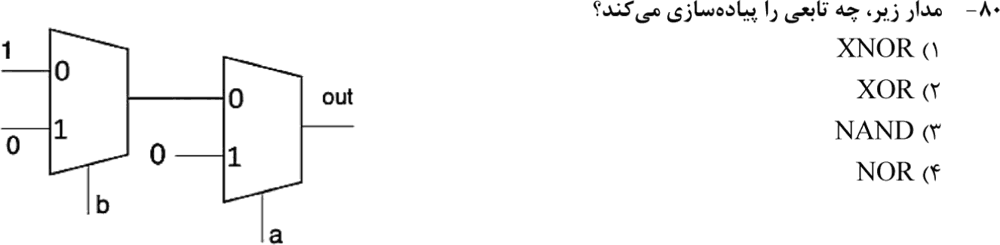

**۲. (ارشد ۱۴۰۴، سؤال ۸۲)**
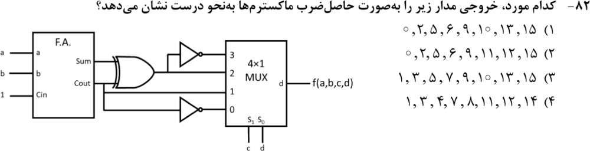

**۳. (ارشد ۱۴۰۱، سؤال ۸۳)**
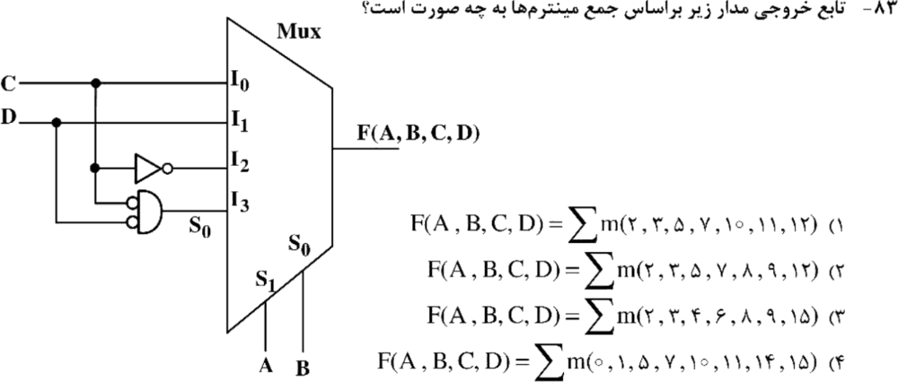

**۴. (ارشد ۱۴۰۰، سؤال ۸۳)**
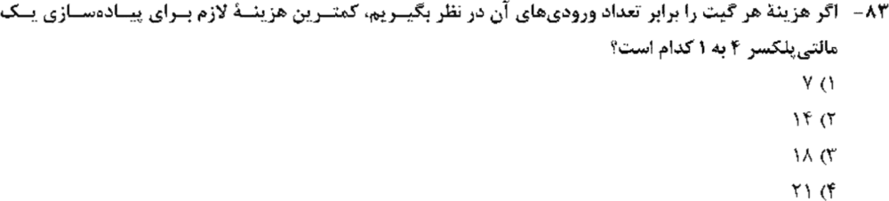

**۵. (ارشد ۱۴۰۰، سؤال ۸۵)**
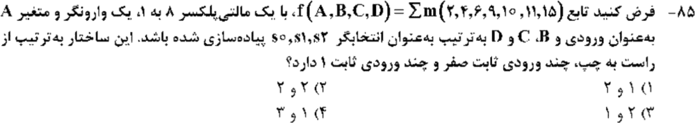

**۶. (ارشد ۱۳۹۹، سؤال ۶۳)**
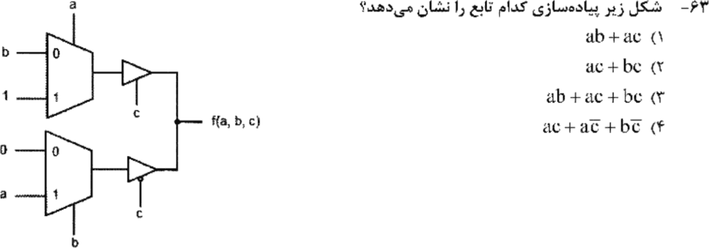

**۷. (ارشد ۱۳۹۹، سؤال ۶۹)**
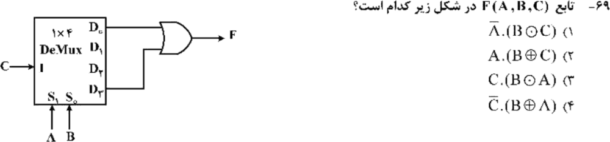

**۸. (ارشد ۱۳۹۹، سؤال ۷۲)**
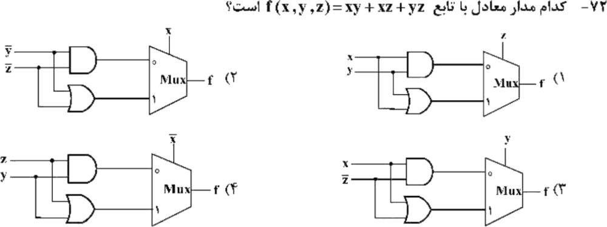

**۹. (ارشد ۱۳۹۹، سؤال ۷۳)**
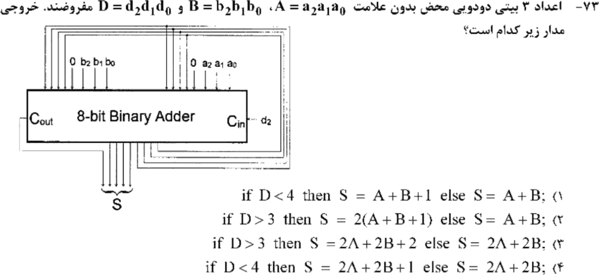

**۱۰. (ارشد ۱۴۰۴، سؤال ۷۷)**
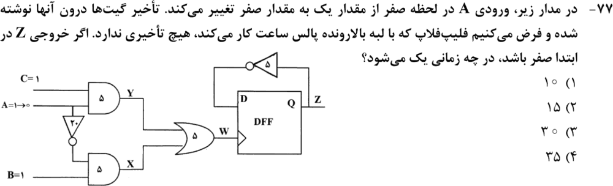

**۱۱. (ارشد ۱۴۰۴، سؤال ۸۱)**
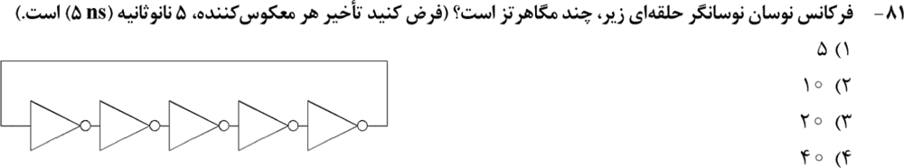

**۱۲. (ارشد ۱۴۰۳، سؤال ۸۱)**
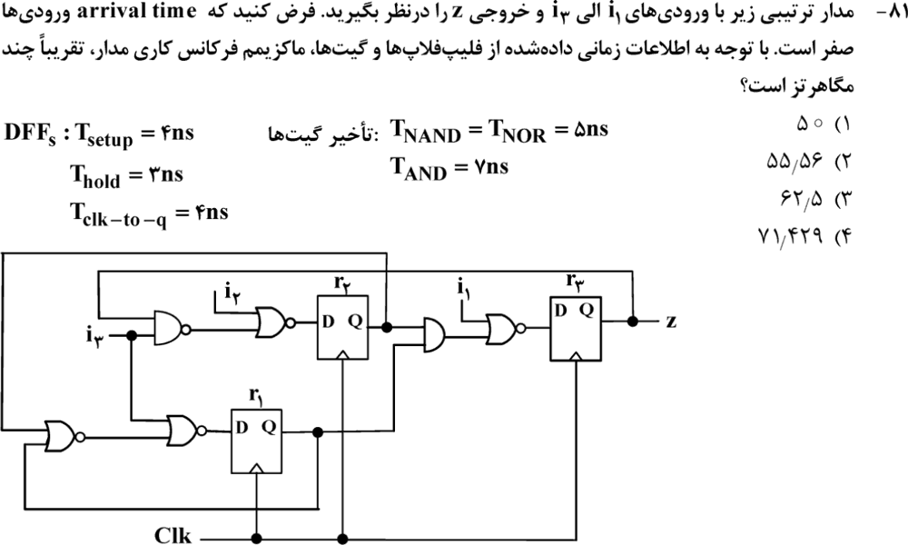

جواب‌ها و راه‌حل (کلید رسمی سازمان سنجش)

| سؤال | ۱ | ۲ | ۳ | ۴ | ۵ | ۶ | ۷ | ۸ | ۹ | ۱۰ | ۱۱ | ۱۲ |
|---|---|---|---|---|---|---|---|---|---|---|---|---|
| کلید | ۴ | ۴ | ۲ | ۳ | ۳ | ۳ | ۳ | ۱ | ۳ | ۳ | ۳ | ۱ |

**۱. گزینهٔ ۴.** MUX اول `b′` می‌دهد. MUX دوم با انتخاب a: اگر `a = 0` خروجی `b′`، وگرنه ۰. پس `a′b′` که همان NOR است.

**۲. گزینهٔ ۴.** با `Cin = 1`: `Sum = (a⊕b)′` و `Cout = a + b`. ورودی‌های MUX (انتخاب c و d) را برای ۱۶ حالت حساب کن. صفرها (ماکسترم‌ها) `1, 3, 4, 7, 8, 11, 12, 14` هستند (شبیه‌سازی رایانه‌ای).

**۳. گزینهٔ ۲.** `F = A′B′C + A′BD + AB′C′ + ABC′D′`. مینترم‌ها: `2, 3, 5, 7, 8, 9, 12`.

**۴. گزینهٔ ۳ (۱۸).** ۲ معکوس‌کننده + ۴ AND سه‌ورودی + یک OR چهارورودی.

**۵. گزینهٔ ۳.** با انتخاب‌های B، C و D، ورودی‌ها به‌ترتیب `0, A, 1, A, A′, 0, A′, A` می‌شوند. پس **دو** ورودی ثابت ۰ و **یک** ورودی ثابت ۱ داریم.

**۶. گزینهٔ ۳.** بالا: `a + b` وقتی `c = 1` فعال است. پایین: `ab` وقتی `c = 0` فعال است. پس `f = c(a+b) + c′ab = ab + ac + bc`.

**۷. گزینهٔ ۳.** `D₀ + D₃ = C·A′B′ + C·AB = C·(A ⊙ B)`.

**۸. گزینهٔ ۱.** انتخاب z: `z = 0` ⇐ `xy` و `z = 1` ⇐ `x + y`. این همان اکثریت است.

**۹. گزینهٔ ۳.** هر دو عدد یک بیت به چپ رفته‌اند (×۲). d₂ (یعنی `D > 3`) در خروجی دو واحد اضافه می‌کند. پس `S = 2A + 2B + 2` یا `2A + 2B`.

**۱۰. گزینهٔ ۳ (۳۰).** A در زمان ۰ از ۱ به ۰ می‌رود.
- Y در ۵ صفر می‌شود و W در ۱۰ صفر می‌شود.
- A′ در ۲۰ یک می‌شود، X در ۲۵ یک می‌شود، و W در ۳۰ یک می‌شود.
- این لبهٔ بالارونده است، پس Z در ۳۰ برابر ۱ می‌شود (`D = Z′ = 1`).

**۱۱. گزینهٔ ۳.** `2 × 5 × 5 = 50 ns`، یعنی ۲۰ مگاهرتز.

**۱۲. گزینهٔ ۱ (۵۰).** طولانی‌ترین مسیر از r₂ یا r₁ به r₃ است: `clk→q (4) + AND (7) + NOR (5) + setup (4) = 20 ns`. پس ۵۰ مگاهرتز. مسیرهای دیگر ۱۸ نانوثانیه‌اند.

---

## 🗂 کارت خلاصهٔ فصل ۲
- MUX: n متغیر به انتخاب، و ورودی‌ها از `{0, 1, x, x′}`. هزینهٔ MUX ۴ به ۱: ۱۸. اکثریت: z انتخاب، `xy` و `x+y`.
- دی‌مالتی‌پلکسر: `Dₖ = I·mₖ`. جمع‌کنندهٔ کامل با `Cin = 1`: `Sum = (a⊕b)′` و `Cout = a + b`.
- دورهٔ کلاک: `clk→q + بیشینهٔ ترکیبی + setup`. نوسانگر حلقه‌ای: `2nt`.
