# فصل ۳: مدار ترتیبی، فلیپ‌فلاپ و شمارنده ★

> **سهم در کنکور:** **۱۴ سؤال** در ارشد ۱۳۹۸ تا ۱۴۰۴، پرتکرارترین مبحث این درس. تقریباً همه با **جدول حالت دستی** حل می‌شوند: حالت فعلی، ورودی فلیپ‌فلاپ‌ها، حالت بعدی.
> **زمان مطالعه:** دو بلوک ۹۰ دقیقه‌ای.

---

## درس ۱: فلیپ‌فلاپ‌ها

| نوع | معادلهٔ مشخصه | نکته |
|---|---|---|
| D | `Q⁺ = D` | |
| T | `Q⁺ = T ⊕ Q` | `T = 1` یعنی تغییر وضعیت |
| JK | `Q⁺ = JQ′ + K′Q` | `J = K = 1` یعنی تغییر وضعیت |
| SR | `Q⁺ = S + R′Q` | `S = R = 1` ممنوع است |

**مثال برای هر سطر جدول:**
- **D:** با `D = 1`، بعد از لبه `Q = 1`، هر چه قبلاً بود.
- **T:** با `Q = 1` و `T = 1` ⇐ `Q⁺ = 1 ⊕ 1 = 0` (تغییر وضعیت)؛ با `T = 0`، Q می‌ماند.
- **JK:** با `Q = 0`، `J = 1`، `K = 0` ⇐ `Q⁺ = 1·1 + 1·0 = 1` (set). با `J = K = 1` و `Q = 1` ⇐ `Q⁺ = 0`.
- **SR:** با `Q = 1`، `S = 0`، `R = 1` ⇐ `Q⁺ = 0 + 0·1 = 0` (reset).

**جدول تحریک JK:**

| `Q → Q⁺` | J | K |
|---|---|---|
| ۰ → ۰ | ۰ | X |
| ۰ → ۱ | ۱ | X |
| ۱ → ۰ | X | ۱ |
| ۱ → ۱ | X | ۰ |

**مثال (یک سطر تحریک):** برای `0 → 1`: باید `J = 1` باشد. K فرقی نمی‌کند: با `K = 0` عمل set است و با `K = 1` عمل toggle، و هر دو از ۰ به ۱ می‌برند ⇐ `K = X`.

- **SR به T:** `S = T·Q′` و `R = T·Q`. با NOR های ورودی‌معکوس: `NOR(T′, Q′) = TQ`.
- **لچ** حساس به سطح است و **فلیپ‌فلاپ** حساس به لبه.

**مثال:** فرض کن D در یک دورهٔ کلاک از ۰ به ۱ و دوباره به ۰ برود، در حالی که کلاک بالاست. لچ D همهٔ این تغییرها را دنبال می‌کند و Q هم ۱ می‌شود و هم دوباره ۰. فلیپ‌فلاپ D فقط مقدار D را در لحظهٔ لبهٔ بالارونده برمی‌دارد.

---

## درس ۲: تحلیل مدار ترتیبی (روش ثابت)

1. معادلهٔ ورودی هر فلیپ‌فلاپ را بنویس (مثلاً `D_A = C′` یا `T₀ = Q₁′`).
2. از حالت اولیه شروع کن. برای هر قدم **همهٔ ورودی‌ها را با حالت فعلی** حساب کن و **بعد** همه را با هم به‌روز کن.
3. دنباله را تا تکرار حالت ادامه بده.

**مثال:** دو فلیپ‌فلاپ D با `D_A = B` و `D_B = A′`، شروع از `AB = 00`.

| حالت AB | `D_A = B` | `D_B = A′` | حالت بعدی |
|---|---|---|---|
| `00` | 0 | 1 | `01` |
| `01` | 1 | 1 | `11` |
| `11` | 1 | 0 | `10` |
| `10` | 0 | 0 | `00` |

- چرخهٔ ۴ حالتی است (شمارندهٔ جانسون ۲ بیتی).
- ⚠️ اشتباه رایج: در سطر اول A را ۰ کنی و بعد برای `D_B` از A **جدید** استفاده کنی. هر دو ورودی با حالت **فعلی** حساب می‌شوند.

**نکته‌ها:**
- **حالت‌های غیرقابل دسترس** = همهٔ حالت‌ها منهای حالت‌های دنبالهٔ شروع از ریست.
- در **ثبات انتقال** با D، هر کلاک داده یک خانه جلو می‌رود.
- **LFSR** n بیتی (بیشینه) چرخه‌ای به طول `2ⁿ − 1` دارد (حالت صفر جداست).

**مثال برای هر نکته:**
- **غیرقابل دسترس:** شمارندهٔ ۳ بیتی که از ریست `0, 1, …, 5` می‌شمارد و دوباره ۰ می‌شود ⇐ حالت‌های ۶ و ۷ غیرقابل دسترس‌اند.
- **ثبات انتقال:** ۴ بیتی با ورودی ۱ و بعد ۰ ها: `0000 → 1000 → 0100 → 0010 → 0001`.
- **LFSR ۳ بیتی** `Q₁Q₂Q₃` که هر کلاک به راست شیفت می‌خورد و بیت ورودی `Q₂ ⊕ Q₃` است: `001 → 100 → 010 → 101 → 110 → 111 → 011 → 001`. هفت حالت، یعنی `2³ − 1`؛ حالت `000` روی خودش می‌ماند.

---

## درس ۳: شمارنده‌ها و تقسیم فرکانس

- **شمارندهٔ دودویی با T:** `T₀ = 1`، `T₁ = Q₀`، `T₂ = Q₁Q₀`. یعنی `A + 1`.
- **تقسیم فرکانس:** هر طبقهٔ تغییر وضعیت فرکانس را نصف می‌کند. بیت kام شمارنده فرکانس `f/2ᵏ⁺¹` دارد.
- **شمارندهٔ پیمانه‌ای با Load یا Clear همگام:** در حالت آخر، شرط Load فعال می‌شود و در **لبهٔ بعدی** مقدار اولیه بارگذاری می‌شود. پس حالت آخر هم دیده می‌شود.
- **شمارنده‌های پشت‌سرهم:** اولی پیمانهٔ ۱۰ (پاک شدن در ۹ و فعال کردن دومی) و دومی پیمانهٔ ۱۶ یعنی پیمانهٔ `160`.
- **ثبات حلقه‌ای** n بیتی: n حالت. **جانسون** n بیتی: `2n` حالت.
- **همگام در برابر ناهمگام:** Clear همگام فقط روی لبهٔ کلاک اثر دارد. ناهمگام بلافاصله اثر دارد.

**مثال برای هر مورد:**
- **شمارندهٔ T:** از `011`: `T₀ = 1`، `T₁ = Q₀ = 1`، `T₂ = Q₁Q₀ = 1` ⇐ هر سه بیت عوض می‌شوند ⇐ `100` (یعنی `3 + 1 = 4`).
- **تقسیم فرکانس:** با کلاک `16 MHz`: `Q₀` با `8 MHz`، `Q₁` با `4 MHz` و `Q₂` با `2 MHz`.
- **Load همگام:** شمارنده با «بارگذاری ۰ وقتی حالت ۹ است»: `0, 1, …, 9, 0, …` ⇐ پیمانهٔ ۱۰ (حالت ۹ یک کلاک کامل دیده می‌شود).
- **Clear ناهمگام در ۱۰:** همان `0, …, 9`، ولی حالت ۱۰ یک لحظهٔ کوتاه ظاهر می‌شود و فوراً به ۰ می‌پرد.
- **پشت‌سرهم:** پیمانهٔ ۱۰ و پیمانهٔ ۱۶ ⇐ `10 × 16 = 160` حالت.
- **حلقه‌ای ۴ بیتی:** `1000 → 0100 → 0010 → 0001` (۴ حالت).
- **جانسون ۴ بیتی:** `0000 → 1000 → 1100 → 1110 → 1111 → 0111 → 0011 → 0001` (۸ حالت).

### تمرین فصل ۳
1. JK با `J = K = 1` چه می‌کند؟
2. شمارندهٔ جانسون ۴ بیتی چند حالت دارد؟
3. برای JK از ۱ به ۱، J و K چه باشند؟

جواب‌ها

1. تغییر وضعیت (toggle).
2. ۸
3. `J = X` و `K = 0`.

---

## 📝 آزمون فصل ۳ (سؤال‌های واقعی کنکور ارشد کامپیوتر)
**زمان: ۴۰ دقیقه برای ۱۴ سؤال.**

**۱. (ارشد ۱۴۰۳، سؤال ۸۲)**
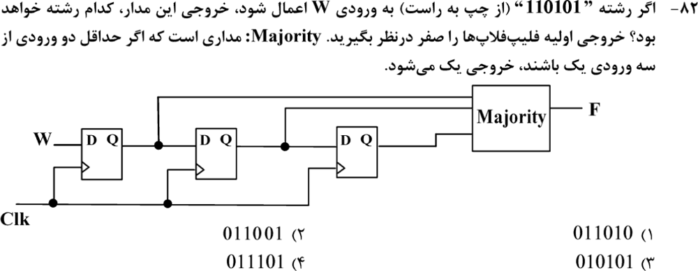

**۲. (ارشد ۱۴۰۲، سؤال ۷۷)**
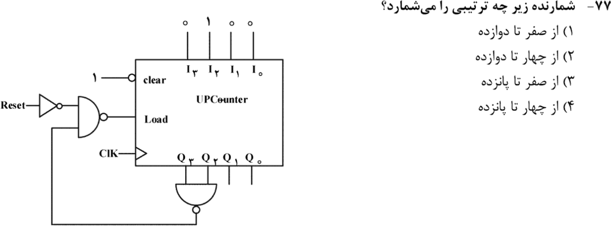

**۳. (ارشد ۱۴۰۲، سؤال ۸۰)**
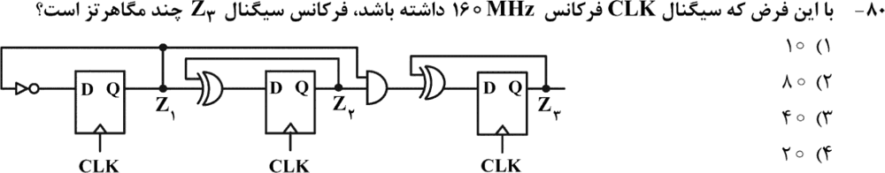

**۴. (ارشد ۱۴۰۱، سؤال ۸۱)**
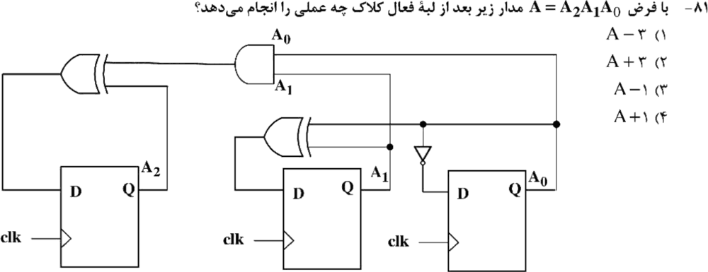

**۵. (ارشد ۱۴۰۱، سؤال ۸۴)**
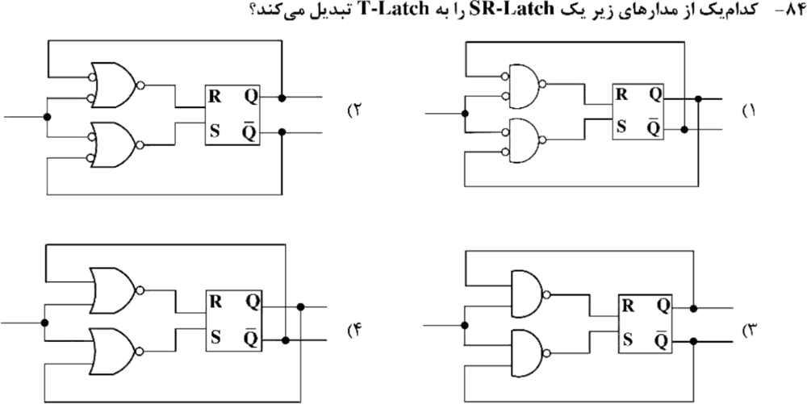

**۶. (ارشد ۱۴۰۱، سؤال ۸۶)**
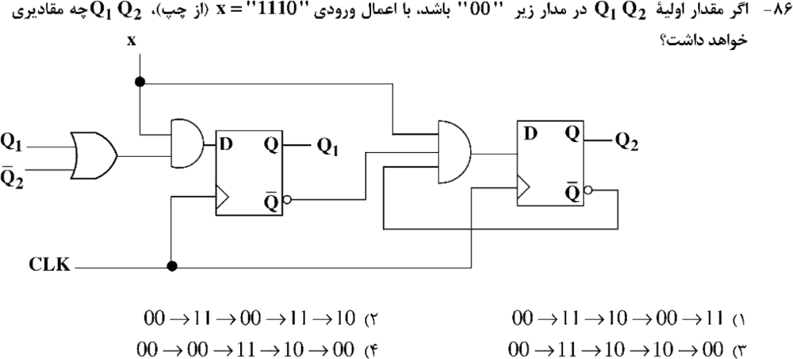

**۷. (ارشد ۱۴۰۰، سؤال ۸۱)**
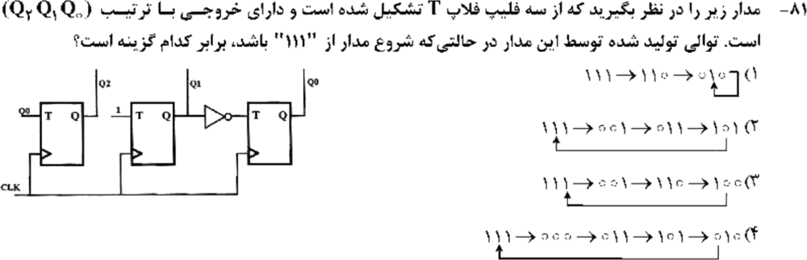

**۸. (ارشد ۱۴۰۰، سؤال ۸۶)**
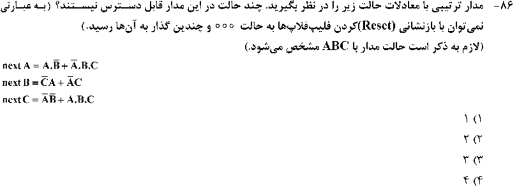

**۹. (ارشد ۱۳۹۹، سؤال ۶۴)**
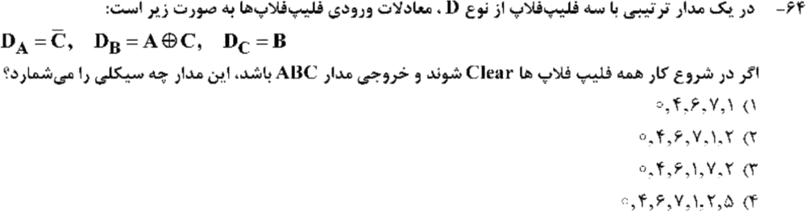

**۱۰. (ارشد ۱۳۹۹، سؤال ۶۸)**
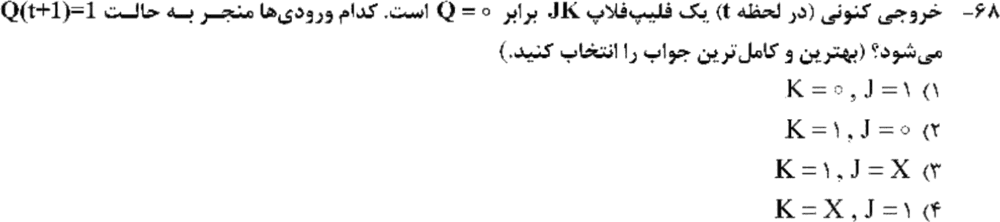

**۱۱. (ارشد ۱۳۹۹، سؤال ۷۰)**
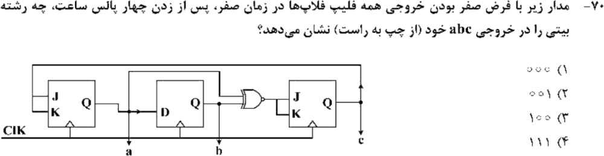

**۱۲. (ارشد ۱۳۹۹، سؤال ۷۱)**
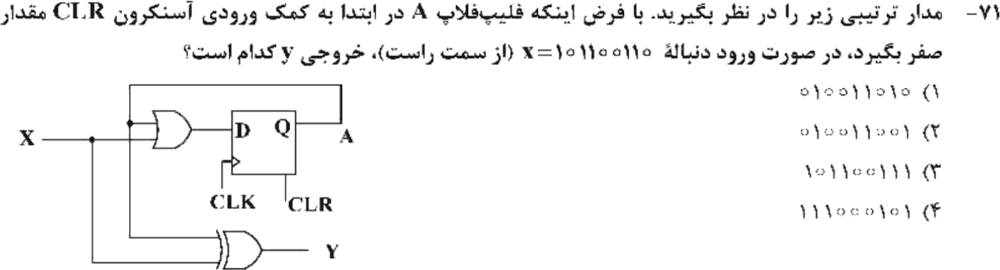

**۱۳. (ارشد ۱۳۹۸، سؤال ۶۵)**
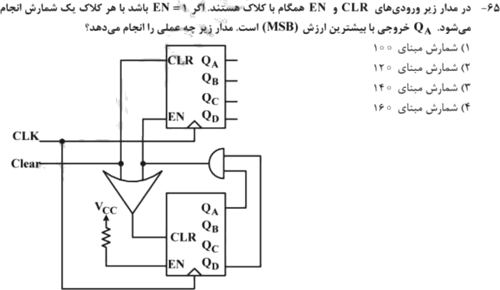

**۱۴. (ارشد ۱۳۹۸، سؤال ۶۸)**
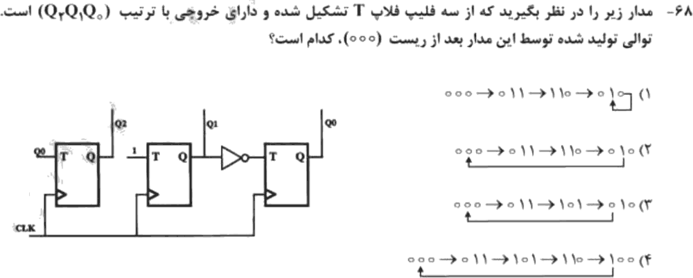

جواب‌ها و راه‌حل (کلید رسمی سازمان سنجش)

| سؤال | ۱ | ۲ | ۳ | ۴ | ۵ | ۶ | ۷ | ۸ | ۹ | ۱۰ | ۱۱ | ۱۲ | ۱۳ | ۱۴ |
|---|---|---|---|---|---|---|---|---|---|---|---|---|---|---|
| کلید | ۴ | ۲ | ۴ | ۴ | ۲ | ۳ | ۳ | ۳ | ۴ | ۴ | ۴ | ۱ | ۴ | ۳ |

**۱. گزینهٔ ۴.** حالت‌های ثبات بعد از هر کلاک: `100، 110، 011، 101، 010، 101`. اکثریت هر کدام: `0، 1، 1، 1، 0، 1`.

**۲. گزینهٔ ۲.** با `Reset = 0`، `Load = Q₃Q₂` است. وقتی شمارنده به ۱۲ (`1100`) می‌رسد، در لبهٔ بعد ۴ (`0100`) بارگذاری می‌شود. پس شمارش از ۴ تا ۱۲.

**۳. گزینهٔ ۴.** Z₁ بر ۲ تقسیم می‌کند (۸۰)، Z₂ بر ۴ (۴۰)، و Z₃ بیت سوم شمارنده است، یعنی تقسیم بر ۸: **۲۰ مگاهرتز**.

**۴. گزینهٔ ۴.** `D₀ = A₀′`، `D₁ = A₁ ⊕ A₀`، `D₂ = A₂ ⊕ A₁A₀`. این یعنی `A + 1`.

**۵. گزینهٔ ۲.** NOR با ورودی‌های معکوس‌شده: `R = NOR(T′, Q′) = TQ` و `S = NOR(T′, Q̄′) = TQ′`. این دقیقاً تبدیل SR به T است.

**۶. گزینهٔ ۳.** `D₁ = x(Q₁ + Q₂′)` و `D₂ = x·Q₁′·Q₂′`. با ورودی‌های `1, 1, 1, 0`: `00 → 11 → 10 → 10 → 00`.

**۷. گزینهٔ ۳.** `T₂ = Q₀`، `T₁ = 1`، `T₀ = Q₁′`. از ۱۱۱: `111 → 001 → 110 → 100 → 111`.

**۸. گزینهٔ ۳.** از ۰۰۰: `000 → 001 → 011 → 110 → 010 → 000`. پنج حالت قابل دسترس‌اند، پس **۳** حالت غیرقابل دسترس.

**۹. گزینهٔ ۴.** از ۰۰۰ (به‌ترتیب ABC): `0 → 4 → 6 → 7 → 1 → 2 → 5 → 0`.

**۱۰. گزینهٔ ۴.** از ۰ به ۱: `J = 1` و `K = X`.

**۱۱. گزینهٔ ۴.** a یک T با `T = c`، b یک D با `D = a`، و c یک T با `T = a ⊙ b` است. `000 → 001 → 100 → 110 → 111`.

**۱۲. گزینهٔ ۱.** `D = X + A` (بعد از اولین ۱، A برای همیشه ۱ می‌ماند) و `Y = X ⊕ A`. ورودی از راست خوانده می‌شود: `0,1,1,0,0,1,1,0,1`. خروجی‌ها `0,1,0,1,1,0,0,1,0` هستند که از راست نوشته می‌شوند: `010011010`.

**۱۳. گزینهٔ ۴ (با تأثیر مثبت).** شمارندهٔ پایین (همیشه فعال) در ۹ (`QA·QD`) پاک می‌شود و هم‌زمان شمارندهٔ بالا را یکی جلو می‌برد. پس شمارش مبنای `10 × 16 = 160`.

**۱۴. گزینهٔ ۳.** همان مدار سؤال ۷ است. از ۰۰۰: `000 → 011 → 101 → 010 → 000`.

---

## 🗂 کارت خلاصهٔ فصل ۳
- D: `Q⁺ = D`؛ T: `Q⁺ = T⊕Q`؛ JK: `JQ′ + K′Q`. تحریک JK برای ۰→۱: `1X` و برای ۱→۰: `X1`. SR به T: `S = TQ′` و `R = TQ`.
- تحلیل: همهٔ ورودی‌ها را با حالت فعلی حساب کن و بعد همه را با هم به‌روز کن. غیرقابل دسترس = همه منهای دنبالهٔ ریست.
- شمارنده: هر طبقه فرکانس را نصف می‌کند. Load همگام در لبهٔ **بعد** اثر می‌کند. پشت‌سرهم ۱۰ × ۱۶ = ۱۶۰. جانسون `2n`.
