# فصل ۴: ماشین حالت، حافظه و PLD، و توصیف سخت‌افزار (Verilog/VHDL)

> **سهم در کنکور:** ۱۱ سؤال در ارشد ۱۳۹۸ تا ۱۴۰۴ (۶ ماشین حالت، ۱ حافظه و PLD، ۴ توصیف سخت‌افزار) + ۱ سؤال حذف‌شده.
> **زمان مطالعه:** یک بلوک ۹۰ دقیقه‌ای.

---

## درس ۱: ماشین میلی و مور

| | مور | میلی |
|---|---|---|
| خروجی وابسته به | فقط حالت | حالت **و** ورودی |
| در نمودار | داخل حالت (`a, 0`) | روی یال (`x/z`) |
| تعداد حالت برای یک تشخیص‌دهنده | معمولاً یکی بیشتر | کمتر |

### طراحی تشخیص‌دهندهٔ دنباله (مثلاً `1001` با هم‌پوشانی)
1. حالت‌ها بر اساس «بلندترین پیشوندی که تا الان دیده شده» تعریف می‌شوند: `S₀: −`، `S₁: 1`، `S₂: 10`، `S₃: 100`.
2. انتقال‌ها: در هر حالت برای ورودی ۰ و ۱، بلندترین پسوند رشتهٔ جدید که پیشوند الگو است را پیدا کن.
3. با کدگذاری دودویی (`S₀ = 00`، …)، برای هر بیت حالت بعدی یک تابع بنویس و ساده کن.

**خواندن نمودار:** ورودی‌ها را قدم‌به‌قدم روی نمودار اجرا کن. در مور، خروجی حالت **شروع** هم معمولاً جزو دنباله است.

---

## درس ۲: کمینه‌سازی حالت
- دو حالت **هم‌ارزند** اگر برای هر ورودی خروجی یکسان داشته باشند **و** حالت‌های بعدی‌شان هم‌ارز باشند.
- **روش افراز:**
  1. گروه‌بندی اول بر اساس سطر خروجی.
  2. هر گروه را بر اساس «گروه حالت بعدی» برای هر ورودی ریزتر کن.
  3. تا ثابت شدن تکرار کن.
- **میان‌بُر:** دو سطر **کاملاً یکسان** (حالت بعدی و خروجی) را فوراً یکی کن و همه‌جا جایگزین کن. بعد دوباره نگاه کن.

---

## درس ۳: حافظه و مدارهای برنامه‌پذیر
- **ROM** با `2ⁿ × m` خانه، هر m تابع از n متغیر را پیاده می‌کند. PLA: AND و OR هر دو برنامه‌پذیر. PAL: فقط AND برنامه‌پذیر و OR ثابت.
- **بلوک FPGA (جدول جست‌وجوی ۱۶×۱ + فلیپ‌فلاپ + MUX):** هر بلوک یک تابع **حداکثر ۴ ورودی** و یک فلیپ‌فلاپ اختیاری دارد. برای شمردن تعداد بلوک:
  1. مدار را به «مخروط‌های» حداکثر ۴ ورودی تقسیم کن.
  2. هر فلیپ‌فلاپ یک بلوک می‌خواهد (اگر با منطق قبلش هم‌بلوک نشود).

---

## درس ۴: Verilog و VHDL (در حد خواندن کد)

| کد | سخت‌افزار |
|---|---|
| `always @(posedge clk)` با `if (!clr)` | فلیپ‌فلاپ با **پاک‌کردن همگام** |
| `always @(posedge clk or negedge rst)` با `if (!rst)` | فلیپ‌فلاپ با **ریست ناهمگام** |
| VHDL: `process(clk, rst)` با `if rst='0' … elsif rising_edge(clk)` | ریست ناهمگام |
| `assign y = …` | منطق ترکیبی |
| `Q <= {Q[2], Q[0]^Q[2], Q[1]}` | ثبات انتقال یا LFSR (همهٔ مقادیر سمت راست با مقدار **قبلی** حساب می‌شوند) |

**ردگیری موج:** فقط در لحظه‌های رویداد فهرست حساسیت (مثلاً لبهٔ بالاروندهٔ d یا لبهٔ پایین‌روندهٔ e) کد اجرا می‌شود. شرط‌ها را به‌ترتیب چک کن.

### تمرین فصل ۴
1. تشخیص‌دهندهٔ مور برای `11` (با هم‌پوشانی) چند حالت دارد؟
2. برای ۴ تابع از ۵ متغیر چه ROM ای لازم است؟

جواب‌ها

1. ۳ (هیچ، `1`، `11` با خروجی ۱).
2. `32 × 4`

---

## 📝 آزمون فصل ۴ (سؤال‌های واقعی کنکور ارشد کامپیوتر)
**زمان: ۳۰ دقیقه برای ۱۱ سؤال.**

**۱. (ارشد ۱۴۰۴، سؤال ۷۸)**
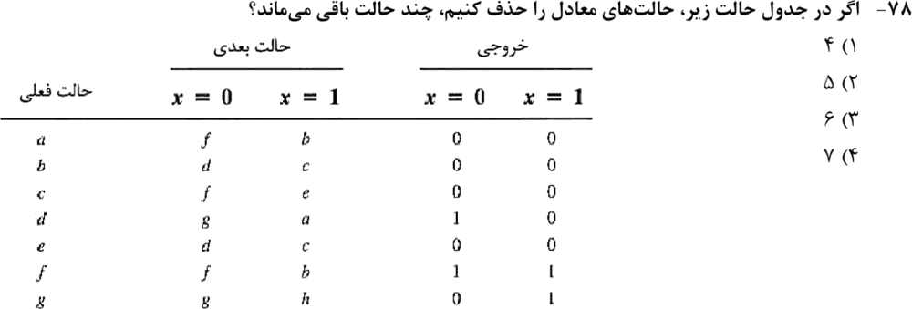

**۲. (ارشد ۱۴۰۳، سؤال ۷۷)**
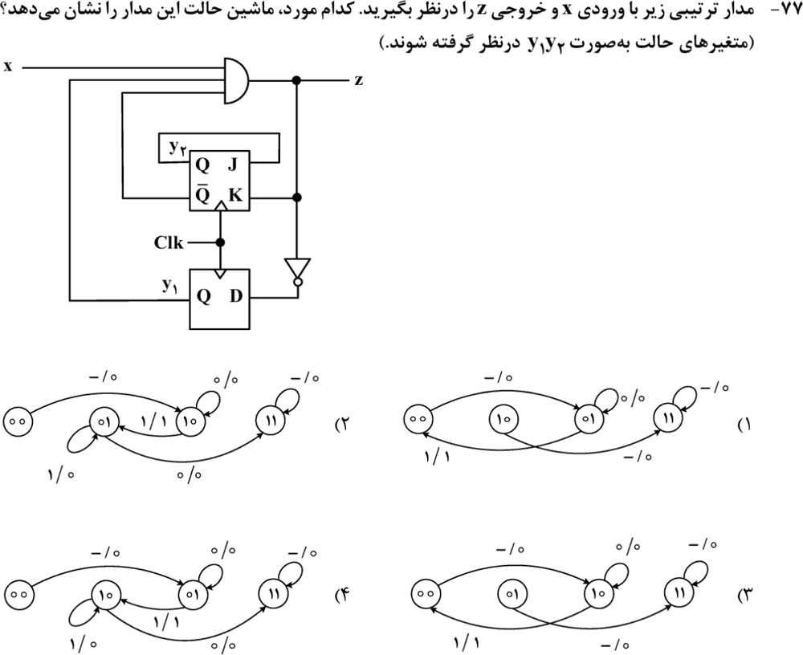

**۳. (ارشد ۱۴۰۲، سؤال ۷۶)**
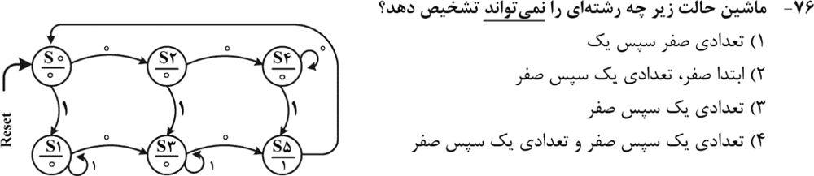

**۴. (ارشد ۱۴۰۰، سؤال ۸۴)**
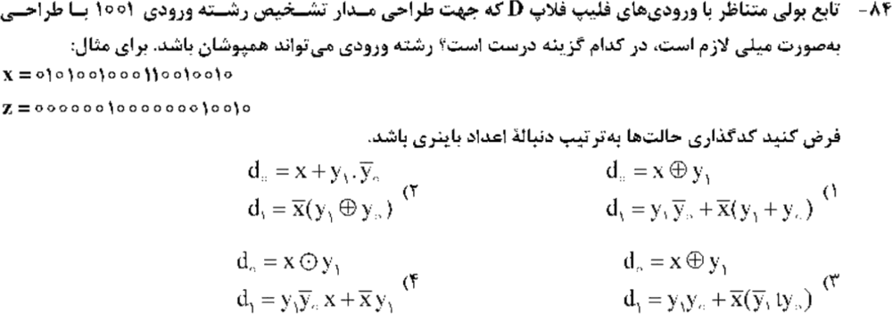

**۵. (ارشد ۱۳۹۹، سؤال ۶۵)**
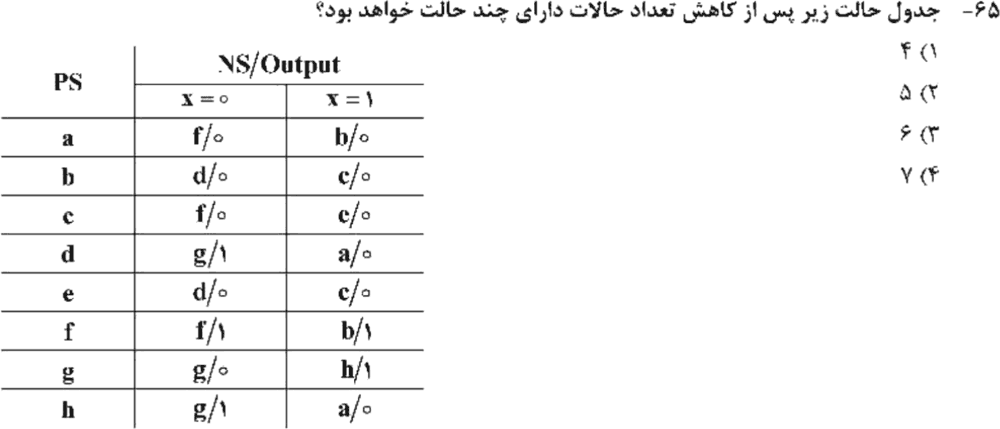

**۶. (ارشد ۱۳۹۸، سؤال ۶۹)**
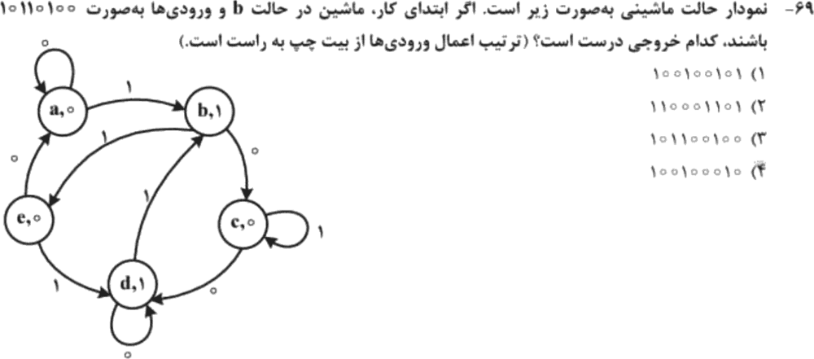

**۷. (ارشد ۱۴۰۳، سؤال ۷۸)**
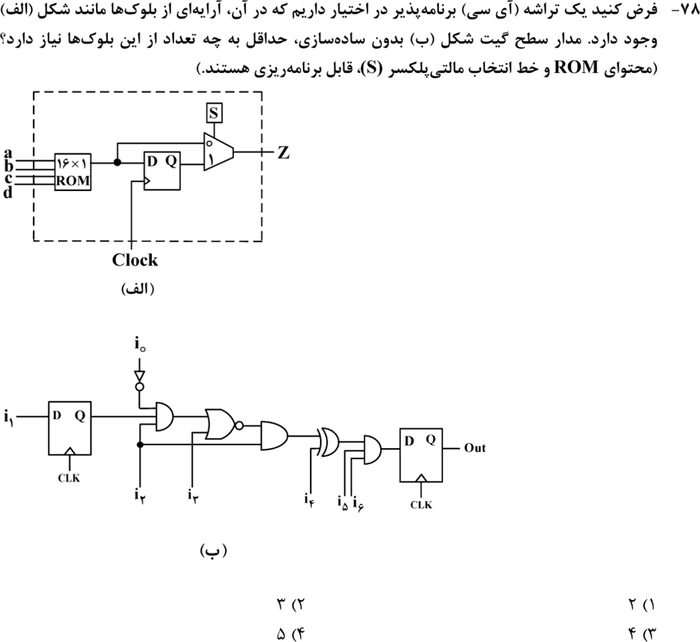

**۸. (ارشد ۱۴۰۳، سؤال ۸۰)**
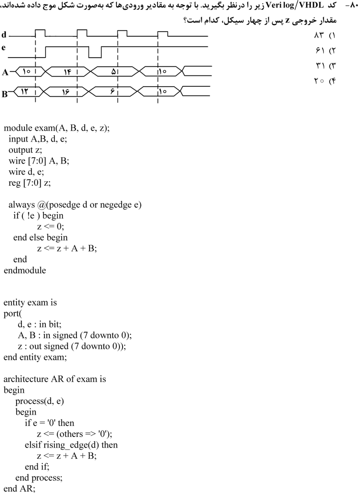

**۹. (ارشد ۱۴۰۲، سؤال ۸۲)**
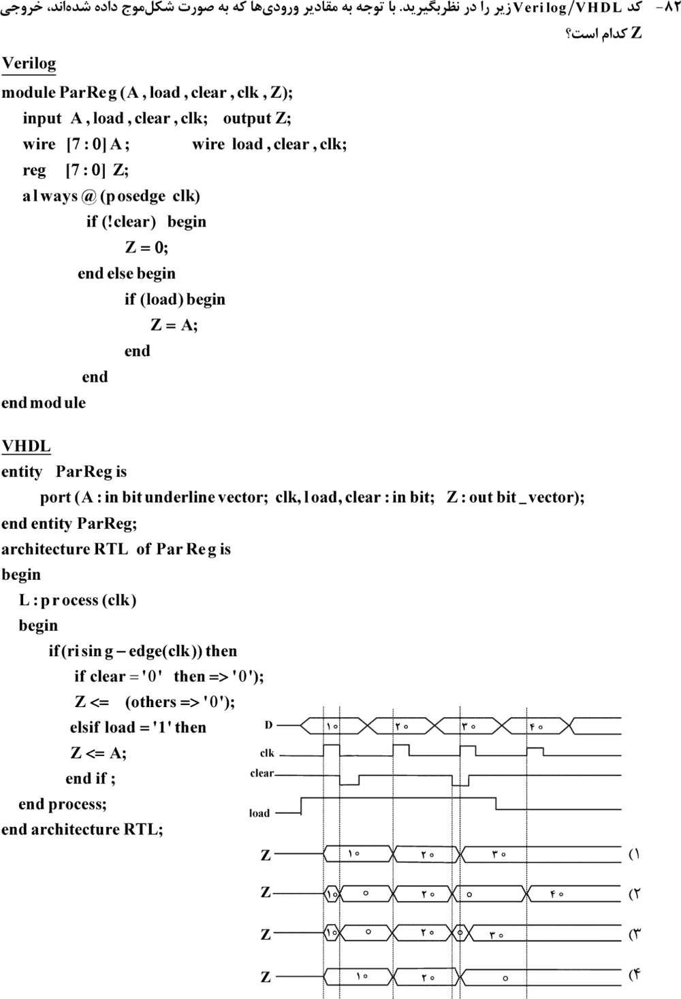

**۱۰. (ارشد ۱۴۰۱، سؤال ۸۲)**
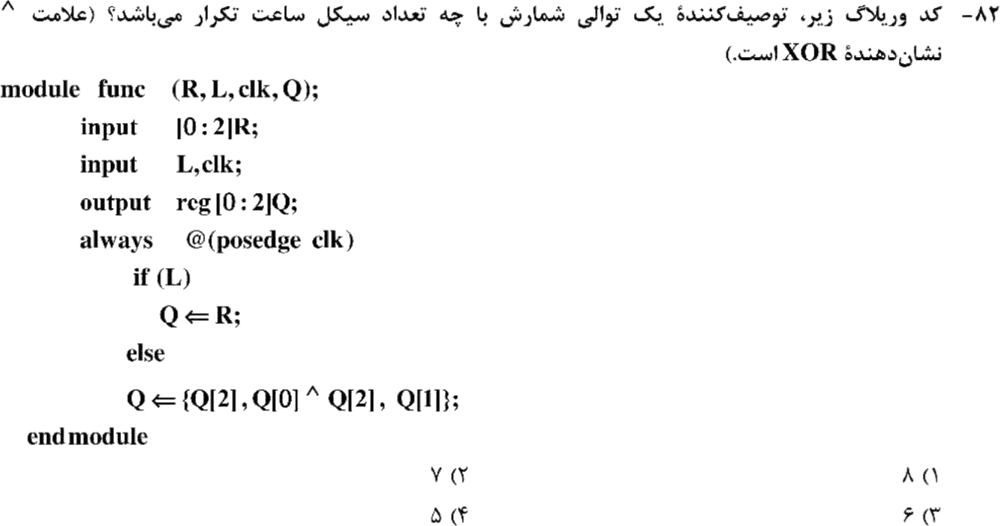

**۱۱. (ارشد ۱۳۹۸، سؤال ۶۷)**
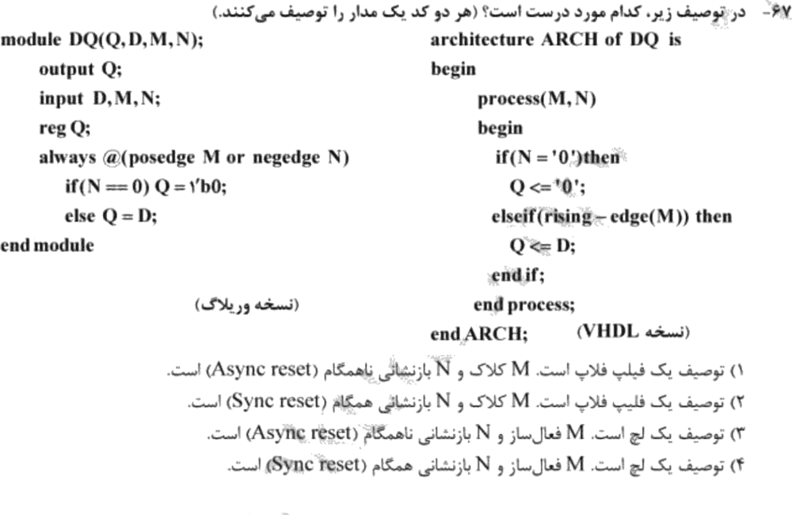

جواب‌ها و راه‌حل (کلید رسمی سازمان سنجش)

| سؤال | ۱ | ۲ | ۳ | ۴ | ۵ | ۶ | ۷ | ۸ | ۹ | ۱۰ | ۱۱ |
|---|---|---|---|---|---|---|---|---|---|---|---|
| کلید | ۲ | ۳ | ۳ | ۲ | ۲ | ۱ | ۲ | ۳ | ۴ | ۲ | ۱ |

**۱. گزینهٔ ۲ (۵).** همان جدول سؤال ۵ است. در این دفترچه سطر h جا افتاده، ولی g به h اشاره می‌کند.
- b و e یکسان‌اند.
- با این یکی شدن، a و c هم یکسان می‌شوند.
- d و h یکسان‌اند.
- f و g جدا می‌مانند.

کلاس‌ها: `{a,c}، {b,e}، {d,h}، {f}، {g}` (با کمینه‌سازی رایانه‌ای تأیید شد).

**۲. گزینهٔ ۳.** `z = x·y₁·y₂′`، `y₁⁺ = z′` و `y₂⁺ = y₂` (چون J همان y₂ است و `K = z`). در نتیجه:
- `00 → 10` (هر ورودی، خروجی ۰).
- در ۱۰: `x = 0` حلقه با خروجی ۰؛ `x = 1` به ۰۰ با خروجی ۱.
- `01 → 11` و ۱۱ روی خودش.

**۳. گزینهٔ ۳.** «تعدادی یک و بعد صفر» به S₃ می‌رسد که خروجی ۰ دارد. برای رسیدن به S₅ یک صفر دیگر لازم است. بقیهٔ الگوها به S₅ (خروجی ۱) می‌رسند.

**۴. گزینهٔ ۲.** حالت‌ها: `00 (−)، 01 (1)، 10 (10)، 11 (100)`.
- `y₀⁺ = 1` وقتی حالت بعد S₁ یا S₃ است: `d₀ = x + y₁y₀′`.
- `y₁⁺ = 1` وقتی حالت بعد S₂ یا S₃ است: `d₁ = x′(y₁ ⊕ y₀)`.

**۵. گزینهٔ ۲ (۵).** کلاس‌ها `{a,c}، {b,e}، {d,h}، {f}، {g}`.

**۶. گزینهٔ ۱.** از b با ورودی‌های `10110100`: حالت‌ها `b,e,a,b,e,a,b,c,d` با خروجی‌های `100100101`.

**۷. گزینهٔ ۲ (۳ بلوک).**
- یک بلوک برای فلیپ‌فلاپ i₁.
- یک بلوک برای منطق ۴ ورودی (i₀، Q، i₂، i₃).
- یک بلوک برای ۴ ورودی بعدی (خروجی قبلی، i₄، i₅، i₆) همراه با فلیپ‌فلاپ خروجی.

**۸. گزینهٔ ۳ (۳۱).**
- لبهٔ اول d: چون `e = 0`، `z = 0`.
- لبهٔ دوم: `z = 14 + 16 = 30`.
- لبهٔ پایین‌روندهٔ e: `z = 0`.
- لبهٔ سوم: `z = 5 + 6 = 11`.
- لبهٔ چهارم: `z = 11 + 10 + 10 = 31`.

**۹. گزینهٔ ۴.** clear همگام است و فقط در لبهٔ بالاروندهٔ کلاک اثر دارد. در لبه‌هایی که `clear = 1` و `load = 1`، Z مقدار A را می‌گیرد. در لبه‌ای که `clear = 0`، Z صفر می‌شود.

**۱۰. گزینهٔ ۲ (۷).** این یک LFSR بیشینه است: از هر حالت غیرصفر چرخه‌ای به طول ۷ دارد (شبیه‌سازی رایانه‌ای).

**۱۱. گزینهٔ ۱.** حساس به لبهٔ بالاروندهٔ M (کلاک) است و N با لبهٔ پایین‌رونده در فهرست حساسیت آمده. پس فلیپ‌فلاپ با ریست ناهمگام.

*(سؤال ۸۷ ارشد ۱۴۰۰ در این مبحث حذف شده است.)*

---

## 🗂 کارت خلاصهٔ فصل ۴
- مور: خروجی در حالت؛ میلی: خروجی روی یال. تشخیص‌دهنده: حالت = بلندترین پیشوند دیده‌شده.
- کمینه‌سازی: سطرهای یکسان را ادغام کن و تکرار کن.
- ROM `2ⁿ × m`. بلوک FPGA: تابع حداکثر ۴ ورودی + یک فلیپ‌فلاپ.
- `posedge clk` تنها یعنی همگام. `or negedge rst` یعنی ناهمگام. سمت راست `<=` با مقادیر قبلی حساب می‌شود.
