# فصل ۱: محاسبات کامپیوتری و ALU ★

> **سهم در کنکور:** **۱۶ سؤال** در ارشد ۱۳۹۸ تا ۱۴۰۴، پرتکرارترین مبحث معماری. تیپ‌ها: واحد حسابی با MUX، ممیز شناور، رمزگذاری بوث، و بیت‌های وضعیت (سرریز، نقلی، مقایسه).
> **پیش‌نیاز:** مدار منطقی فصل ۱ و ۲ (مکمل ۲، جمع‌کننده، MUX).
> **زمان مطالعه:** دو بلوک ۹۰ دقیقه‌ای.

---

## درس ۱: واحد حسابی با MUX و تمام‌جمع‌کننده

در هر طبقه، ورودی دوم تمام‌جمع‌کننده (`yᵢ`) از یک MUX می‌آید. **کل واحد = `A + Y + Cin`.**

| ورودی MUX (برای همهٔ بیت‌ها) | Y | نتیجه با Cin = 0 | نتیجه با Cin = 1 |
|---|---|---|---|
| `bᵢ` | B | `A + B` | `A + B + 1` |
| `b̄ᵢ` | `B̄ = −B − 1` | `A − B − 1` | **`A − B`** |
| `0` | ۰ | `A` | `A + 1` |
| `1` | `11…1 = −1` | `A − 1` | `A` |

**روش حل:** برای هر سطر جدول عملکرد، از روی نتیجه بفهم Y چه بوده و کدام ورودی MUX است.

---

## درس ۲: بیت‌های وضعیت و مقایسه

| بیت | معنی |
|---|---|
| C (نقلی) | نقلی خروجی از بیت آخر؛ برای **بی‌علامت** یعنی سرریز جمع |
| V (سرریز) | `c_n ⊕ c_(n−1)`؛ برای **مکمل ۲** معنی دارد. دو عدد هم‌علامت که جمعشان علامت مخالف بدهد |
| S (علامت) | بیت آخر نتیجه |
| Z (صفر) | نتیجه صفر است |

**مقایسه با `A − B = A + B̄ + 1`:**

| شرط | بی‌علامت | باعلامت (مکمل ۲) |
|---|---|---|
| `A ≥ B` | `C = 1` | `S = V` (یعنی `S ⊙ V = 1`) |
| `A = B` | `Z = 1` | `Z = 1` |
| `A < B` | `C = 0` | `S ≠ V` |

**مثال:** `F3E2 + EA29` (۱۶ بیتی) = `1DE0B`. پس `C = 1` و `S = 1`. دو عدد منفی جمعشان منفی شده، پس `V = 0`.

---

## درس ۳: ضرب و تقسیم

- **جمع و شیفت:** هر بیت ۱ در مضروب‌فیه یک جمع می‌خواهد. همیشه **n** شیفت.
- **بوث:** رقم iام رمزشده = `bᵢ₋₁ − bᵢ` (با `b₋₁ = 0`). `10` یعنی تفریق، `01` یعنی جمع، `00` و `11` یعنی هیچ.
  - تعداد شیفت همیشه **n** (تعداد بیت‌ها) است، ولی تعداد جمع و تفریق به الگو بستگی دارد.
  - کمترین تعداد جمع و تفریق صفر است (مثلاً مضروب‌فیه صفر).
  - برای اعداد علامت‌دار در مکمل ۲ کار می‌کند.
  - تعداد گام‌ها (شیفت‌ها) از روش جمع و شیفت **کمتر نیست**.
- **تقسیم 2n بیتی بر n بیتی با خارج‌قسمت n بیتی:** شرط عدم سرریز این است که مقسوم‌علیه از **نیمهٔ بالای** مقسوم بزرگ‌تر باشد. در حالت کلی: مقسوم‌علیه بزرگ‌تر از «بالاترین بیت‌های مقسوم به طول مقسوم‌علیه».

**مثال بوث:** `10011101` (از بیت ۷ تا ۰) رمز می‌شود به `(−1, 0, +1, 0, 0, −1, +1, −1)`.

---

## درس ۴: ممیز شناور

`مقدار = (−1)^S × مانتیس × 2^(E − بایاس)`
- **یک ضمنی (implicit):** مانتیس `1.M`، پس همهٔ بیت‌های M کسری‌اند.
- **یک صریح (explicit):** بیت اول مانتیس خودش همان «۱.» است، پس یک بیت کسری کمتر داریم.
- **بزرگ‌ترین عدد** (بدون نمای رزرو): بیشینهٔ نما منهای بایاس، و مانتیس همه ۱.

**مثال:** S=1، E=3 بیت (بایاس ۴)، M=4 بیت با یک ضمنی:
- `0.75 = 1.1₂ × 2⁻¹`
- `E = −1 + 4 = 3 = 011` و `M = 1000`
- رشته `0 011 1000` در مبنای ۱۶ می‌شود `38`.
- بزرگ‌ترین عدد: `1.1111₂ × 2^(7−4) = 15.5`.

### تمرین فصل ۱
1. در واحد درس ۱، با ورودی `b̄` و `Cin = 1` چه عملی انجام می‌شود؟
2. `01111111 + 00000001` (هشت بیتی): مقدار C و V؟
3. رمز بوث `0110`؟

جواب‌ها

1. `A − B`
2. `C = 0` و `V = 1` (دو مثبت، نتیجه منفی).
3. از بیت ۰: `0−0 = 0`، `0−1 = −1`، `1−1 = 0`، `1−0 = +1`. پس (از بیت ۳ به ۰): `(+1, 0, −1, 0)`.

---

## 📝 آزمون فصل ۱ (سؤال‌های واقعی کنکور ارشد کامپیوتر)
**زمان: ۴۰ دقیقه برای ۱۶ سؤال.**

**۱. (ارشد ۱۴۰۴، سؤال ۸۵)**
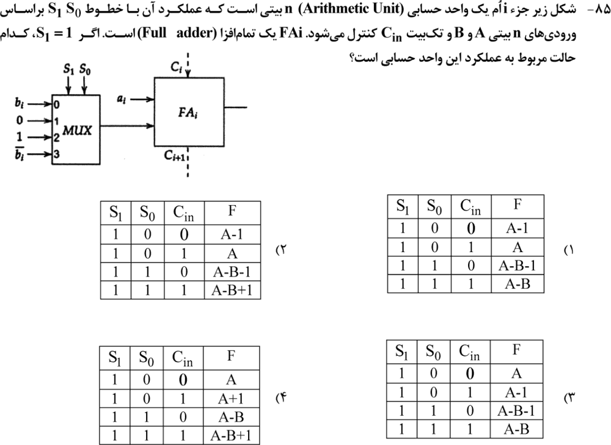

**۲. (ارشد ۱۴۰۳، سؤال ۸۴)**
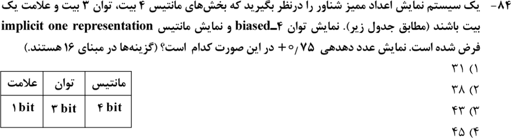

**۳. (ارشد ۱۴۰۳، سؤال ۸۹)**
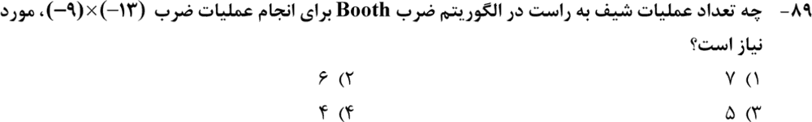

**۴. (ارشد ۱۴۰۲، سؤال ۸۹)**
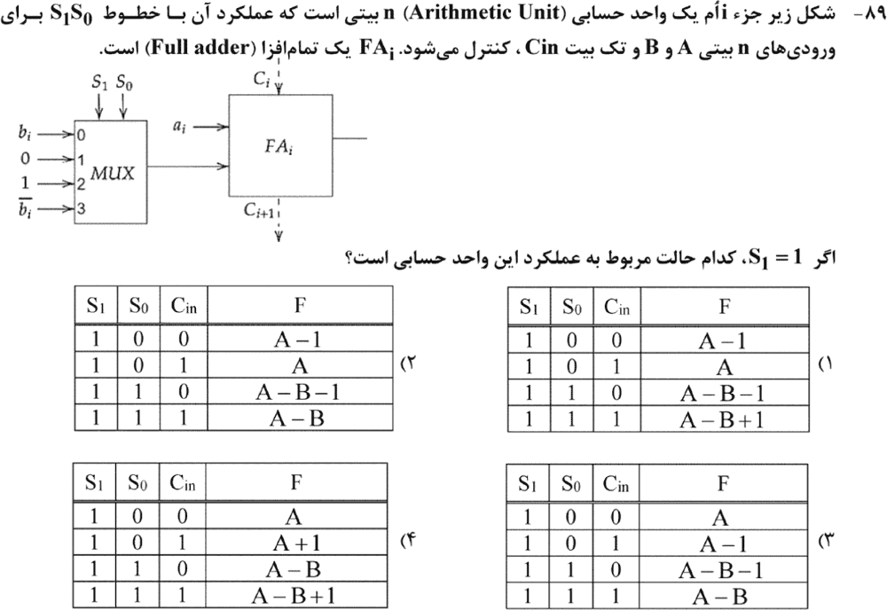

**۵. (ارشد ۱۴۰۱، سؤال ۸۹)**
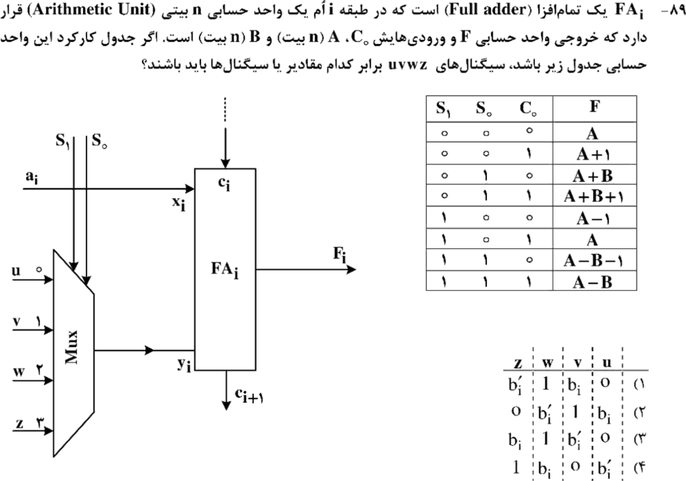

**۶. (ارشد ۱۴۰۱، سؤال ۹۰)**
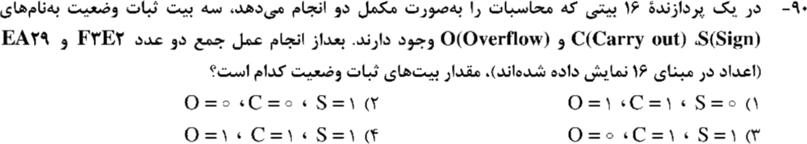

**۷. (ارشد ۱۴۰۱، سؤال ۹۴)**
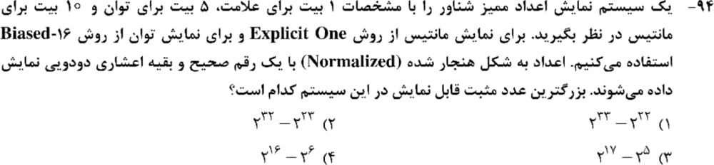

**۸. (ارشد ۱۴۰۰، سؤال ۸۸)**
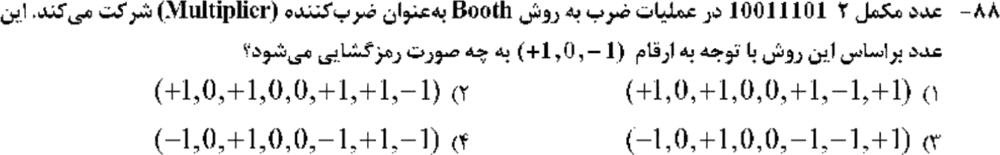

**۹. (ارشد ۱۴۰۰، سؤال ۹۱)**
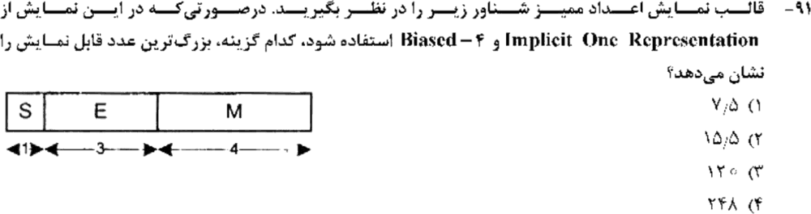

**۱۰. (ارشد ۱۴۰۰، سؤال ۹۳)**
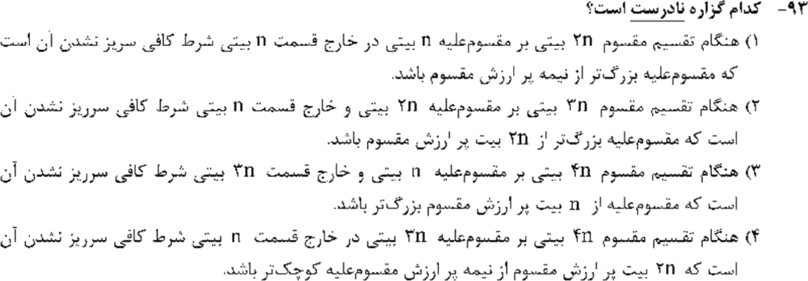

**۱۱. (ارشد ۱۳۹۹، سؤال ۷۴)**
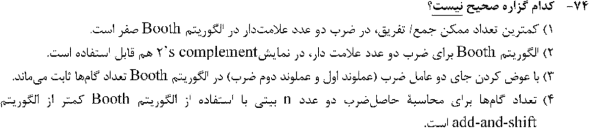

**۱۲. (ارشد ۱۳۹۹، سؤال ۷۹)**
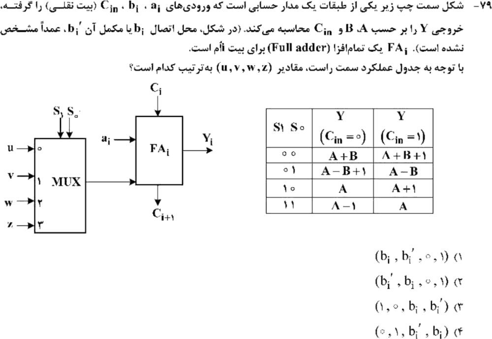

**۱۳. (ارشد ۱۳۹۹، سؤال ۸۱)**
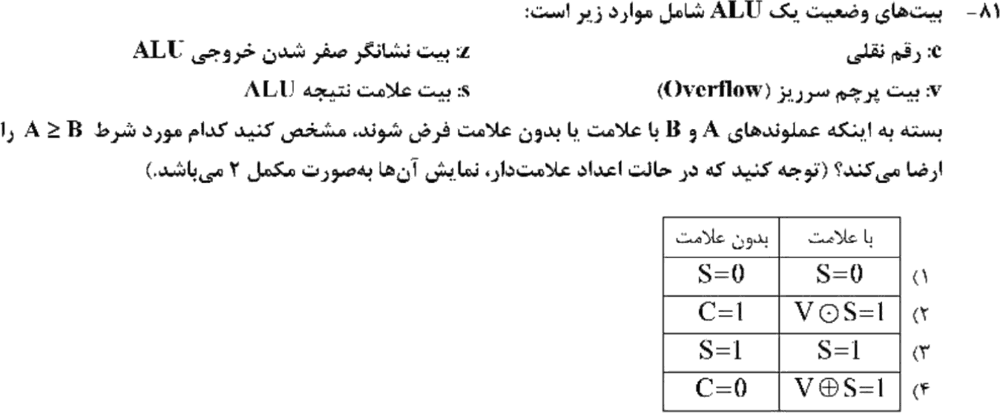

**۱۴. (ارشد ۱۳۹۹، سؤال ۸۲)**
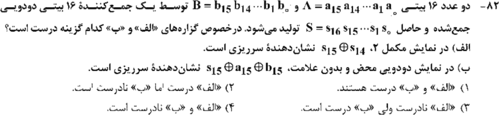

**۱۵. (ارشد ۱۳۹۸، سؤال ۷۰)**
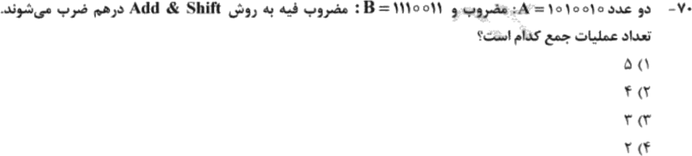

**۱۶. (ارشد ۱۳۹۸، سؤال ۷۳)**
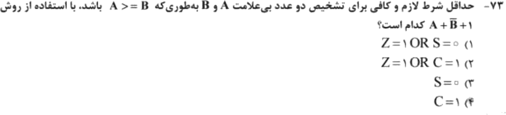

جواب‌ها و راه‌حل (کلید رسمی سازمان سنجش)

| سؤال | ۱ | ۲ | ۳ | ۴ | ۵ | ۶ | ۷ | ۸ | ۹ | ۱۰ | ۱۱ | ۱۲ | ۱۳ | ۱۴ | ۱۵ | ۱۶ |
|---|---|---|---|---|---|---|---|---|---|---|---|---|---|---|---|---|
| کلید | ۱ | ۲ | ۳ | ۲ | ۱ | ۳ | ۴ | ۴ | ۲ | ۴ | ۳ و ۴ | ۱ | ۲ | ۴ | ۱ | ۴ |

**۱. گزینهٔ ۱.** طبق جدول درس ۱: با `S₁S₀ = 10` (ورودی ثابت ۱ یعنی −۱): `A − 1` و `A`. با `11` (ورودی `b̄`): `A − B − 1` و `A − B`.

**۲. گزینهٔ ۲.** `0 011 1000` یعنی `38` در مبنای ۱۶ (درس ۴).

**۳. گزینهٔ ۳ (۵).** `−13` و `−9` هر کدام ۵ بیت (مکمل ۲) می‌خواهند. در بوث تعداد شیفت برابر تعداد بیت‌هاست.

**۴. گزینهٔ ۲.** همان مدار سؤال ۱ است. ترتیب گزینه‌ها در این دفترچه فرق دارد.

**۵. گزینهٔ ۱.** طبق جدول: سطر ۰۰ یعنی `A + Cin`، پس `u = 0`. سطر ۰۱ یعنی `A + B`، پس `v = bᵢ`. سطر ۱۰ یعنی `A − 1`، پس `w = 1`. سطر ۱۱ یعنی `A − B − 1`، پس `z = b̄ᵢ`.

**۶. گزینهٔ ۳.** `F3E2 + EA29 = 1DE0B`، پس `C = 1`، `S = 1` و `O = 0` (دو منفی، نتیجه منفی).

**۷. گزینهٔ ۴.** بیشینهٔ نما `31 − 16 = 15`. با یک صریح، مانتیس `1.111111111` است (۹ بیت کسری) که برابر `2 − 2⁻⁹` می‌شود. پس `(2 − 2⁻⁹)·2¹⁵ = 2¹⁶ − 2⁶`.

**۸. گزینهٔ ۴.** `(−1, 0, +1, 0, 0, −1, +1, −1)` (درس ۳).

**۹. گزینهٔ ۲.** `1.1111₂ × 2³ = 15.5`.

**۱۰. گزینهٔ ۴ (نادرست).** برای خارج‌قسمت n بیتی از تقسیم 4n بر 3n، شرط درست این است که مقسوم‌علیه از **3n بیت بالای** مقسوم بزرگ‌تر باشد، نه آنچه گزینه می‌گوید.

**۱۱. گزینه‌های ۳ و ۴ (هر دو پذیرفته شده).** گزارهٔ ۴ قطعاً غلط است: تعداد گام‌ها (شیفت‌ها) در بوث همان n است. گزارهٔ ۳ هم اگر «گام» را تعداد جمع و تفریق بدانیم غلط است، چون با جابه‌جایی عملوندها این تعداد عوض می‌شود.

**۱۲. گزینهٔ ۱.** `u = b` (جمع)، `v = b′` (تفریق)، `w = 0` (`A` و `A + 1`)، `z = 1` (`A − 1` و `A`). در جدول سؤال، سطر ۰۱ با `Cin = 0` به‌جای `A − B − 1` به شکل `A − B + 1` چاپ شده که ظاهراً غلط تایپی است.

**۱۳. گزینهٔ ۲.** بی‌علامت: `C = 1`. باعلامت: `V ⊙ S = 1` (درس ۲).

**۱۴. گزینهٔ ۴.** هر دو نادرست‌اند. سرریز مکمل ۲ برابر `c₁₆ ⊕ c₁₅ = s₁₆ ⊕ (s₁₅ ⊕ a₁₅ ⊕ b₁₅)` است، نه `s₁₅ ⊕ s₁₄`. سرریز بی‌علامت خود `s₁₆` (نقلی) است، نه `s₁₅ ⊕ a₁₅ ⊕ b₁₅` (که همان `c₁₅` است).

**۱۵. گزینهٔ ۱.** `1110011` پنج بیت ۱ دارد، پس ۵ جمع.

**۱۶. گزینهٔ ۴.** بی‌علامت با `A + B̄ + 1`: `A ≥ B` ⇔ `C = 1`.

---

## 🗂 کارت خلاصهٔ فصل ۱
- واحد حسابی: `A + Y + Cin`؛ `Y ∈ {B, B̄, 0, −1}`. `B̄ + 1 = −B`.
- `A ≥ B`: بی‌علامت `C = 1`؛ باعلامت `S = V`. سرریز مکمل ۲: `c_n ⊕ c_(n−1)`.
- بوث: رقم = `bᵢ₋₁ − bᵢ`؛ شیفت‌ها همیشه n. جمع و شیفت: تعداد جمع = تعداد ۱ ها.
- ممیز شناور: ضمنی یعنی `1.M`؛ صریح یعنی یک بیت کسری کمتر. بیشینه: `(2 − 2^−f)·2^(Emax − بایاس)`.
