# فصل ۲: مجموعهٔ دستورالعمل، آدرس‌دهی، انتقال ثبات و واحد کنترل

> **سهم در کنکور:** ۱۶ سؤال در ارشد ۱۳۹۸ تا ۱۴۰۴ (۶ دستورالعمل و آدرس‌دهی، ۱۰ انتقال ثبات و کنترل). تیپ‌ها: شمردن opcode با کدگذاری گسترش‌پذیر، اجرای چند دستور روی حافظه، و ردگیری مسیر داده.
> **زمان مطالعه:** دو بلوک ۹۰ دقیقه‌ای.

---

## درس ۱: قالب دستور و opcode گسترش‌پذیر

- طول دستور = opcode + فیلدهای آدرس. با k بیت opcode حداکثر `2ᵏ` دستور داریم.
- **روش «فضای کل»:** هر دستور با f بیت فیلد آدرس، `2^f` الگوی بیتی مصرف می‌کند. جمع مصرف همهٔ دستورها باید `≤ 2^(طول دستور)` باشد.

**مثال:** دستور ۱۴ بیتی با آدرس ۵ بیتی، ۱۴ دستور دوعملوندی و ۶۰ دستور تک‌عملوندی.
- دوعملوندی: opcode چهار بیتی (۱۶ ترکیب)؛ ۱۴ تا مصرف شده و ۲ ترکیب می‌ماند.
- هر ترکیب باقی‌مانده با ۵ بیت اضافه، ۳۲ تک‌عملوندی می‌دهد: `2 × 32 = 64`. ۶۰ تا مصرف شده و ۴ ترکیب می‌ماند.
- هر ترکیب باقی‌مانده با ۵ بیت دیگر، ۳۲ بدون‌عملوند می‌دهد: `4 × 32 = 128`.

**تعداد بیت‌های فیلد:** opcode برابر `⌈log₂ تعداد دستورها⌉`، ثبات برابر `log₂ تعداد ثبات‌ها`، و آدرس حافظه همهٔ بیت‌های باقی‌مانده.

**مثال:** دستور ۲۴ بیتی با قالب «opcode + ثبات + آدرس حافظه»، ۳۲ دستور و ۱۶ ثبات: opcode `⌈log₂ 32⌉ = 5` بیت، ثبات `log₂ 16 = 4` بیت، و آدرس `24 − 5 − 4 = 15` بیت ⇐ `2¹⁵ = 32768` خانهٔ حافظه قابل آدرس‌دهی است.

---

## درس ۲: معماری‌ها و شیوه‌های آدرس‌دهی

| معماری | نمونه |
|---|---|
| پشته‌ای (صفرآدرسه) | `PUSH A`، `PUSH B`، `ADD`، `POP C` |
| انباشتگر (تک‌آدرسه) | `LOAD A`، `ADD B`، `STORE C` |
| ثبات-حافظه | `ADD R1, A` |
| بارگذاری و ذخیره (RISC) | فقط `LD` و `ST` با حافظه کار می‌کنند |

**مثال (`D = (A + B) × C` در هر معماری):**
- **پشته‌ای:** `PUSH A`، `PUSH B`، `ADD`، `PUSH C`، `MUL`، `POP D` (۶ دستور، بدون آدرس در ADD و MUL).
- **انباشتگر:** `LOAD A`، `ADD B`، `MUL C`، `STORE D` (۴ دستور).
- **ثبات-حافظه:** `LOAD R1, A`، `ADD R1, B`، `MUL R1, C`، `STORE R1, D`.
- **RISC:** `LD R1, A`، `LD R2, B`، `LD R3, C`، `ADD R4, R1, R2`، `MUL R4, R4, R3`، `ST R4, D` (۶ دستور، ولی همه ساده و هم‌طول).

| آدرس‌دهی | عملوند |
|---|---|
| بی‌واسطه | خود عدد |
| مستقیم | `M[addr]` |
| غیرمستقیم | `M[M[addr]]` |
| ثبات غیرمستقیم `[R]` | `M[R]` |
| ایندکس یا جابه‌جایی `d[R]` | `M[R + d]` |

**مثال برای هر سطر جدول:** `M[100] = 200`، `M[200] = 300`، `R1 = 100`، و فیلد آدرس دستور ۱۰۰ است.
- بی‌واسطه: عملوند **۱۰۰**.
- مستقیم: `M[100] = 200`.
- غیرمستقیم: `M[M[100]] = M[200] = 300`.
- ثبات غیرمستقیم `[R1]`: `M[100] = 200`.
- ایندکس `100[R1]`: `M[100 + 100] = M[200] = 300`.

**اجرای برنامه:** هر خط را جداگانه اجرا کن و جدولی از ثبات‌ها نگه دار. جهت (مقصد چپ یا راست) را از صورت سؤال بخوان.

---

## درس ۳: انتقال ثبات (RTL) و مسیر داده

- `P: R2 ← R1` یعنی وقتی سیگنال P فعال است، در لبهٔ کلاک R1 در R2 نوشته می‌شود. **سیگنال کنترلی که به Load وصل است همان شرط RTL است.**
- **گذرگاه مشترک با بافر سه‌حالته:** یک دیکدر روی Enable ها (منبع) و یک دیکدر روی Load ها (مقصد).
- **بانک ثبات با دو درگاه خواندن و یک درگاه نوشتن:** هر درگاه خواندن یک دیکدر و (برای k ثبات n بیتی) `k·n` بافر سه‌حالته می‌خواهد. درگاه نوشتن هم یک دیکدر برای Load ها.
- **ردگیری چند سیکل:** در هر سیکل، همهٔ ورودی‌ها را با مقادیر **فعلی** حساب کن و بعد ثبات‌هایی را که Load دارند هم‌زمان به‌روز کن.
- **حداقل سیکل:** کارهای مستقل که منبع مشترک ندارند (ALU، گذرگاه، درگاه نوشتن) می‌توانند هم‌زمان انجام شوند.

**مثال برای هر مورد:**
- **شرط RTL:** در `T1: R2 ← R1`، سیم T1 به Load ثبات R2 وصل است. اگر در لبهٔ کلاک `T1 = 1` باشد، R2 مقدار R1 را می‌گیرد؛ وگرنه عوض نمی‌شود.
- **گذرگاه:** با ۴ ثبات، برای `R1 ← R3` دیکدر منبع کد `11` می‌گیرد (Enable بافر R3) و دیکدر مقصد کد `01` (Load ثبات R1).
- **بانک ثبات:** ۸ ثبات ۱۶ بیتی با دو درگاه خواندن ⇐ هر درگاه یک دیکدر ۳ به ۸ و `8 × 16 = 128` بافر، یعنی ۲۵۶ بافر برای دو درگاه. درگاه نوشتن یک دیکدر ۳ به ۸ روی Load ها دارد.
- **هم‌زمانی:** با `R1 = 5` و `R2 = 3`، در یک سیکل `R1 ← R2, R2 ← R1` ⇐ `R1 = 3` و `R2 = 5`. هر دو مقدار قدیمی را خواندند، پس جابه‌جایی بدون ثبات کمکی انجام شد.
- **موازی:** `R1 ← R1 + R2` (از ALU) و `PC ← PC + 1` (با شمارندهٔ خود PC) منبع مشترکی ندارند و در یک سیکل انجام می‌شوند.

---

## درس ۴: واحد کنترل

- **سخت‌افزاری:** سریع؛ با شمارندهٔ زمانی و دیکدر.
- **ریزبرنامه‌ای:** حافظهٔ کنترل. ریزدستور مانو چهار فیلد دارد: عملیات، شرط (`U` بی‌شرط، `I`، `S`، `Z`)، پرش (`JMP`، `CALL`، `RET`، `MAP`)، و آدرس.
  - **زیرروال INDRCT (آدرس غیرمستقیم) در مانو:**
    ```
    INDRCT: READ   U  JMP  NEXT
            DRTAR  U  RET
    ```
- **چرخهٔ واکشی:** `MAR ← PC`؛ `MDR ← M[MAR]` و `PC ← PC + 1`؛ `IR ← MDR`. یعنی ۳ سیکل در مسیر دادهٔ ساده.

**مثال برای هر مورد:**
- **INDRCT:** با `AR = 50` و `M[50] = 300`: ریزدستور اول (`READ`) کار `DR ← M[AR] = 300` را انجام می‌دهد و به خط بعد می‌رود؛ دومی (`DRTAR`) کار `AR ← DR = 300` را انجام می‌دهد و برمی‌گردد. حالا AR آدرس مؤثر را دارد.
- **واکشی:** با `PC = 100` و دستور X در `M[100]`: سیکل ۱ ⇐ `MAR = 100`؛ سیکل ۲ ⇐ `MDR = X` و `PC = 101`؛ سیکل ۳ ⇐ `IR = X`.

### تمرین فصل ۲
1. دستور ۱۶ بیتی، ۸ ثبات، دستورهای سه‌ثباتی. حداکثر چند دستور سه‌ثباتی داریم؟
2. RTL زیر چه دستوری است؟ `MAR ← X; DR ← M[MAR]; A ← A + DR`

<details>
<summary>جواب‌ها</summary>

1. `16 − 9 = 7` بیت opcode، پس ۱۲۸.
2. `ADD X`
</details>

---

## 📝 آزمون فصل ۲ (سؤال‌های واقعی کنکور ارشد کامپیوتر)
**زمان: ۴۰ دقیقه برای ۱۶ سؤال.**

**۱. (ارشد ۱۴۰۴، سؤال ۸۳)**
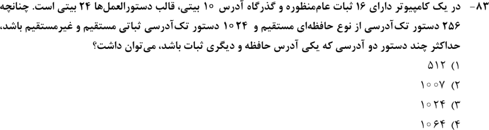

**۲. (ارشد ۱۴۰۴، سؤال ۸۹)**
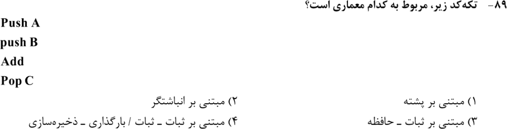

**۳. (ارشد ۱۴۰۲، سؤال ۸۶)**
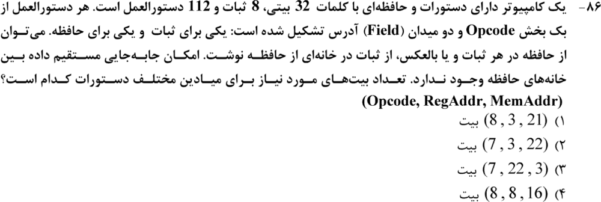

**۴. (ارشد ۱۳۹۹، سؤال ۷۷)**
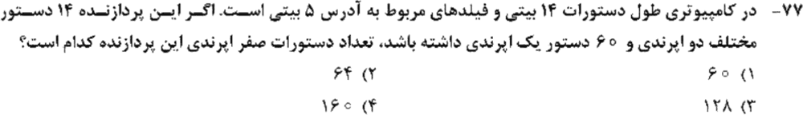

**۵. (ارشد ۱۳۹۹، سؤال ۸۰)**
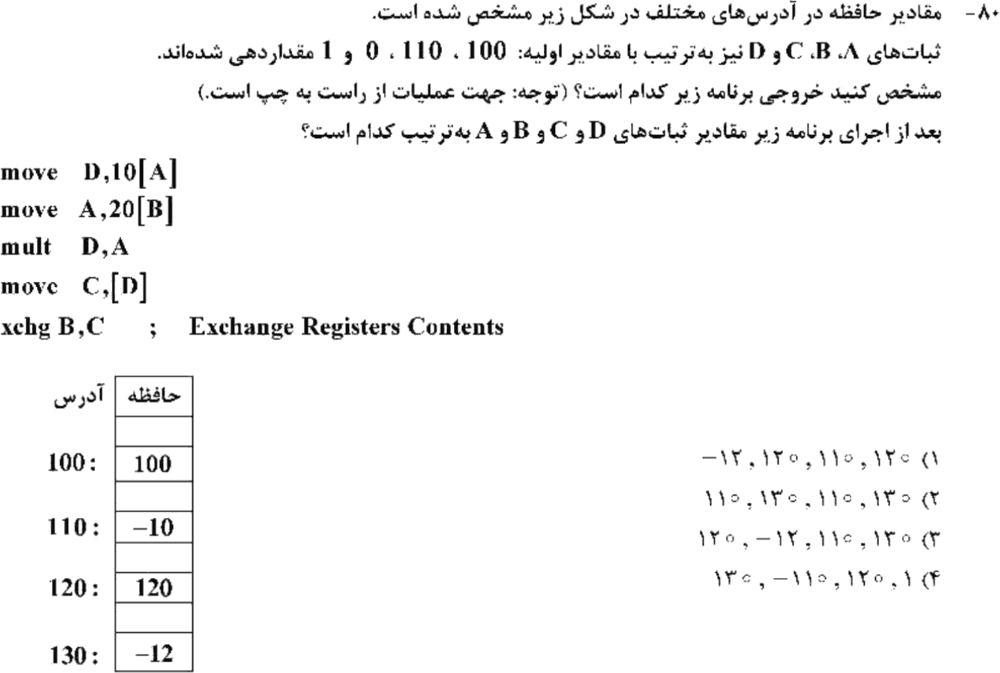

**۶. (ارشد ۱۳۹۹، سؤال ۸۴)**
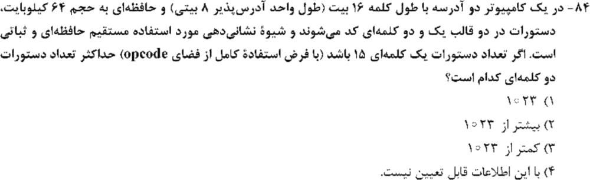

**۷. (ارشد ۱۴۰۴، سؤال ۸۷)**
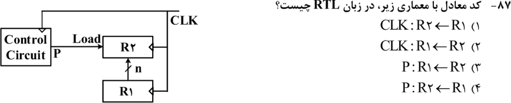

**۸. (ارشد ۱۴۰۳، سؤال ۸۷)**
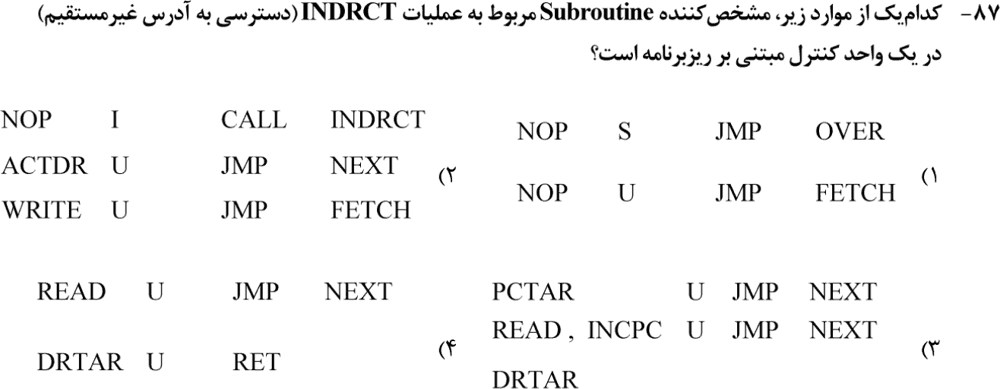

**۹. (ارشد ۱۴۰۲، سؤال ۷۹)**
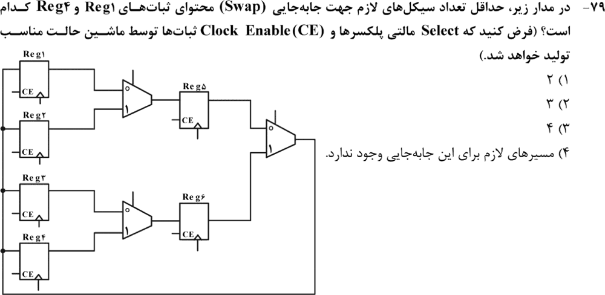

**۱۰. (ارشد ۱۴۰۲، سؤال ۸۱)**
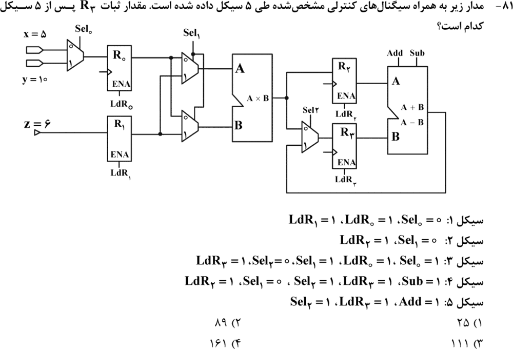

**۱۱. (ارشد ۱۴۰۲، سؤال ۸۵)**
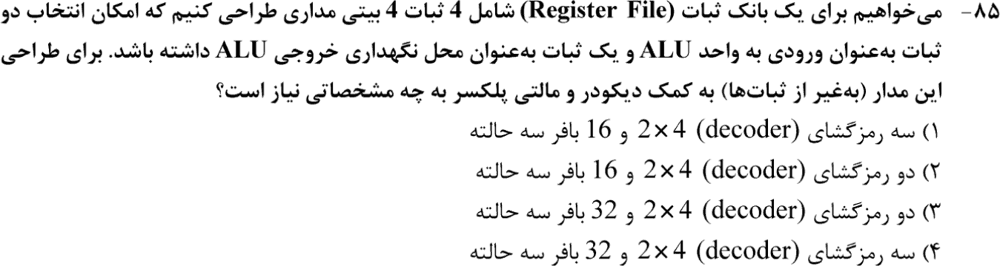

**۱۲. (ارشد ۱۴۰۲، سؤال ۸۸)**
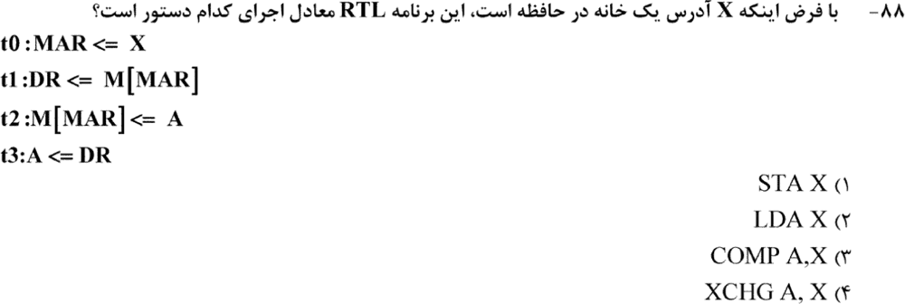

**۱۳. (ارشد ۱۴۰۱، سؤال ۸۸)**
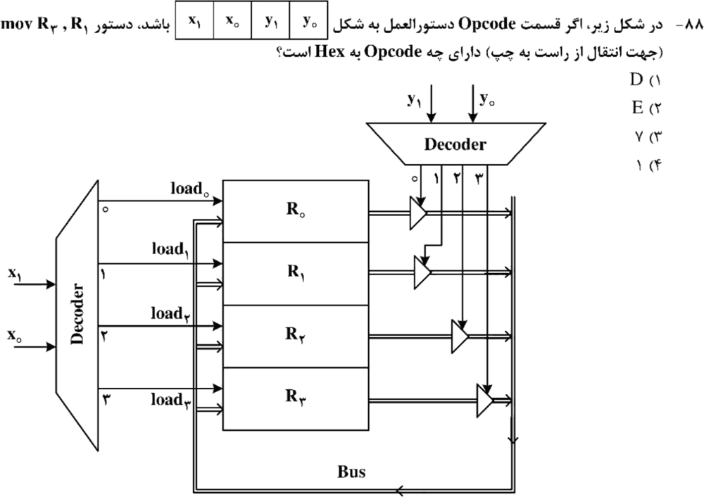

**۱۴. (ارشد ۱۴۰۰، سؤال ۹۰)**
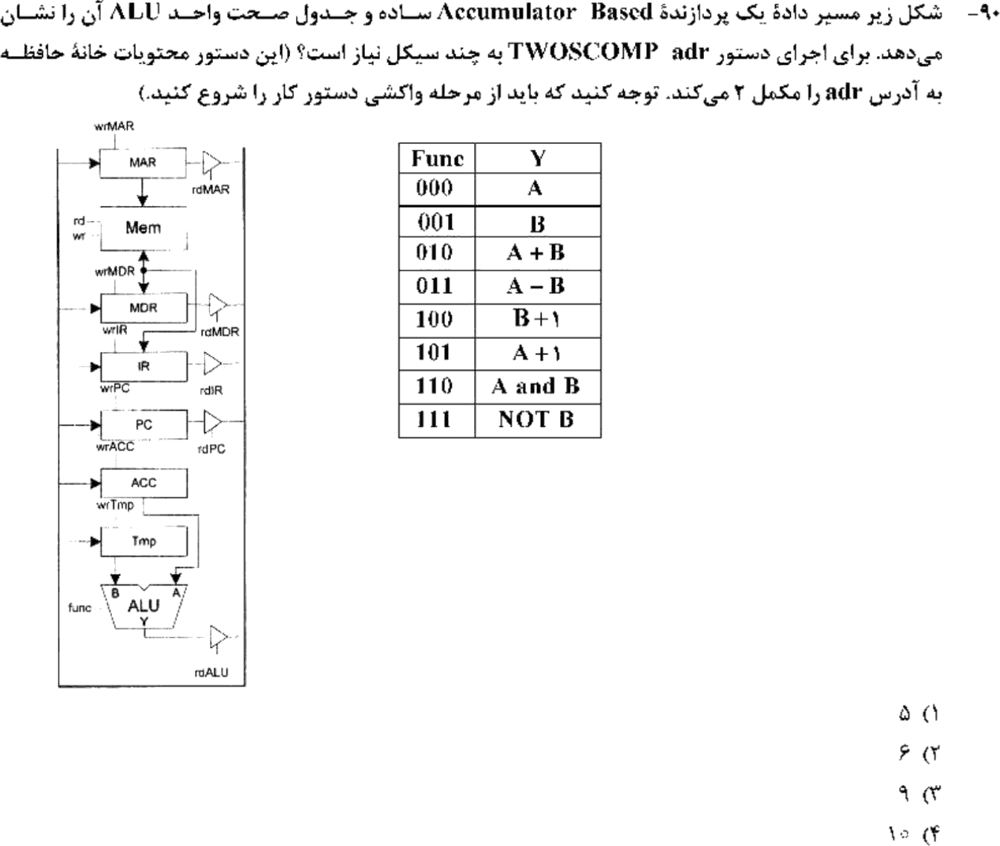

**۱۵. (ارشد ۱۳۹۹، سؤال ۷۵)**
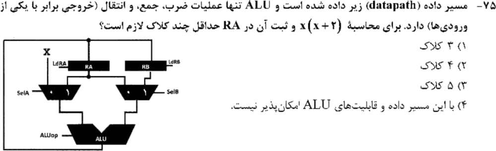

**۱۶. (ارشد ۱۳۹۸، سؤال ۷۲)**
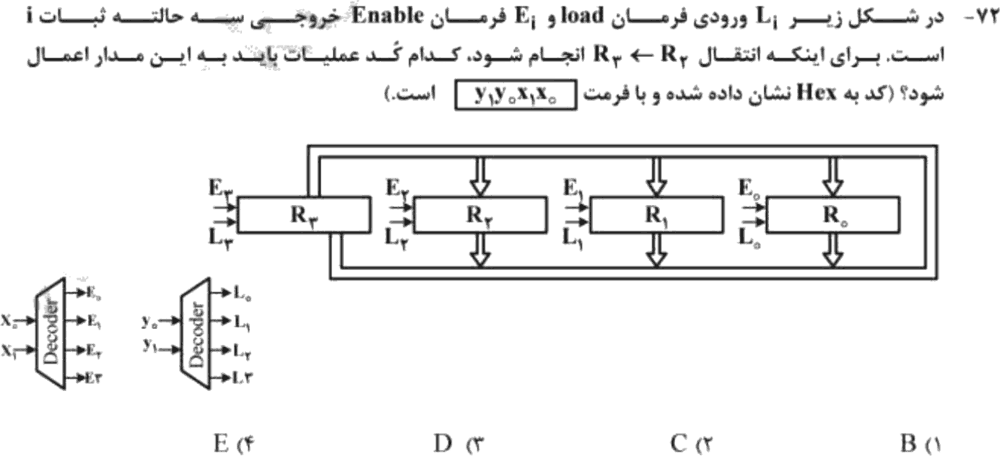

<details>
<summary>جواب‌ها و راه‌حل (کلید رسمی سازمان سنجش)</summary>

| سؤال | ۱ | ۲ | ۳ | ۴ | ۵ | ۶ | ۷ | ۸ | ۹ | ۱۰ | ۱۱ | ۱۲ | ۱۳ | ۱۴ | ۱۵ | ۱۶ |
|---|---|---|---|---|---|---|---|---|---|---|---|---|---|---|---|---|
| کلید | ۲ | ۱ | ۲ | ۳ | ۱ | ۲ | ۴ | ۴ | ۲ | ۴ | ۴ | ۴ | ۱ | ۳ | ۲ | ۴ |

**۱. گزینهٔ ۲ (۱۰۰۷).** دستور ۲۴ بیتی. دوآدرسه (حافظه ۱۰ بیت + ثبات ۴ بیت) `2¹⁴` الگو مصرف می‌کند. تک‌آدرسهٔ حافظه‌ای `2¹⁰` و تک‌آدرسهٔ ثباتی `2⁴`. از `N·2¹⁴ + 256·2¹⁰ + 1024·2⁴ ≤ 2²⁴` نتیجه می‌شود `N ≤ 1024 − 16 − 1 = 1007`.

**۲. گزینهٔ ۱.** PUSH و POP و ADD بدون عملوند یعنی پشته‌ای.

**۳. گزینهٔ ۲.** ۱۱۲ دستور یعنی ۷ بیت، ۸ ثبات یعنی ۳ بیت، و `32 − 10 = 22` بیت آدرس حافظه.

**۴. گزینهٔ ۳ (۱۲۸).** مثال درس ۱.

**۵. گزینهٔ ۱.**
- `D ← M[10 + 100] = −10`
- `A ← M[20 + 110] = −12`
- `D ← D × A = 120`
- `C ← M[120] = 120`
- با `xchg`: `B = 120` و `C = 110`

نتیجه به ترتیب D، C، B، A: `120، 110، 120، −12`.

**۶. گزینهٔ ۲ (بیشتر از ۱۰۲۳).** آدرس ۱۶ بیتی کل کلمهٔ دوم را پر می‌کند، پس کلمهٔ اول دستورهای دوکلمه‌ای فقط opcode و فیلد ثبات دارد. ۱۵ دستور یک‌کلمه‌ای فقط بخش کوچکی از فضای opcode را مصرف می‌کنند. سؤال تعداد ثبات‌ها را نگفته، ولی با فیلدهای ثبات معمول، فضای باقی‌مانده بیش از ۱۰۲۳ دستور دوکلمه‌ای جا دارد. این استدلال کلید رسمی است؛ سؤال کمی ناقص است.

**۷. گزینهٔ ۴.** سیگنال P به Load ثبات R2 وصل است: `P: R2 ← R1`.

**۸. گزینهٔ ۴.** زیرروال INDRCT مانو (درس ۴).

**۹. گزینهٔ ۲ (۳).**
- سیکل ۱: `Reg5 ← Reg1` و `Reg6 ← Reg4` (موازی).
- سیکل ۲: انتخاب Reg5 و نوشتن در Reg4.
- سیکل ۳: انتخاب Reg6 و نوشتن در Reg1.

**۱۰. گزینهٔ ۴ (۱۶۱).** مقدار R0 و R1 بعد از سیکل ۱ برابر ۵ و ۶ است.
- با `Sel₁ = 0` ضرب‌کننده `R0 × R0` و با `Sel₁ = 1` ضرب‌کننده `R1 × R1` را می‌دهد.
- سیکل ۲: `R2 = 25`.
- سیکل ۳: `R3 = 36` و `R0 ← 10`.
- خط بازخورد از خروجی **`A + B`** ی ALU به MUX می‌رود. پس سیگنال Sub روی R3 اثری ندارد.
- سیکل ۴: `R3 = 25 + 36 = 61` و `R2 = 100`.
- سیکل ۵: `R3 = 100 + 61 = 161`.

(اگر بازخورد از `A − B` بود، جواب در گزینه‌ها نبود.)

**۱۱. گزینهٔ ۴.** دو درگاه خواندن: ۲ دیکدر و `2 × 4 × 4 = 32` بافر سه‌حالته. یک درگاه نوشتن: یک دیکدر دیگر. جمع ۳ دیکدر.

**۱۲. گزینهٔ ۴.** حافظه در DR خوانده می‌شود، A در حافظه نوشته می‌شود، و DR در A. این تبادل یعنی `XCHG A, X`.

**۱۳. گزینهٔ ۱.** با انتقال از راست به چپ، R1 به R3 می‌رود. مقصد R3 با `x = 11` و منبع R1 با `y = 01`. پس `1101 = D`.

**۱۴. گزینهٔ ۳ (۹).**
- واکشی: ۳ سیکل.
- `MAR ← IR(adr)`، `MDR ← M`، `Tmp ← MDR`.
- `ACC ← NOT B`، `ACC ← ACC + 1` (`A + 1`).
- `MDR ← ACC` و نوشتن در حافظه.

**۱۵. گزینهٔ ۲ (۴).**
- `RA ← X`
- `RB ← X + RA = 2x`
- `RA ← RA × X = x²`
- `RA ← RA + RB`

با مسیر داده‌ای که ورودی X فقط از یک MUX می‌رسد، ۳ کلاک کافی نیست.

**۱۶. گزینهٔ ۴.** مقصد `L₃` یعنی `y = 11` و منبع `E₂` یعنی `x = 10`. پس `y₁y₀x₁x₀ = 1110 = E`.
</details>

---

## 🗂 کارت خلاصهٔ فصل ۲
- opcode گسترش‌پذیر: `Σ تعداد × 2^(فیلد) ≤ 2^(طول)`. ترکیب‌های باقی‌مانده × `2^(بیت آزادشده)`.
- پشته‌ای = PUSH، POP و عملیات بدون عملوند. `d[R] = M[R + d]`.
- RTL: سیگنال Load همان شرط است. بانک ثبات: هر درگاه خواندن یک دیکدر و `k·n` بافر.
- INDRCT مانو: `READ U JMP NEXT` و `DRTAR U RET`. واکشی ۳ سیکل.
