# فصل ۳: کارایی و قانون آمدال، خط لوله، و حافظهٔ نهان

> **سهم در کنکور:** ۱۹ سؤال در ارشد ۱۳۹۸ تا ۱۴۰۴ (۶ کارایی، ۵ خط لوله، ۸ حافظهٔ نهان). همه محاسبه‌ای‌اند و با چند فرمول ثابت حل می‌شوند.
> **زمان مطالعه:** دو بلوک ۹۰ دقیقه‌ای.

---

## درس ۱: کارایی و قانون آمدال

- **زمان اجرا** = `تعداد دستور × CPI / فرکانس`. کارایی = `1/زمان`.
- **CPI میانگین** = `Σ (درصد کلاس × CPI کلاس)`.
- **آمدال:** اگر کسر f از زمان s برابر سریع‌تر شود: `تسریع = 1 / ((1 − f) + f/s)`.
- **چند بخش با هم:** `تسریع = 1 / (بخش ثابت + Σ fᵢ/sᵢ)`.
- **«۲۰٪ بهبود کارایی»** یعنی زمان جدید = زمان قدیم / ۱٫۲.
- اگر بخشی **کندتر** شود (s < 1)، کسرش در فرمول بزرگ‌تر می‌شود.

**مثال:** ۴۰٪ زمان روی RAM (۲ برابر سریع‌تر) و ۳۰٪ روی دیسک (۳ برابر سریع‌تر):
`1/(0.3 + 0.2 + 0.1) = 1.67`

---

## درس ۲: خط لوله

- **k طبقه، n ورودی:** زمان `(k + n − 1)·τ` که τ برابر کندترین طبقه (+ تأخیر ثبات) است.
- **بدون خط لوله:** `n × مجموع تأخیرها`.
- **تسریع بیشینه** (n به بی‌نهایت) = `(مجموع تأخیرها) / τ`. با تأخیر ثبات δ: `Σ / (max + δ)`.
- **مدار با چند مسیر موازی:** تأخیر بدون خط لوله = **طولانی‌ترین مسیر**. τ = کندترین ماژول.

### مخاطرهٔ داده در خط لولهٔ ۵ مرحله‌ای (IF ID EX DM WB) بدون forwarding
- دستور وابسته باید ID خود را **بعد از** WB دستور تولیدکننده انجام دهد.
- **با فرض «نوشتن در نیمهٔ اول، خواندن در نیمهٔ دوم»:** ID می‌تواند **در همان** سیکل WB باشد. فاصلهٔ ۱ (دستور بلافاصله بعد) یعنی **۲ توقف**.
- **بدون این فرض:** فاصلهٔ ۱ یعنی **۳ توقف**.
- کل سیکل = `5 + (n − 1) + توقف‌ها`.

⚠️ کنکور ۱۴۰۴ (سؤال ۸۴) فرض اول و کنکور ۱۴۰۱ (سؤال ۹۳) فرض دوم را گرفته. در تست، اگر عدد بدون فرض در گزینه‌ها نبود، فرض دیگر را امتحان کن.

---

## درس ۳: حافظهٔ نهان

### تقسیم آدرس
`آدرس = Tag | Index | Offset`
- `Offset = log₂(اندازهٔ بلوک)` (به واحد آدرس‌پذیر: بایت یا کلمه).
- `Index = log₂(تعداد مجموعه‌ها)`. تعداد مجموعه‌ها = تعداد بلوک‌های نهان / تعداد راه‌ها.
  - نگاشت مستقیم: مجموعه = بلوک.
  - انجمنی کامل: Index صفر است.
- `Tag = طول آدرس − Index − Offset`.
- **سربار:** `(Tag + بیت اعتبار [+ dirty]) × تعداد بلوک‌ها`.

**مثال:** نهان ۱ مگابایت، حافظه ۵۱۲ مگابایت، بلوک ۳۲ بایت، نگاشت مستقیم:
- آدرس ۲۹ بیت، Offset ۵.
- بلوک‌ها `2²⁰/2⁵ = 2¹⁵`، پس Index ۱۵.
- Tag `29 − 15 − 5 = 9`.

### شبیه‌سازی نرخ اصابت
1. بلوک = `⌊آدرس / اندازهٔ بلوک⌋`.
2. مجموعه = `بلوک mod تعداد مجموعه‌ها`.
3. در هر مجموعه، فهرست LRU نگه دار.

### زمان دسترسی
`AMAT = زمان اصابت + نرخ عدم اصابت × جریمه`. در مسائل «چند کلاک برای این دنباله»، برای هر دسترسی هزینهٔ اصابت یا عدم اصابت را جمع بزن. سیاست جایگزینی (LRU، MRU، FIFO) را دقیق اجرا کن.

### تمرین فصل ۳
1. خط لولهٔ ۴ طبقه با تأخیرهای `2, 3, 2, 3` و تأخیر ثبات ۱. تسریع بیشینه؟
2. نهان ۴-راهه، ۶۴ کیلوبایت، بلوک ۶۴ بایت، آدرس ۳۲ بیتی. Tag و Index؟
3. ۵۰٪ زمان ۱۰ برابر سریع‌تر شود. تسریع؟

جواب‌ها

1. `10/(3 + 1) = 2.5`
2. بلوک‌ها `2¹⁰`، مجموعه‌ها `2⁸`. پس Index ۸، Offset ۶، Tag ۱۸.
3. `1/(0.5 + 0.05) ≈ 1.82`

---

## 📝 آزمون فصل ۳ (سؤال‌های واقعی کنکور ارشد کامپیوتر)
**زمان: ۴۵ دقیقه برای ۱۹ سؤال.**

**۱. (ارشد ۱۴۰۴، سؤال ۸۶)**
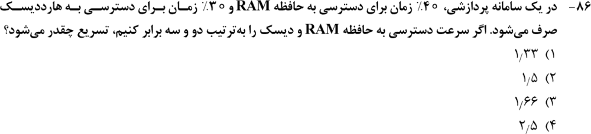

**۲. (ارشد ۱۴۰۳، سؤال ۸۵)**
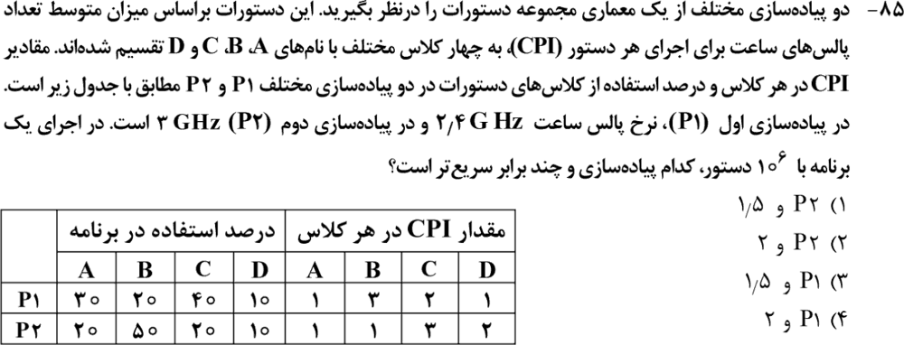

**۳. (ارشد ۱۴۰۳، سؤال ۸۶)**
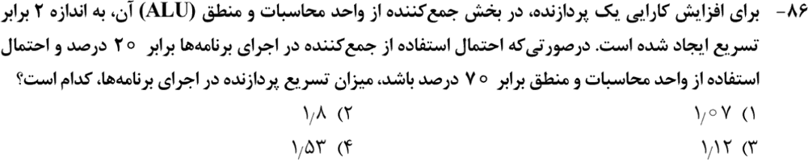

**۴. (ارشد ۱۴۰۲، سؤال ۸۴)**
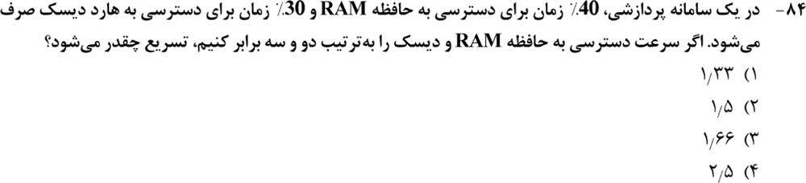

**۵. (ارشد ۱۴۰۱، سؤال ۹۱)**
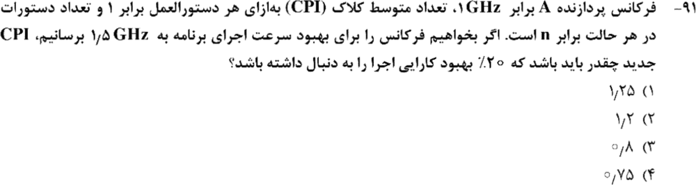

**۶. (ارشد ۱۳۹۸، سؤال ۷۱)**
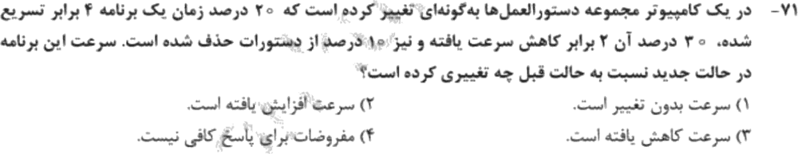

**۷. (ارشد ۱۴۰۴، سؤال ۸۴)**
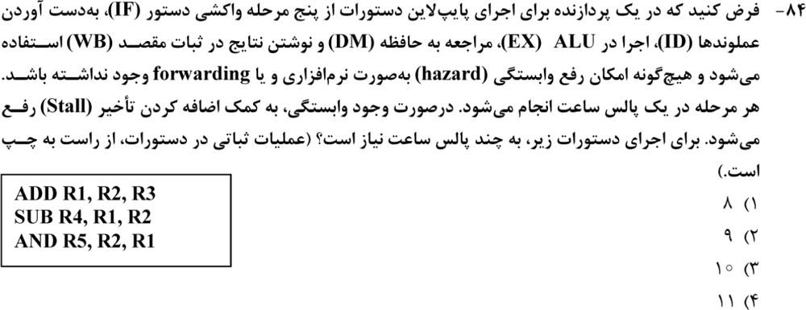

**۸. (ارشد ۱۴۰۱، سؤال ۹۳)**
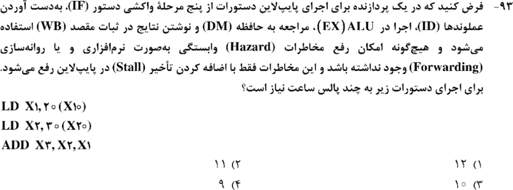

**۹. (ارشد ۱۴۰۰، سؤال ۹۲)**
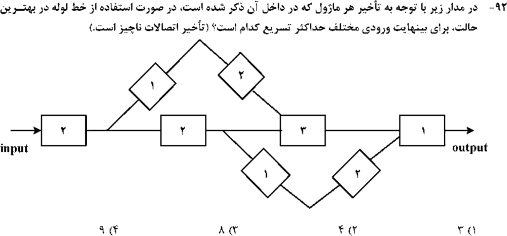

**۱۰. (ارشد ۱۴۰۰، سؤال ۹۴)**
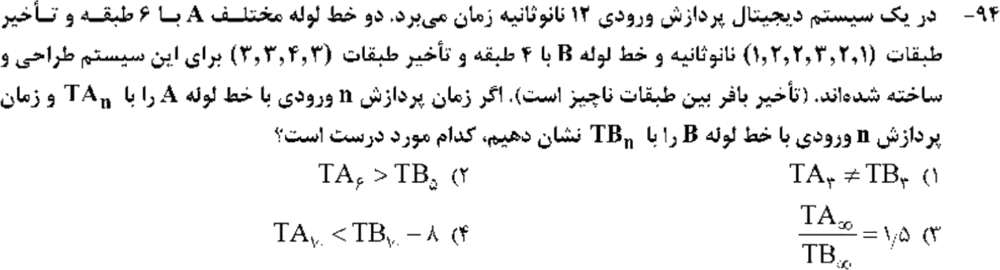

**۱۱. (ارشد ۱۳۹۹، سؤال ۷۸)**
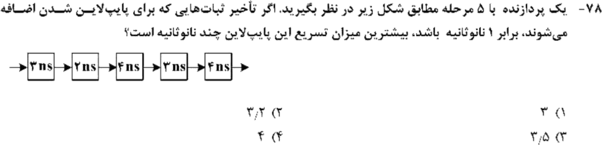

**۱۲. (ارشد ۱۴۰۴، سؤال ۸۸)**
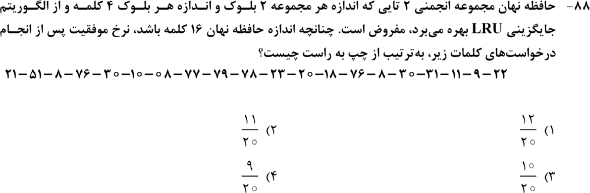

**۱۳. (ارشد ۱۴۰۳، سؤال ۸۳)**
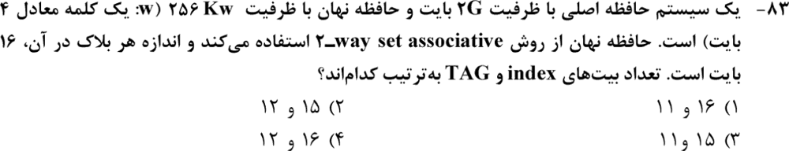

**۱۴. (ارشد ۱۴۰۳، سؤال ۸۸)**
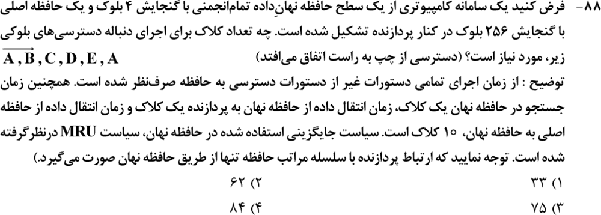

**۱۵. (ارشد ۱۴۰۲، سؤال ۸۷)**
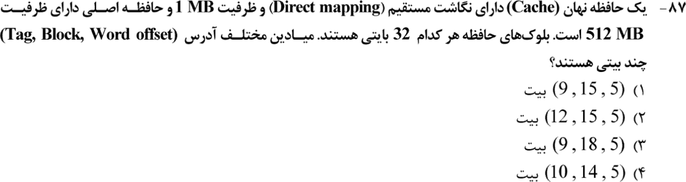

**۱۶. (ارشد ۱۴۰۱، سؤال ۹۲)**
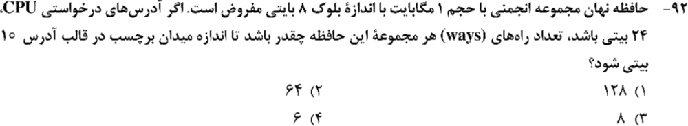

**۱۷. (ارشد ۱۴۰۰، سؤال ۸۹)**
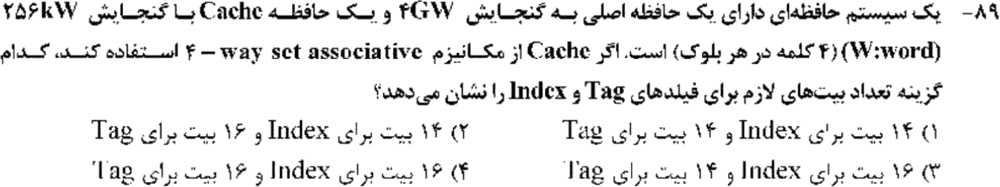

**۱۸. (ارشد ۱۳۹۹، سؤال ۷۶)**
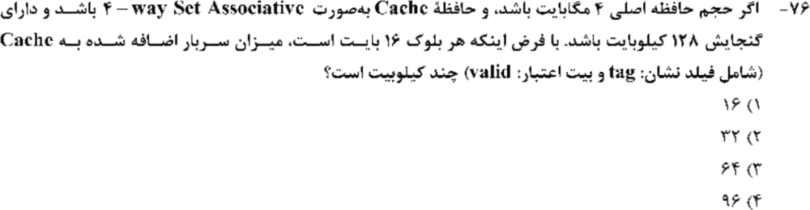

**۱۹. (ارشد ۱۳۹۹، سؤال ۸۳)**
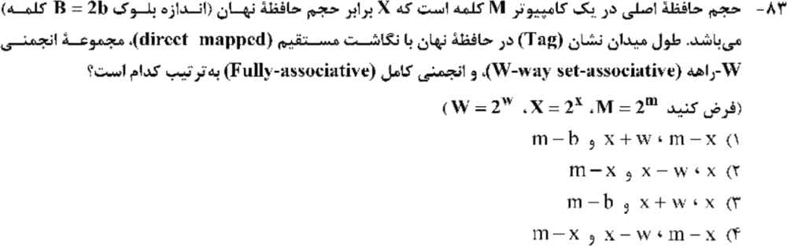

جواب‌ها و راه‌حل (کلید رسمی سازمان سنجش)

| سؤال | ۱ | ۲ | ۳ | ۴ | ۵ | ۶ | ۷ | ۸ | ۹ | ۱۰ | ۱۱ | ۱۲ | ۱۳ | ۱۴ | ۱۵ | ۱۶ | ۱۷ | ۱۸ | ۱۹ |
|---|---|---|---|---|---|---|---|---|---|---|---|---|---|---|---|---|---|---|---|
| کلید | ۳ | ۱ | ۳ | ۳ | ۱ | ۳ | ۲ | ۳ | ۱ و ۲ | ۲ | ۲ | ۲ | ۲ | ۲ | ۱ | ۲ | ۲ | ۳ | ۳ |

**۱. گزینهٔ ۳.** `1/(0.3 + 0.4/2 + 0.3/3) = 1/0.6 ≈ 1.66`.

**۲. گزینهٔ ۱.**
- `CPI₁ = 0.3 + 0.6 + 0.8 + 0.1 = 1.8` و `CPI₂ = 0.2 + 0.5 + 0.6 + 0.2 = 1.5`.
- زمان‌ها `1.8/2.4 = 0.75` و `1.5/3 = 0.5`.
- پس P2 به اندازهٔ **۱٫۵ برابر** سریع‌تر است.

**۳. گزینهٔ ۳.** `1/(0.8 + 0.2/2) ≈ 1.11`؛ نزدیک‌ترین گزینه ۱٫۱۲ است. (۷۰٪ ALU اطلاعات اضافه است؛ فقط بخش جمع‌کننده تسریع شده.)

**۴. گزینهٔ ۳.** همان سؤال ۱ است: ۱٫۶۶.

**۵. گزینهٔ ۱.** زمان جدید باید `n/1.2` (بر حسب نانوثانیه) شود: `n·CPI/1.5 = n/1.2`، پس `CPI = 1.25`.

**۶. گزینهٔ ۳.** `0.2/4 + 0.3 × 2 + 0.5 = 1.15`. حتی اگر ۱۰٪ دستورهای حذف‌شده ۱۰٪ زمان را کم کنند، باز هم `> 1` است. پس سرعت **کاهش** یافته.

**۷. گزینهٔ ۲ (۹).** یک وابستگی RAW بین دو دستور پشت‌سرهم داریم. با فرض نوشتن در نیمهٔ اول سیکل، ۲ توقف: `7 + 2 = 9`.

**۸. گزینهٔ ۳ (۱۰).** ADD به X2 از دستور قبلی وابسته است. کلید این سؤال ID را **بعد از** WB حساب کرده، یعنی ۳ توقف: `7 + 3 = 10`. (این فرض با سؤال ۷ فرق دارد؛ نکتهٔ درس ۲ را ببین.)

**۹. گزینه‌های ۱ و ۲ (هر دو پذیرفته شده).** طولانی‌ترین مسیر `2 + (1 + 2) + 3 + 1 = 9` است. کندترین ماژول ۳ است. تسریع `9/3 = 3`.

**۱۰. گزینهٔ ۲.** τ_A = ۳ و τ_B = ۴.
- `TA₆ = (6 + 6 − 1)·3 = 33`
- `TB₅ = (4 + 5 − 1)·4 = 32`

پس `TA₆ > TB₅`. بقیهٔ گزینه‌ها غلط‌اند:
- `TA₃ = 8·3 = 24 = 6·4 = TB₃` (برابرند).
- `TA∞/TB∞ = 3/4`.
- `TA₁₀ = 45` و `TB₁₀ − 8 = 52 − 8 = 44`، پس `TA₁₀ < TB₁₀ − 8` برقرار نیست.

**۱۱. گزینهٔ ۲.** `16/(4 + 1) = 3.2`.

**۱۲. گزینهٔ ۲ (`11/20`).** نهان ۴ بلوکی و ۲-راهه یعنی ۲ مجموعه. با شبیه‌سازی LRU (بلوک = `⌊آدرس/4⌋` و مجموعه = بلوک mod 2) ۱۱ اصابت به دست می‌آید (شبیه‌سازی رایانه‌ای).

**۱۳. گزینهٔ ۲.** آدرس بایتی ۳۱ بیت، نهان ۱ مگابایت، بلوک ۱۶ بایت. بلوک‌ها `2¹⁶`، مجموعه‌ها `2¹⁵`. پس Index ۱۵ و Tag `31 − 15 − 4 = 12`.

**۱۴. گزینهٔ ۲ (۶۲).** عدم اصابت: `1 + 10 + 1 = 12`؛ اصابت: `1 + 1 = 2`.
- A، B، C و D عدم اصابت‌اند: `48`.
- E عدم اصابت است و D را (طبق MRU) بیرون می‌اندازد: `12`.
- A اصابت است: `2`.

جمع `62`.

**۱۵. گزینهٔ ۱.** `(9, 15, 5)` (مثال درس ۳).

**۱۶. گزینهٔ ۲.** Offset ۳ و Tag ۱۰، پس Index `24 − 10 − 3 = 11`. بلوک‌ها `2¹⁷`، پس تعداد راه‌ها `2¹⁷/2¹¹ = 64`.

**۱۷. گزینهٔ ۲.** آدرس ۳۲ بیت (بر حسب کلمه)، Offset ۲. بلوک‌ها `2¹⁶`، مجموعه‌ها `2¹⁴`. پس Index ۱۴ و Tag ۱۶.

**۱۸. گزینهٔ ۳ (۶۴ کیلوبیت).** آدرس ۲۲ بیت، Offset ۴. بلوک‌ها `2¹³`، مجموعه‌ها `2¹¹`. Tag برابر ۷. با بیت اعتبار ۸ بیت برای هر بلوک: `8 × 8K = 64` کیلوبیت.

**۱۹. گزینهٔ ۳.** حافظهٔ اصلی X **برابر** نهان است، پس اندازهٔ نهان `2^(m−x)`.
- مستقیم: Tag = `x`.
- W-راهه: Tag = `x + w`.
- انجمنی کامل: Tag = `m − b`.

---

## 🗂 کارت خلاصهٔ فصل ۳
- زمان = `IC × CPI / f`. آمدال: `1/(ثابت + Σf/s)`.
- خط لوله: `(k + n − 1)τ`؛ تسریع بیشینه `Σ/(max + δ)`. RAW پشت‌سرهم: ۲ توقف (نیم‌سیکل) یا ۳ توقف.
- نهان: Offset = بلوک، Index = مجموعه‌ها، Tag = بقیه. سربار = `(Tag + valid) × بلوک‌ها`. LRU را برای هر مجموعه جدا شبیه‌سازی کن.
