# فصل ۱: زبان منظم، عبارت منظم و ماشین متناهی ★

> **سهم در کنکور:** ۱۳ سؤال در ارشد ۱۳۹۸ تا ۱۴۰۴، پرتکرارترین مبحث این درس. تیپ‌ها: «زبان این ماشین کدام عبارت است؟»، تساوی عبارت‌های منظم، تعداد حالت DFA کمینه، و کلاس‌های هم‌ارزی.
> **سؤال‌های آزمون فصل**، تصویر عینی از دفترچهٔ سازمان سنجش هستند.
> **زمان مطالعه:** دو بلوک ۹۰ دقیقه‌ای.

---

## درس ۱: زبان و عملیات

- `L*` همیشه `ε` را دارد. **`∅* = {ε}`** و **`∅·L = ∅`** (الحاق با تهی، تهی است).
- `L⁺ = L·L*`. اگر `ε ∈ L`، آنگاه `L⁺ = L*`.

### عضویت در L*
برای اینکه بفهمی رشته‌ای در `L*` هست یا نه، آن را از **چپ به راست** به قطعه‌های L تقسیم کن. هر جا گیر کردی، یک انتخاب قبلی را عوض کن. **ترفند:** اگر همهٔ عضوهای L با a تمام می‌شوند به‌جز `ab`، پس هر رشته‌ای که به b ختم می‌شود باید با `ab` تمام شود.

---

## درس ۲: عبارت منظم

- اولویت: `*` بالاتر از الحاق، و الحاق بالاتر از `+` (یا `|`).
- **اتحادهای پرکاربرد:**
  - `(a+b)* = (a*b*)* = (a*+b*)*`
  - `(ab)*a = a(ba)*`
  - `ε + r·r* = r*`
- **بدون `00`:** `(1 + 01)*(ε + 0) = (ε + 0)(1 + 10)*`
- **تعداد زوج 0:** `1*(01*01*)*`

**روش مقایسهٔ چند عبارت:** کوتاه‌ترین رشته‌هایی را که در یکی هست و در دیگری نیست امتحان کن (طول ۰ تا ۳). معمولاً یک گزینه مثلاً رشته‌های طول فرد را نمی‌سازد.

---

## درس ۳: DFA و NFA

- هر NFA (حتی با ε) یک DFA معادل دارد (ساخت زیرمجموعه، حداکثر `2ⁿ` حالت).
- **ماشین با چند حالت شروع** (پذیرندهٔ متناهی): زبانش اجتماع زبان‌ها از هر حالت شروع است.
- **همیشه** می‌توان DFA معادلی ساخت که به حالت شروعش هیچ یالی وارد نشود: یک کپی از حالت شروع بساز.
- **DFA به عبارت منظم:** حذف حالت‌ها یکی‌یکی. برای چک کردن گزینه‌ها، چند رشتهٔ کوتاه را روی ماشین اجرا کن.

### گرامر خطی از روی DFA
| نوع | برای یال `p --x--> q` | پایان |
|---|---|---|
| خطی راست | `P → x Q` | برای حالت نهایی `P → ε` |
| خطی چپ | `Q → P x` | حالت شروع `→ ε`؛ متغیر شروع = حالت نهایی |

---

## درس ۴: کمینه‌سازی و مایهیل-نرود

- دو حالت **هم‌ارزند** اگر برای هر رشتهٔ ادامه، هر دو بپذیرند یا هر دو رد کنند.
- **روش:** حالت‌ها را اول به «نهایی و غیرنهایی» تقسیم کن و بعد گروه‌ها را با نگاه به مقصد یال‌ها ریزتر کن.
- **مایهیل-نرود:** تعداد کلاس‌های هم‌ارزی رشته‌ها برابر تعداد حالت‌های DFA کمینه است. L منظم است ⇔ تعداد کلاس‌ها متناهی است.
- **کلاس‌ها نسبت به یک ماشین:** هر حالت قابل دسترس یک کلاس است (نمایندهٔ هر کلاس، کوتاه‌ترین رشته‌ای است که به آن حالت می‌رسد).
- **فرمول آماده:** DFA کمینهٔ `{aⁿbⁿ | n ≤ K}` دقیقاً `2K + 2` حالت دارد (شامل حالت مرده).

### تمرین فصل ۱
1. عبارت منظم رشته‌های دودویی با تعداد زوج 0؟
2. کلاس‌های مایهیل-نرود `(ab)*` چند تا هستند؟
3. `∅*·{a} ∪ ∅` چیست؟
4. NFA با ۵ حالت، حداکثر به DFA با چند حالت تبدیل می‌شود؟

جواب‌ها

1. `1*(01*01*)*`
2. **۳**: `[ε]` (پذیرش)، `[a]`، و `[b]` (مرده). `ab` هم در کلاس ε است.
3. `{a}`
4. `2⁵ = 32`

---

## 📝 آزمون فصل ۱ (سؤال‌های واقعی کنکور ارشد کامپیوتر)
**زمان: ۳۰ دقیقه برای ۱۳ سؤال.**

**۱. (ارشد ۱۴۰۴، سؤال ۴۷)**
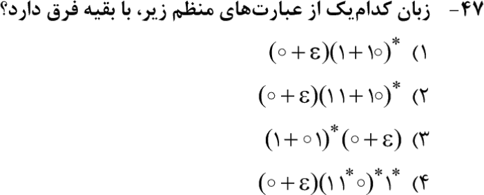

**۲. (ارشد ۱۴۰۳، سؤال ۴۶)**
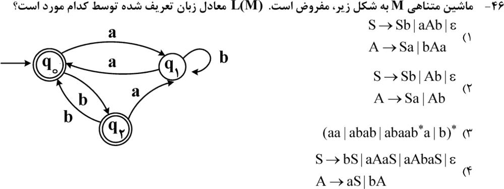

**۳. (ارشد ۱۴۰۲، سؤال ۴۶)**
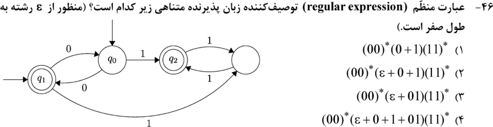

**۴. (ارشد ۱۴۰۲، سؤال ۴۷)**
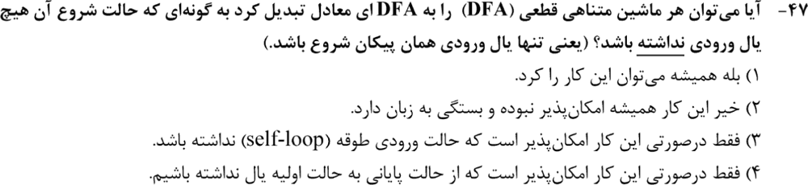

**۵. (ارشد ۱۴۰۲، سؤال ۴۸)**
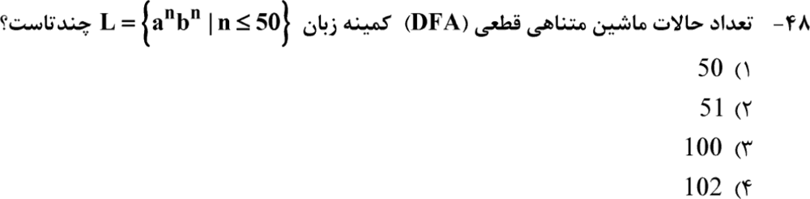

**۶. (ارشد ۱۴۰۲، سؤال ۴۹)**
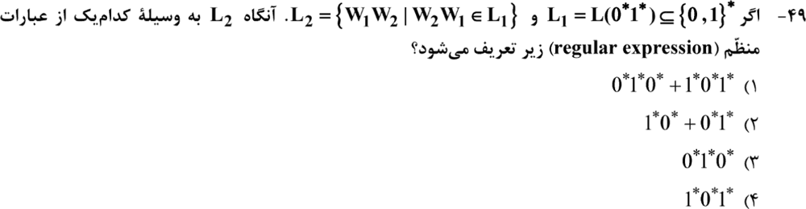

**۷. (ارشد ۱۴۰۰، سؤال ۵۵)**
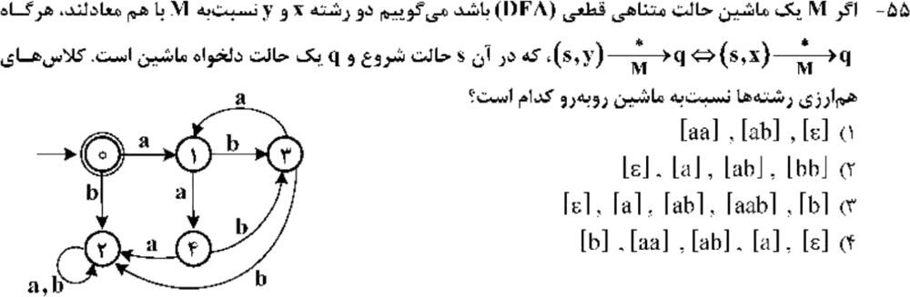

**۸. (ارشد ۱۳۹۹، سؤال ۵۱)**
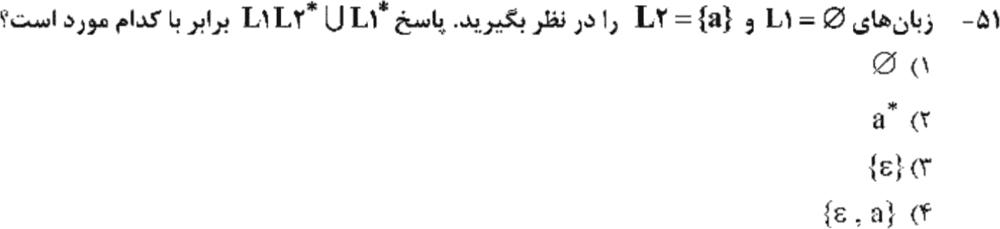

**۹. (ارشد ۱۳۹۹، سؤال ۵۲)**
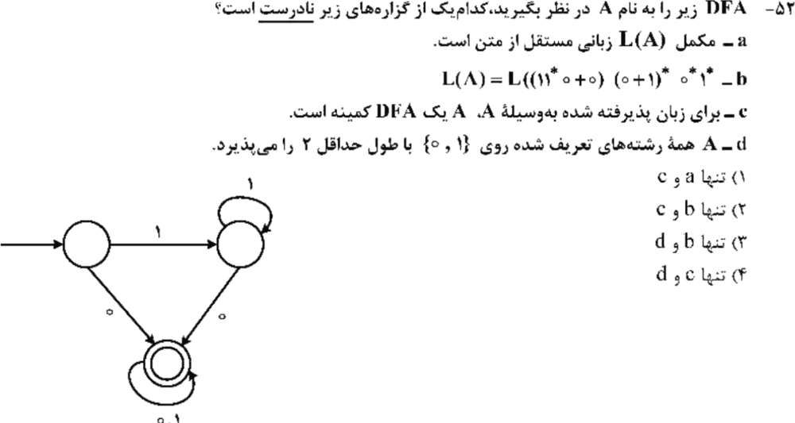

**۱۰. (ارشد ۱۳۹۹، سؤال ۵۳)**
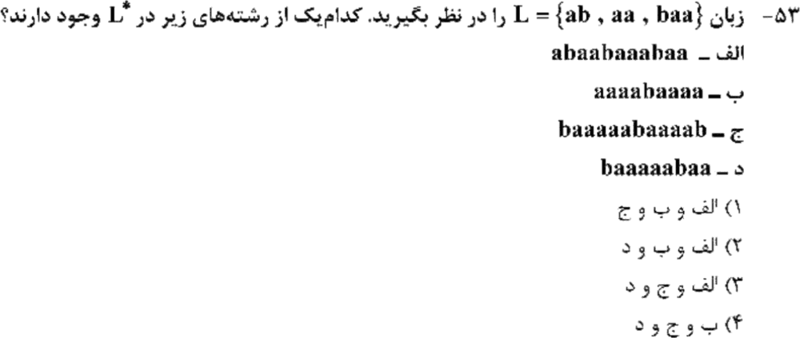

**۱۱. (ارشد ۱۳۹۸، سؤال ۶۱)**
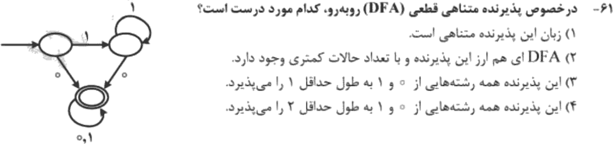

**۱۲. (ارشد ۱۳۹۸، سؤال ۶۲)**
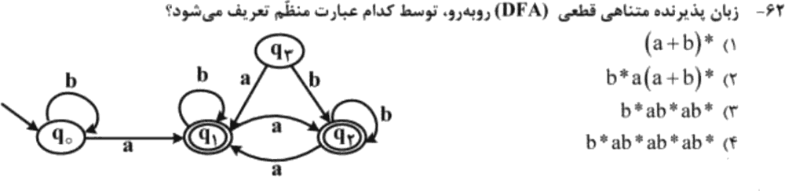

**۱۳. (ارشد ۱۳۹۸، سؤال ۶۳)**
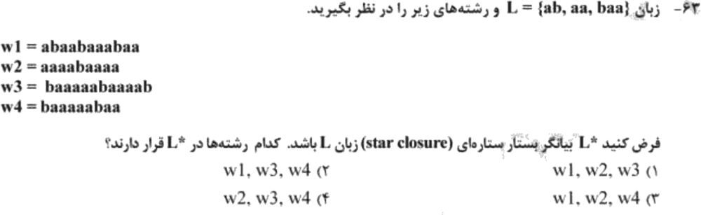

جواب‌ها و راه‌حل (کلید رسمی سازمان سنجش)

| سؤال | ۱ | ۲ | ۳ | ۴ | ۵ | ۶ | ۷ | ۸ | ۹ | ۱۰ | ۱۱ | ۱۲ | ۱۳ |
|---|---|---|---|---|---|---|---|---|---|---|---|---|---|
| کلید | ۲ | ۲ | ۴ | ۱ | ۴ | ۱ | ۴ | ۳ | ۴ | ۲ | ۲ | ۲ | ۳ |

**۱. گزینهٔ ۲.** گزینه‌های ۱، ۳ و ۴ همه «رشته‌های بدون `00`» هستند. گزینهٔ ۲ بعد از پیشوند فقط بلوک‌های دوتایی `11` و `10` دارد، پس مثلاً رشتهٔ `1` را نمی‌سازد.

**۲. گزینهٔ ۲ (کلید رسمی).** q₀ و q₂ هم‌ارزند (هر دو نهایی؛ با a به q₁ و با b بین هم). زبان ماشین «تعداد زوج a» است. با P = {q₀, q₂} و Q = q₁، گرامر خطی چپ چنین است: `S → Sb | Aa | ε` و `A → Sa | Ab`. گزینهٔ ۲ همین است، با این تفاوت که در دفترچه `S → Ab` چاپ شده؛ ظاهراً **غلط تایپی** است و باید `S → Aa` باشد. بقیهٔ گزینه‌ها زبان دیگری می‌سازند (گزینهٔ ۳ رشتهٔ `aba` را ندارد).

**۳. گزینهٔ ۴.** ماشین **دو حالت شروع** دارد (q₀ و q₁).
- از q₁ (که نهایی است): `(00)*(ε + 01)(11)*`.
- از q₀: `(00)*(0 + 1)(11)*`.

اجتماع این دو `(00)*(ε + 0 + 1 + 01)(11)*` است.

**۴. گزینهٔ ۱.** همیشه ممکن است: یک حالت شروع جدید (کپی حالت قبلی با همان یال‌های خروجی و همان نهایی بودن) بساز که هیچ یالی به آن وارد نشود.

**۵. گزینهٔ ۴.** فرمول `2K + 2` با `K = 50`: **۱۰۲** (با رایانه برای K کوچک چک شد: ۴، ۶، ۸).

**۶. گزینهٔ ۱.** چرخش‌های `0ⁱ1ʲ` به شکل `0*1*0*` (برش درون صفرها) یا `1*0*1*` (برش درون یک‌ها) هستند.

**۷. گزینهٔ ۴.** هر حالت قابل دسترس یک کلاس است: `[ε]`→۰، `[a]`→۱، `[ab]`→۳، `[aa]`→۴، `[b]`→۲ (مرده). پنج کلاس.

**۸. گزینهٔ ۳.** `L₁L₂* = ∅` و `L₁* = ∅* = {ε}`.

**۹. گزینهٔ ۴.** `L(A)` همان «رشته‌های دارای حداقل یک 0» است.
- a درست است (مکملش `1*` منظم و در نتیجه مستقل از متن است).
- b درست است.
- c نادرست است (حالت شروع و حالت «فقط ۱ دیده‌شده» هم‌ارزند، پس کمینه نیست).
- d نادرست است (`11` پذیرفته نمی‌شود).

**۱۰. گزینهٔ ۲.**
- الف: `ab·aa·baa·ab·aa` ✓
- ب: `aa·aa·baa·aa` ✓
- د: `baa·aa·baa` ✓
- ج ممکن نیست (با رایانه چک شد).

**۱۱. گزینهٔ ۲.** همان ماشین سؤال ۹ است، که دو حالتش هم‌ارزند. پس DFA کوچک‌تری هم هست.

**۱۲. گزینهٔ ۲.** با اولین a وارد حالت‌های نهایی q₁ و q₂ می‌شویم و دیگر بیرون نمی‌آییم (q₃ دست‌نیافتنی است): `b*a(a+b)*`.

**۱۳. گزینهٔ ۳.** w1 = `ab·aa·baa·ab·aa`، w2 = `aa·aa·baa·aa`، w4 = `baa·aa·baa`. w3 ممکن نیست.

*(سؤال ۵۶ ارشد ۱۳۹۹ در این مبحث حذف شده است.)*

---

## 🗂 کارت خلاصهٔ فصل ۱
- `∅* = {ε}` و `∅L = ∅`. عضویت در `L*`: قطعه‌بندی از چپ.
- بدون `00`: `(ε+0)(1+10)*`. برای مقایسهٔ عبارت‌ها رشته‌های کوتاه را امتحان کن.
- NFA ⇐ DFA با حداکثر `2ⁿ` حالت. ماشین با چند حالت شروع: اجتماع زبان‌ها.
- کلاس‌ها = حالت‌های قابل دسترس. DFA کمینهٔ `aⁿbⁿ` با `n ≤ K`: `2K + 2` حالت.
- خطی راست: `P → xQ`؛ خطی چپ: `Q → Px`.
