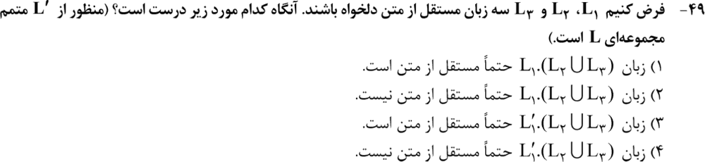
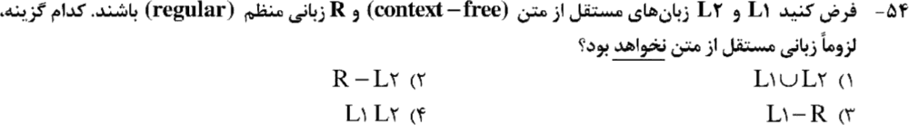
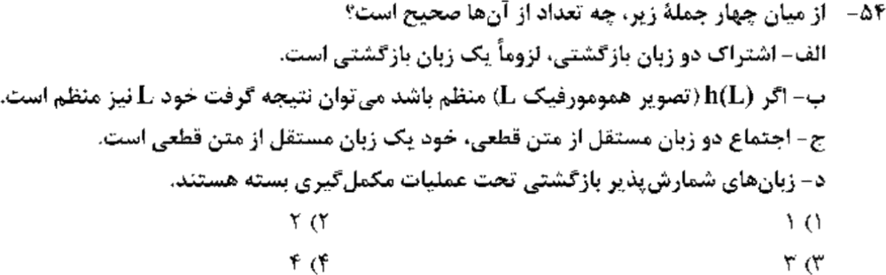
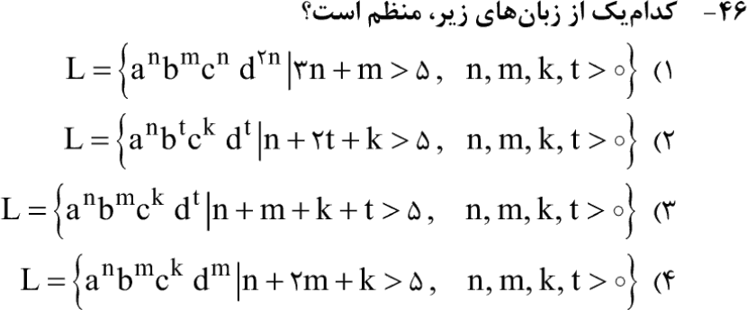
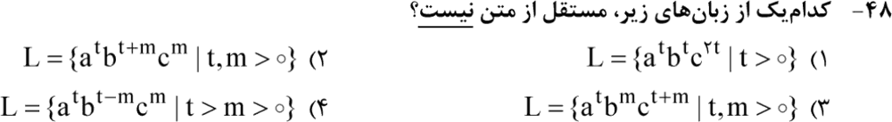
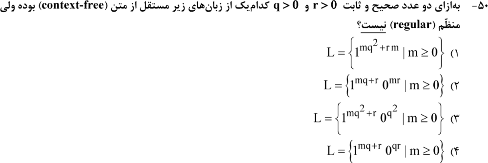
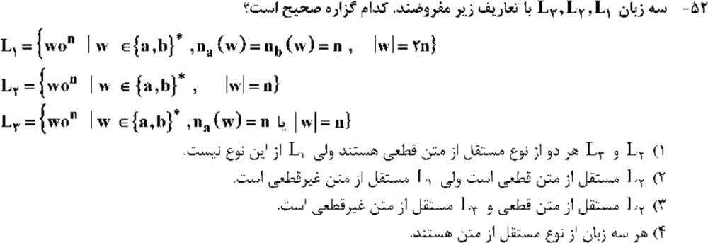
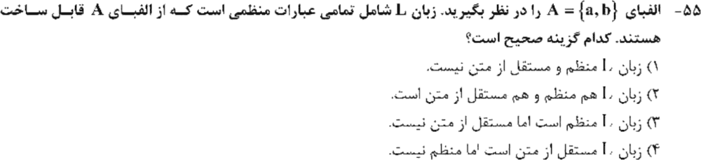
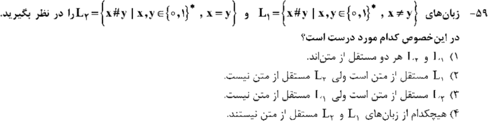
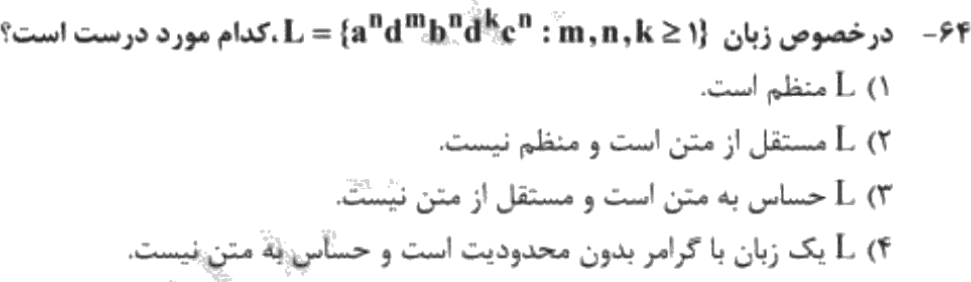

# فصل ۲: خواص بستاری و تشخیص نوع زبان

> **سهم در کنکور:** ۱۰ سؤال در ارشد ۱۳۹۸ تا ۱۴۰۴ (۳ بستاری و ۷ تشخیص نوع زبان). اگر جدول بستاری و چند الگوی «منظم / مستقل از متن / نه» را از بر باشی، جواب‌ها زیر یک دقیقه‌اند.
> **زمان مطالعه:** یک بلوک ۹۰ دقیقه‌ای.

---

## درس ۱: جدول بستاری (حفظ کن)

| عمل | منظم | مستقل از متن (CFL) | CFL قطعی (DCFL) | بازگشتی (تصمیم‌پذیر) | شمارش‌پذیر بازگشتی (RE) |
|---|---|---|---|---|---|
| اجتماع | ✅ | ✅ | ❌ | ✅ | ✅ |
| اشتراک | ✅ | ❌ | ❌ | ✅ | ✅ |
| **مکمل** | ✅ | ❌ | ✅ | ✅ | ❌ |
| الحاق | ✅ | ✅ | ❌ | ✅ | ✅ |
| ستاره | ✅ | ✅ | ❌ | ✅ | ✅ |
| اشتراک با منظم | ✅ | ✅ | ✅ | ✅ | ✅ |
| همریختی | ✅ | ✅ | ❌ | ❌ | ✅ |

**مثال برای خانه‌های مهم جدول:**
- **اشتراک CFL ها:** `L₁ = {aⁿbⁿcᵐ}` و `L₂ = {aᵐbⁿcⁿ}` هر دو CFL اند، ولی `L₁ ∩ L₂ = {aⁿbⁿcⁿ}` نیست.
- **مکمل CFL:** اگر مکمل بسته بود، با دمورگان (`A ∩ B = (A′ ∪ B′)′`) اشتراک هم بسته می‌شد، که دیدیم نیست. نمونهٔ مشخص: مکمل `{ww}` مستقل از متن است، ولی خود `{ww}` نیست.
- **اجتماع DCFL ها:** `{aⁿbⁿcᵐ} ∪ {aᵐbⁿcⁿ}`. هر کدام قطعی است، ولی برای اجتماع ماشین باید از اول حدس بزند که a ها را با b ها مقایسه کند یا b ها را با c ها.
- **اشتراک با منظم:** `{aⁿbⁿ} ∩ (aa)*b* = {a²ᵏb²ᵏ}` که هنوز CFL است.
- **همریختی:** با `h(a) = h(b) = 0`، داریم `h({aⁿbⁿ}) = {0²ⁿ} = (00)*`.

**نتیجه‌های پرکاربرد:**
- `L − R = L ∩ R′` برای CFL، مستقل از متن است. ولی `R − L = R ∩ L′` **لزوماً** نیست (مکمل CFL).
- اگر `h(L)` منظم باشد، **نمی‌شود** نتیجه گرفت L منظم است.
- مکمل یک CFL ممکن است CFL نباشد. پس عبارتی مثل «`L′₁·(L₂ ∪ L₃)` حتماً CFL است» غلط است.

**مثال:**
- `L − R`: `{aⁿbⁿ} − {ε} = {aⁿbⁿ | n ≥ 1}` ⇐ CFL.
- `R − L`: با `R = Σ*` و L = «مکمل `{ww}`» (که CFL است): `Σ* − L = {ww}` ⇐ CFL نیست.
- **همریختی:** در مثال بالا `h(L) = (00)*` منظم است، ولی `L = {aⁿbⁿ}` منظم نیست.

---

## درس ۲: تشخیص نوع زبان

### منظم (حافظهٔ متناهی کافی است)
- توان‌ها **مستقل از هم‌اند** و فقط شرط‌های محدود دارند، مثل `aⁿbᵐcᵏdᵗ` با `n+m+k+t > 5`.
- زبان یک‌حرفی با طول‌های **تصاعد حسابی**، مثل `1^(m·c)` یا `1^(mq+r)`.
- عددی که **ثابت** است (به m بستگی ندارد) مشکلی ایجاد نمی‌کند، مثل `0^(q²)`.

**مثال:**
- `{aⁿbᵐ | n + m > 2}` = همهٔ `a*b*` به‌جز ۶ رشتهٔ کوتاه ⇐ منظم.
- `{1^(3m)} = (111)*` ⇐ منظم.
- `0^(q²)` با `q = 3` ثابت، فقط رشتهٔ `0⁹` است ⇐ منظم.

### مستقل از متن، نه منظم (یک پشته کافی است)
- **یک جفتِ برابر** یا **تو در تو**: `aⁿbⁿ`، `aⁿbᵐcᵐ`، `aᵗbᵐcᵗ⁺ᵐ`، `aᵗbᵗ⁻ᵐcᵐ`، `wwᴿ`، `{x#y | x ≠ y}`.
- شرط خطی بین دو شمارش، مثل `1^(mq+r)0^(mr)` یا `m + 2n ≥ p`.

**مثال (پشته چطور کار می‌کند):**
- `aⁿbᵐcᵐ`: a ها را رد کن؛ b ها را push کن؛ با هر c یکی pop کن.
- `aᵗbᵐcᵗ⁺ᵐ`: هم a ها و هم b ها را push کن؛ با هر c یکی pop کن.
- `wwᴿ`: `abba` ⇐ `a` و `b` را push کن؛ بعد `b` و `a` را با pop تطبیق بده.

### نه مستقل از متن
- **سه شمارش برابر:** `aⁿbⁿcⁿ`، `aᵗbᵗc²ᵗ`، `aⁿdᵐbⁿdᵏcⁿ`. این‌ها حساس به متن‌اند.
- **تطبیق متقاطع:** `aⁿbᵐcⁿdᵐ`.
- **تکرار رشته:** `{ww}` و `{x#x}`.
- طول غیرخطی در زبان یک‌حرفی: `a^(n²)`، `a^(2ⁿ)`، `a^p` (p اول).

**مثال (چرا نه):**
- `aⁿbⁿcⁿ`: بعد از تطبیق a ها با b ها پشته خالی شده و چیزی برای مقایسه با c ها نمانده.
- `ww`: `abab` ⇐ نیمهٔ اول باید **به همان ترتیب** با نیمهٔ دوم مقایسه شود. پشته ترتیب را برعکس می‌کند و این کار صف لازم دارد.
- `a^(n²)`: طول‌ها `1, 4, 9, 16, …` با فاصله‌های `3, 5, 7, …` که بزرگ و بزرگ‌تر می‌شوند. زبان یک‌حرفی CFL حتماً منظم است، یعنی طول‌هایش از جایی به بعد تصاعد حسابی‌اند. پس این زبان CFL نیست.

### قطعی یا غیرقطعی
- اگر ماشین باید «حدس بزند» (کجا وسط رشته است؟ کدام شرط برقرار است؟)، زبان CFL **غیرقطعی** است: `wwᴿ`، و «شرط ۱ **یا** شرط ۲» با دو شمارش مختلف.
- اگر مرز مشخص است (مثل `#` یا تغییر حرف)، معمولاً DCFL است: `{w0ⁿ : |w| = n}`.

**مثال:** در `wwᴿ` با ورودی `abba`، ماشین بعد از خواندن `ab` نمی‌داند وسط رسیده یا نه (شاید ورودی `abbbba` باشد) ⇐ باید حدس بزند. ولی در `wcwᴿ` (با نشانهٔ وسط c)، با دیدن c می‌داند وقت pop کردن است ⇐ قطعی.

### زبان عبارت‌های منظم
مجموعهٔ **همهٔ** عبارت‌های منظم روی یک الفبا (به‌عنوان رشته) پرانتزهای متوازن لازم دارد. پس **مستقل از متن است ولی منظم نیست**.

**مثال:** `((a+b)*)` یک عبارت منظم درست است، ولی `((a)` نیست. چک کردن این‌که پرانتزها جفت‌اند، همان زبان پرانتزهای متوازن است.

---

## درس ۳: سلسله‌مراتب چامسکی
`منظم ⊂ DCFL ⊂ CFL ⊂ حساس به متن ⊂ بازگشتی ⊂ RE`
- نوع ۰ (بدون محدودیت) معادل ماشین تورینگ است.
- نوع ۱ (غیرکاهشی) معادل LBA است.
- نوع ۲ (مستقل از متن) معادل PDA است.
- نوع ۳ (منظم) معادل DFA است.

**مثال (یک زبان از هر سطح):**
- منظم: `(ab)*`.
- DCFL ولی نه منظم: `{aⁿbⁿ}`.
- CFL ولی نه DCFL: `{wwᴿ}`.
- حساس به متن ولی نه CFL: `{aⁿbⁿcⁿ}`.
- RE ولی نه بازگشتی: زبان توقف (فصل ۴).

### تمرین فصل ۲
منظم، مستقل از متن، یا هیچ‌کدام؟
1. `{aⁿbᵐ | n ≤ m}`
2. `{aⁿbⁿcᵐdᵐ}`
3. `{aⁿbᵐcⁿdᵐ}`
4. `{a²ⁿ | n ≥ 0}`

جواب‌ها

1. مستقل از متن (نه منظم).
2. مستقل از متن (دو جفت **پشت‌سرهم**).
3. نه مستقل از متن (جفت‌های **متقاطع**).
4. منظم (`(aa)*`).

---

## 📝 آزمون فصل ۲ (سؤال‌های واقعی کنکور ارشد کامپیوتر)
**زمان: ۲۰ دقیقه برای ۱۰ سؤال.**

**۱. (ارشد ۱۴۰۴، سؤال ۴۹)**

**۲. (ارشد ۱۴۰۱، سؤال ۵۴)**

**۳. (ارشد ۱۴۰۰، سؤال ۵۴)**

**۴. (ارشد ۱۴۰۴، سؤال ۴۶)**

**۵. (ارشد ۱۴۰۳، سؤال ۴۸)**

**۶. (ارشد ۱۴۰۲، سؤال ۵۰)**

**۷. (ارشد ۱۴۰۰، سؤال ۵۲)**

**۸. (ارشد ۱۳۹۹، سؤال ۵۵)**

**۹. (ارشد ۱۳۹۹، سؤال ۵۹)**

**۱۰. (ارشد ۱۳۹۸، سؤال ۶۴)**

جواب‌ها و راه‌حل (کلید رسمی سازمان سنجش)

| سؤال | ۱ | ۲ | ۳ | ۴ | ۵ | ۶ | ۷ | ۸ | ۹ | ۱۰ |
|---|---|---|---|---|---|---|---|---|---|---|
| کلید | ۱ | ۲ | ۱ | ۳ | ۱ | ۲ | ۳ | ۴ | ۲ | ۳ |

**۱. گزینهٔ ۱.** CFL ها تحت اجتماع و الحاق بسته‌اند. مکمل CFL ممکن است CFL نباشد، پس گزاره‌های «حتماً» درباره‌اش غلط‌اند.

**۲. گزینهٔ ۲.** `R − L₂ = R ∩ L₂′` شامل مکمل CFL است. بقیه CFL‌اند.

**۳. گزینهٔ ۱ (فقط یکی).** الف درست است (اشتراک دو بازگشتی، بازگشتی است). ب غلط (عکس همریختی). ج غلط (DCFL تحت اجتماع بسته نیست). د غلط (RE تحت مکمل بسته نیست).

**۴. گزینهٔ ۳.** توان‌ها مستقل‌اند و فقط شرط «جمع > ۵» دارند، که با حافظهٔ متناهی چک می‌شود. بقیه تطبیق برابری لازم دارند.

**۵. گزینهٔ ۱.** `aᵗbᵗc²ᵗ` سه شمارش وابسته دارد. بقیه یک تطبیق تو در تو هستند.

**۶. گزینهٔ ۲.** `1^(mq+r)0^(mr)`: تعداد صفرها به m وابسته است و m از روی یک‌ها خوانده می‌شود، پس پشته لازم است. بقیه (توان‌های تصاعدی یا ثابت) منظم‌اند.

**۷. گزینهٔ ۳.** L₁ سه شمارش برابر (a، b و 0) دارد، پس CFL نیست. L₂ قطعی است: برای هر حرف w یک push و برای هر 0 یک pop. L₃ «یا» دارد و باید حدس بزند کدام شرط را چک کند، پس غیرقطعی است.

**۸. گزینهٔ ۴.** عبارت‌های منظم پرانتز متوازن دارند، پس مستقل از متن‌اند ولی منظم نیستند.

**۹. گزینهٔ ۲.** `x ≠ y` مستقل از متن است (حدس محل اختلاف یا اختلاف طول). `x = y` (یعنی `{w#w}`) نیست.

**۱۰. گزینهٔ ۳.** `aⁿ…bⁿ…cⁿ` سه شمارش برابر دارد: حساس به متن است ولی مستقل از متن نیست.

---

## 🗂 کارت خلاصهٔ فصل ۲
- CFL: اجتماع، الحاق، ستاره، و ∩ منظم ✅؛ ∩ و مکمل ❌. DCFL: مکمل ✅، اجتماع ❌. RE: مکمل ❌.
- منظم: توان‌های مستقل، تصاعد حسابی یک‌حرفی، ثابت‌ها.
- CFL: یک جفت یا تو در تو. نه CFL: سه برابر، متقاطع، `ww`، و طول غیرخطی.
- «یا» با دو شمارش، یا `wwᴿ` ⇐ غیرقطعی. زبان عبارت‌های منظم مستقل از متن است، نه منظم.
