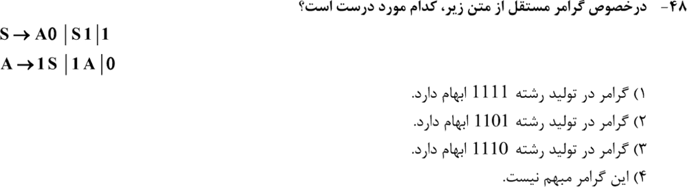
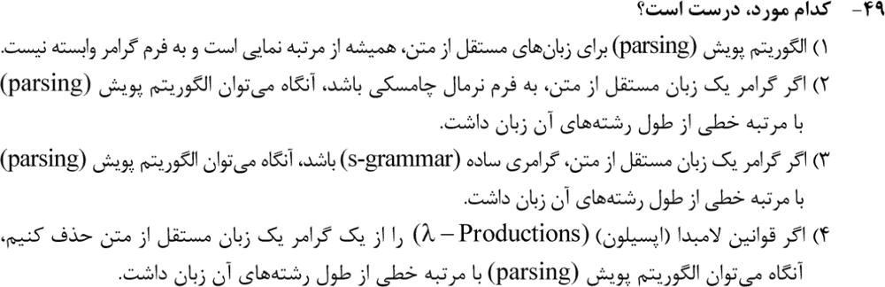
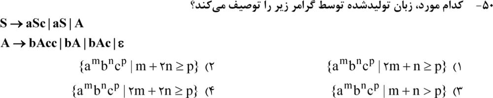
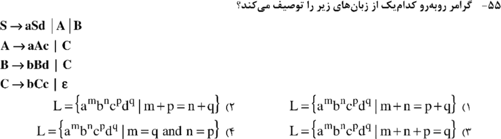
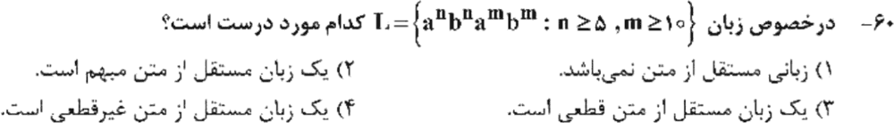

# فصل ۳: گرامر مستقل از متن و اتوماتون پشته‌ای

> **سهم در کنکور:** ۵ سؤال در ارشد ۱۳۹۸ تا ۱۴۰۴ (به‌علاوهٔ ۲ سؤال حذف‌شده). تیپ‌ها: «زبان این گرامر کدام است؟»، ابهام، و زمان پویش (parsing).
> **زمان مطالعه:** یک بلوک ۹۰ دقیقه‌ای.

---

## درس ۱: خواندن زبان یک گرامر

**روش:** برای هر قاعده ببین **هر بار اعمالش چه چیزی به دو سر رشته اضافه می‌کند.**
- `S → aSb | ε` ⇐ `aⁿbⁿ`
- `S → aSb | aS | ε` ⇐ `aᵐbⁿ` با `m ≥ n`
- `S → aSc | aS` ⇐ هر a صفر یا یک c می‌دهد، پس `p ≤ m`.
- **گرامر تو در تو** (`S → aSd`، بعد `A → aAc`، بعد `C → bCc`): لایه‌ها را از بیرون به داخل بنویس، تعداد هر حرف را برحسب تعداد اعمال هر قاعده بنویس، و رابطه را پیدا کن.

**مثال برای هر مورد:**
- `S → aSb | aS | ε`: اشتقاق `aab`: `S ⇒ aS ⇒ aaSb ⇒ aab`. هر `aSb` یک a و یک b می‌دهد و هر `aS` فقط a ⇐ `m ≥ n` ✓.
- **تو در تو:** `S → aSd | A`، `A → aAc | C`، `C → bCc | ε`. اگر قاعدهٔ اول i بار، دومی j بار و سومی k بار اعمال شود: `a^(i+j) bᵏ c^(j+k) dⁱ`. پس رابطه `#a + #b = #c + #d` است.
  - با `i = j = k = 1`: `S ⇒ aSd ⇒ aAd ⇒ aaAcd ⇒ aaCcd ⇒ aabCccd ⇒ aabccd` (چک: `2 + 1 = 2 + 1`).

**میان‌بُر تستی:** کوتاه‌ترین رشته‌ها (ε و طول ۱ و ۲) را بساز و گزینه‌ها را رد کن.

**مثال:** برای `S → aSbb | ε` کوتاه‌ترین رشته‌ها `ε` و `abb` هستند. هر گزینه‌ای که `ab` را بسازد (مثلاً `aⁿbⁿ`) فوراً رد می‌شود.

---

## درس ۲: ابهام

- گرامر **مبهم** است اگر رشته‌ای **دو درخت تجزیه** (یا دو اشتقاق چپ‌ترین) داشته باشد.
- **روش آزمایش:** برای رشتهٔ داده‌شده، اولین قاعدهٔ ممکن را از دو راه متفاوت امتحان کن و ببین هر دو تا انتها می‌رسند یا نه.
- مثال کلاسیک: `S → S + S | a` برای `a+a+a` دو درخت دارد.
- **ابهام ذاتی:** زبانی که **هیچ** گرامر نامبهمی ندارد (مثل `{aⁱbʲcᵏ | i = j یا j = k}`).
- اینکه «آیا یک گرامر مستقل از متن مبهم است؟» **تصمیم‌ناپذیر** است.

**مثال:** در `{aⁱbʲcᵏ | i = j یا j = k}`، رشتهٔ `abc` هر دو شرط را دارد. هر گرامری برای این زبان باید بخشی برای «`i = j`» و بخشی برای «`j = k`» داشته باشد، و رشته‌هایی مثل `aⁿbⁿcⁿ` از هر دو بخش ساخته می‌شوند.

**مثال (دو درخت، و رفعش):**
- درخت ۱: `(a + a) + a`؛ اشتقاق چپ‌ترین: `S ⇒ S+S ⇒ S+S+S ⇒ a+S+S ⇒ a+a+S ⇒ a+a+a` (S چپ اول باز شد).
- درخت ۲: `a + (a + a)`؛ اشتقاق چپ‌ترین: `S ⇒ S+S ⇒ a+S ⇒ a+S+S ⇒ a+a+S ⇒ a+a+a`.
- **رفع ابهام:** `S → S + a | a` همان زبان را دارد و هر رشته فقط یک درخت (شرکت‌پذیری چپ).

---

## درس ۳: فرم‌های نرمال و پویش

| موضوع | نکته |
|---|---|
| فرم نرمال چامسکی (CNF) | `A → BC | a`. اشتقاق رشتهٔ طول n دقیقاً `2n − 1` قدم دارد. CYK در `O(n³)` |
| فرم نرمال گرایباخ (GNF) | `A → aα`. هر قدم یک حرف تولید می‌کند |
| **گرامر ساده (s‑grammar)** | برای هر زوج (A, a) حداکثر یک قاعدهٔ `A → aα` وجود دارد. پس پویش **خطی** است |
| حذف قواعد λ | فقط پویش را **پایان‌پذیر** می‌کند، نه خطی |
| پویش CFL کلی | چندجمله‌ای (`O(n³)`)، **نه نمایی** |

**مثال برای هر سطر جدول:**
- **CNF:** با `S → AB`، `A → a` و `B → b`: `S ⇒ AB ⇒ aB ⇒ ab` یعنی ۳ قدم = `2·2 − 1`. (یعنی `n − 1` قدم شکستن و n قدم تولید حرف.)
- **GNF:** با `S → aSB | aB` و `B → b`: `S ⇒ aSB ⇒ aaBB ⇒ aabB ⇒ aabb`. ۴ قدم برای ۴ حرف.
- **گرامر ساده:** `S → aS | bSS | c`. حرف بعدی ورودی دقیقاً یک قاعده را انتخاب می‌کند؛ پویش بدون عقبگرد و خطی است.
- **حذف λ:** `S → aSb | ε` می‌شود `S → aSb | ab` (به‌علاوهٔ `S₀ → S | ε`). حالا هر قدم حداقل یک حرف می‌سازد، پس جستجو تمام می‌شود؛ ولی هنوز ممکن است نمایی باشد.

---

## درس ۴: اتوماتون پشته‌ای (PDA)
- NPDA ⇔ CFG. پذیرش با حالت نهایی یا با پشتهٔ خالی، برای NPDA معادل‌اند.
- DPDA از NPDA **ضعیف‌تر** است: `wwᴿ` با DPDA پذیرفته نمی‌شود.
- زبان‌هایی مثل `aⁿbⁿaᵐbᵐ` (با حد پایین ثابت روی n و m) **قطعی**‌اند: می‌شمارد، تخلیه می‌کند، دوباره می‌شمارد.

**مثال:** PDA برای `aⁿbⁿ`: با هر a یک X روی پشته بگذار؛ با هر b یک X بردار؛ اگر ورودی تمام شد و پشته خالی بود، بپذیر. برای `aab`: پشته `XX` ⇐ `X` ⇐ ورودی تمام شده ولی پشته خالی نیست ⇐ رد.
- **`aⁿbⁿaᵐbᵐ`:** همین کار را دو بار پشت سر هم انجام بده. تغییر حرف از b به a علامت شروع دور دوم است، پس حدسی لازم نیست.

### تمرین فصل ۳
1. زبان `S → aSbb | ε`؟
2. اشتقاق رشتهٔ ۶ حرفی در CNF چند قدم دارد؟
3. آیا `S → aS | Sa | a` مبهم است؟

جواب‌ها

1. `aⁿb²ⁿ`
2. `2·6 − 1 = 11`
3. بله، مثلاً `aa` دو درخت دارد (`aS` یا `Sa`).

---

## 📝 آزمون فصل ۳ (سؤال‌های واقعی کنکور ارشد کامپیوتر)
**زمان: ۱۲ دقیقه.**

**۱. (ارشد ۱۴۰۴، سؤال ۴۸)**

**۲. (ارشد ۱۴۰۳، سؤال ۴۹)**

**۳. (ارشد ۱۴۰۳، سؤال ۵۰)**

**۴. (ارشد ۱۴۰۱، سؤال ۵۵)**

**۵. (ارشد ۱۳۹۹، سؤال ۶۰)**

جواب‌ها و راه‌حل (کلید رسمی سازمان سنجش)

| سؤال | ۱ | ۲ | ۳ | ۴ | ۵ |
|---|---|---|---|---|---|
| کلید | ۳ | ۳ | ۲ | ۱ | ۳ |

**۱. گزینهٔ ۳.** رشتهٔ `1110` دو درخت تجزیه دارد (با شمارش رایانه‌ای همهٔ درخت‌ها تأیید شد). رشته‌های `1111` و `1101` فقط یک درخت دارند.

**۲. گزینهٔ ۳.** در گرامر ساده، هر قدم با دیدن یک حرف فقط یک انتخاب دارد، پس پویش خطی است. CNF یعنی CYK و `O(n³)`. حذف λ پویش را خطی نمی‌کند. پویش هم «همیشه نمایی» نیست.

**۳. گزینهٔ ۲.** در S، هر a صفر یا یک c می‌دهد. در A، هر b صفر، یک یا دو c می‌دهد. پس `p ≤ m + 2n`.

**۴. گزینهٔ ۱.** راه A: `aⁱ·aʲ·bˡcˡ·cʲ·dⁱ` با `m = i+j`، `n = l`، `p = l+j`، `q = i`، پس `m + n = p + q`. راه B هم همین رابطه را می‌دهد.

**۵. گزینهٔ ۳.** `aⁿbⁿ` و بعد `aᵐbᵐ`: یک DPDA می‌شمارد و تخلیه می‌کند، دو بار پشت‌سرهم. پس CFL قطعی است.

*(سؤال‌های ۵۲ ارشد ۱۴۰۱ و ۵۷ ارشد ۱۳۹۹ در این مبحث حذف شده‌اند.)*

---

## 🗂 کارت خلاصهٔ فصل ۳
- زبان گرامر: سهم هر قاعده را بشمار. `aSc | aS` یعنی هر a صفر یا یک c.
- ابهام: دو درخت. «مبهم است؟» تصمیم‌ناپذیر است.
- CNF: `2n − 1` قدم و CYK `O(n³)`. گرامر ساده: پویش خطی.
- DPDA ضعیف‌تر از NPDA است (`wwᴿ`). `aⁿbⁿaᵐbᵐ` قطعی است.
