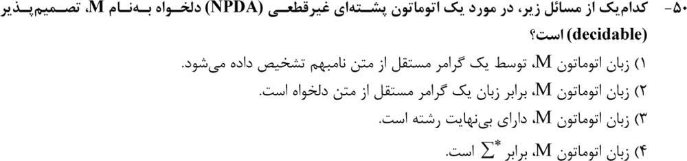
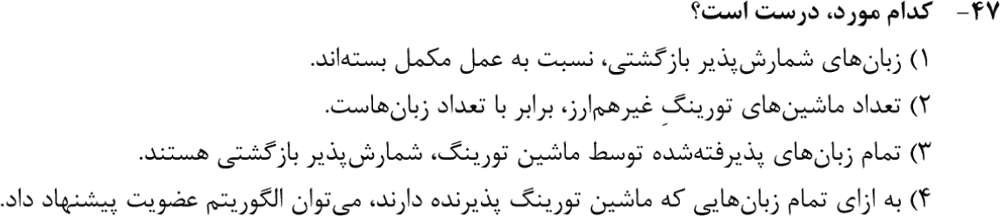
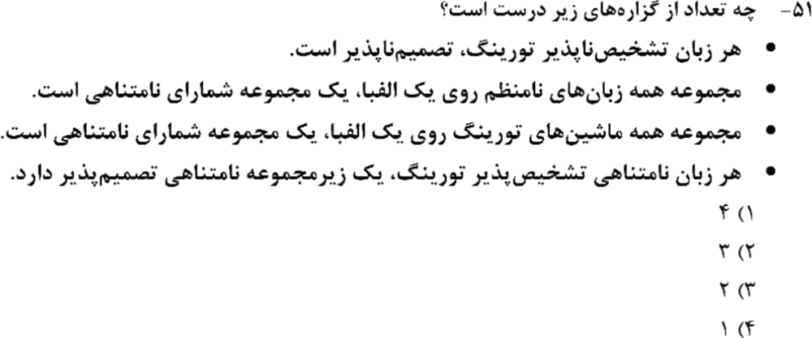
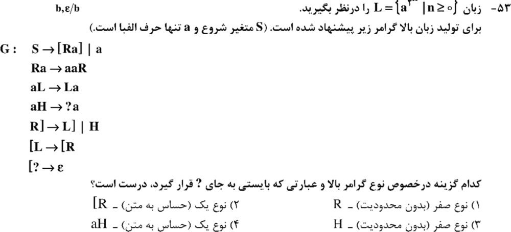
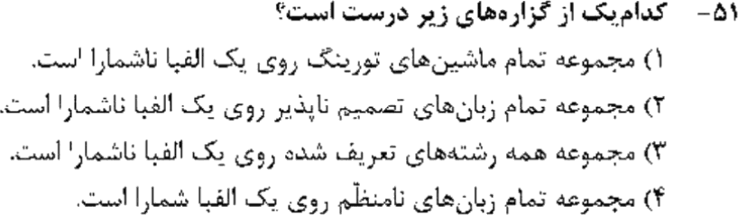
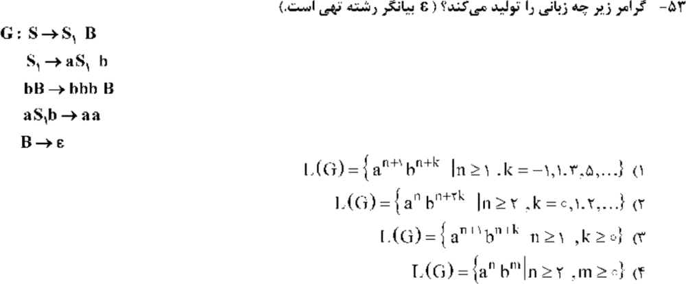
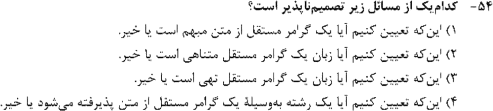
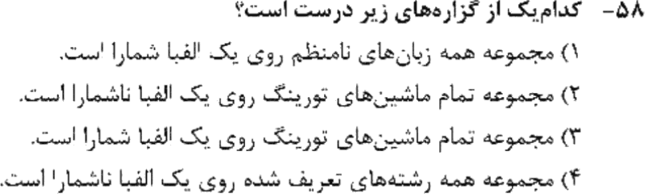

# فصل ۴: ماشین تورینگ، تصمیم‌پذیری و شمارایی

> **سهم در کنکور:** ۸ سؤال در ارشد ۱۳۹۸ تا ۱۴۰۴. تقریباً همه مفهومی‌اند: «کدام تصمیم‌پذیر است؟»، «کدام مجموعه شماراست؟»، و نوع گرامر.
> **پیش‌نیاز:** گسسته فصل ۲ (شمارایی).
> **زمان مطالعه:** یک بلوک ۹۰ دقیقه‌ای.

---

## درس ۱: بازگشتی و شمارش‌پذیر بازگشتی

| | تعریف |
|---|---|
| **شمارش‌پذیر بازگشتی (RE)** | یک ماشین تورینگ رشته‌های عضو را می‌پذیرد (برای غیرعضوها ممکن است متوقف نشود) |
| **بازگشتی (تصمیم‌پذیر)** | یک ماشین تورینگ همیشه متوقف می‌شود و بله یا نه می‌گوید |

- **L بازگشتی است ⇔ L و `L′` هر دو RE هستند.**
- RE تحت مکمل **بسته نیست** (مثلاً `A_TM` در RE است ولی مکملش نیست).
- زبان «پذیرفته‌شده توسط یک ماشین تورینگ» یعنی **همان** RE. «عضویت» برای همهٔ RE ها تصمیم‌پذیر **نیست**.
- **هر زبان RE نامتناهی، یک زیرمجموعهٔ نامتناهی تصمیم‌پذیر دارد.** (رشته‌هایی را بردار که در شمارش، از همهٔ قبلی‌ها طولانی‌ترند.)
- هر زبانِ «تشخیص‌ناپذیر» (غیر RE) قطعاً تصمیم‌ناپذیر هم هست.

---

## درس ۲: شمارایی (پرتست‌ترین بخش)

| مجموعه | شمارا؟ |
|---|---|
| همهٔ رشته‌های روی Σ (یعنی `Σ*`) | **شمارای نامتناهی** |
| همهٔ ماشین‌های تورینگ (و برنامه‌ها، گرامرها، DFA ها) | **شمارا** (هر کدام یک توصیف متناهی است) |
| همهٔ زبان‌ها (`P(Σ*)`) | **ناشمارا** |
| زبان‌های **نامنظم**، **تصمیم‌ناپذیر**، **غیر RE** | **ناشمارا** (چون فقط تعداد شمارایی زبان «خوب» داریم) |
| زبان‌های منظم، CFL، بازگشتی، RE | شمارا |

**نتیجه:** بیشتر زبان‌ها حتی RE هم نیستند.

---

## درس ۳: جدول تصمیم‌پذیری

| مسئله | DFA و زبان منظم | CFG و PDA | ماشین تورینگ |
|---|---|---|---|
| عضویت `w ∈ L` | ✅ | ✅ (CYK) | ❌ |
| تهی بودن | ✅ | ✅ | ❌ |
| **متناهی یا نامتناهی** | ✅ | **✅** | ❌ |
| `L = Σ*` | ✅ | ❌ | ❌ |
| تساوی دو زبان | ✅ | ❌ | ❌ |
| **ابهام گرامر** | — | **❌** | — |
| آیا زبان، زبان یک CFG نامبهم است؟ | — | ❌ | — |

**قضیهٔ رایس:** هر ویژگی **غیربدیهی** از **زبان** یک ماشین تورینگ تصمیم‌ناپذیر است.

---

## درس ۴: گرامرهای نوع ۰ و ۱
- **نوع ۰ (بدون محدودیت):** `α → β` دلخواه، حتی کوتاه‌کننده مثل `[H → ε`. معادل ماشین تورینگ.
- **نوع ۱ (حساس به متن):** `|α| ≤ |β|` (غیرکاهشی). معادل LBA.
- اگر گرامری قاعدهٔ کوتاه‌کننده داشته باشد (مثلاً چیزی به ε برود)، **نوع ۰** است.
- **ردگیری گرامر نشانه‌دار** (مثل تولید `a^(2ⁿ)`): نشانه‌ها (`R`، `L`، `H`) مثل یک «هد» روی رشته جابه‌جا می‌شوند. هر قاعده را مثل یک قدم ماشین بخوان.

### تمرین فصل ۴
1. آیا «`L(G) = Σ*`» برای CFG تصمیم‌پذیر است؟
2. آیا «`L(M)` متناهی است؟» برای DFA تصمیم‌پذیر است؟ برای ماشین تورینگ چطور؟
3. مجموعهٔ زبان‌های غیر RE روی `{0,1}` شماراست؟

جواب‌ها

1. خیر.
2. برای DFA بله؛ برای ماشین تورینگ خیر (رایس).
3. خیر، ناشماراست.

---

## 📝 آزمون فصل ۴ (سؤال‌های واقعی کنکور ارشد کامپیوتر)
**زمان: ۱۵ دقیقه برای ۸ سؤال.**

**۱. (ارشد ۱۴۰۴، سؤال ۵۰)**

**۲. (ارشد ۱۴۰۳، سؤال ۴۷)**

**۳. (ارشد ۱۴۰۱، سؤال ۵۱)**

**۴. (ارشد ۱۴۰۱، سؤال ۵۳)**

**۵. (ارشد ۱۴۰۰، سؤال ۵۱)**

**۶. (ارشد ۱۴۰۰، سؤال ۵۳)**

**۷. (ارشد ۱۳۹۹، سؤال ۵۴)**

**۸. (ارشد ۱۳۹۹، سؤال ۵۸)**

جواب‌ها و راه‌حل (کلید رسمی سازمان سنجش)

| سؤال | ۱ | ۲ | ۳ | ۴ | ۵ | ۶ | ۷ | ۸ |
|---|---|---|---|---|---|---|---|---|
| کلید | ۳ | ۳ | ۲ | ۳ | ۲ | ۱ | ۱ | ۳ |

**۱. گزینهٔ ۳.** نامتناهی بودن زبان یک CFG (یا NPDA) تصمیم‌پذیر است (دور در گراف متغیرها). بقیه (نامبهم بودن، تساوی با گرامر دلخواه، `Σ*`) تصمیم‌ناپذیرند.

**۲. گزینهٔ ۳.** طبق تعریف، زبان پذیرفته‌شده توسط ماشین تورینگ RE است.
- گزینهٔ ۱ غلط است (RE تحت مکمل بسته نیست).
- گزینهٔ ۲ غلط است (ماشین‌ها شمارا و زبان‌ها ناشمارا هستند).
- گزینهٔ ۴ غلط است (عضویت برای RE تصمیم‌ناپذیر است).

**۳. گزینهٔ ۲ (سه تا).** گزاره‌های ۱، ۳ و ۴ درست‌اند. گزارهٔ ۲ غلط است، چون زبان‌های نامنظم ناشمارا هستند.

**۴. گزینهٔ ۳.** قاعدهٔ `[? → ε` کوتاه‌کننده است، پس گرامر نوع ۰ است. `?` همان H است: H با `aH → Ha` به چپ می‌رود تا به `[` برسد و بعد `[H → ε` آن را پاک می‌کند.

**۵. گزینهٔ ۲.** زبان‌های تصمیم‌ناپذیر ناشمارا هستند. ماشین‌ها شمارا هستند، رشته‌ها شمارا هستند، و نامنظم‌ها ناشمارا (پس گزینهٔ ۴ غلط است).

**۶. گزینهٔ ۱.** `S ⇒ aᵏS₁bᵏB`. با `aS₁b → aa` به `aᵏ⁺¹bᵏ⁻¹B` می‌رسیم. هر بار `bB → bbbB` دو b اضافه می‌کند (به شرطی که حداقل یک b باشد)، و در آخر `B → ε`. پس `aⁿ⁺¹bⁿ⁺ᵏ` با `k = −1, 1, 3, 5, …`.

**۷. گزینهٔ ۱.** ابهام گرامر تصمیم‌ناپذیر است. متناهی بودن، تهی بودن و عضویت تصمیم‌پذیرند.

**۸. گزینهٔ ۳.** ماشین‌های تورینگ شمارا هستند.

---

## 🗂 کارت خلاصهٔ فصل ۴
- بازگشتی ⇔ L و `L′` هر دو RE. RE تحت مکمل بسته نیست. هر RE نامتناهی یک زیرمجموعهٔ نامتناهی تصمیم‌پذیر دارد.
- شمارا: `Σ*`، ماشین‌ها، گرامرها، RE ها. ناشمارا: همهٔ زبان‌ها، نامنظم‌ها، تصمیم‌ناپذیرها، غیر RE ها.
- CFG: عضویت، تهی بودن و متناهی بودن ✅. تساوی، `Σ*` و ابهام ❌. ماشین تورینگ: رایس.
- قاعدهٔ کوتاه‌کننده ⇐ نوع ۰. غیرکاهشی ⇐ نوع ۱.
