# فصل ۱: جستجوی ناآگاهانه و آگاهانه (A* و هیوریستیک) ★

> **سهم در کنکور:** **۱۸ سؤال** در ارشد ۱۳۹۸ تا ۱۴۰۴ (۵ ناآگاهانه و ۱۳ آگاهانه)، پرتکرارترین فصل هوش مصنوعی. بیشتر سؤال‌ها دربارهٔ ویژگی‌های هیوریستیک (قابل قبول یا سازگار) و ترکیب آن‌ها هستند.
> **زمان مطالعه:** دو بلوک ۹۰ دقیقه‌ای.

---

## درس ۱: جستجوی ناآگاهانه

b = ضریب انشعاب، d = عمق کم‌عمق‌ترین هدف، m = بیشترین عمق، C* = هزینهٔ بهینه، ε = کمترین هزینهٔ گام.

| روش | کامل؟ | بهینه؟ | زمان | حافظه |
|---|---|---|---|---|
| BFS | ✅ (b متناهی) | ✅ اگر هزینه‌ها برابر باشند | `O(bᵈ)` | `O(bᵈ)` |
| هزینهٔ یکنواخت (UCS) | ✅ (ε > 0) | ✅ | `O(b^(1+⌊C*/ε⌋))` | همان |
| DFS | ❌ (عمق نامحدود) | ❌ | `O(bᵐ)` | **`O(bm)`** |
| عمقی تکراری (IDS) | ✅ | ✅ (هزینهٔ برابر) | `O(bᵈ)` (تکرارها مرتبه را عوض نمی‌کنند) | **`O(bd)`** |
| دوطرفه | ✅ | ✅ (BFS از دو طرف) | `O(b^(d/2))` | همان |

- **IDS** = حافظهٔ DFS + کامل بودن BFS.
- در UCS، عبارت `⌊C*/ε⌋` جای d را می‌گیرد.
- **UCS** حالت خاص A* با `h = 0` است.
- **BFS** حالت خاص UCS با هزینه‌های برابر است (برعکسش نه).
- دو عامل در **محیط نامحدود** که دنبال هم می‌گردند: اگر هر دو BFS بزنند، جستجوی دوطرفه می‌شود و بهینه است.

**مثال (یک گراف، چهار روش):** یال‌ها `S→A (1)`، `S→B (4)`، `A→G (5)`، `B→G (1)`. بهترین مسیر `S-B-G` با هزینهٔ ۵ است.
- **BFS:** لایهٔ ۱ = `{A, B}`؛ G اول از طریق A دیده می‌شود ⇐ مسیر `S-A-G` با هزینهٔ ۶ (بهینه نیست، چون هزینه‌ها برابر نیستند).
- **UCS:** مرز `A(1), B(4)` ⇐ A را باز کن: `G(6)`. مرز `B(4), G(6)` ⇐ B را باز کن: G با هزینهٔ ۵ به‌روز می‌شود. G(5) کمترین است ⇐ هزینهٔ **۵** ✓.
- **DFS:** `S → A → G` (هزینهٔ ۶).
- **IDS:** حد ۰: فقط S؛ حد ۱: S، A، B؛ حد ۲: G از طریق A پیدا می‌شود.

**مثال (اعداد، `b = 10` و `d = 5`):**
- BFS حدود `10 + 100 + … + 10⁵ = 111110` گره تولید می‌کند و همه در حافظه‌اند.
- IDS: `5·10 + 4·100 + 3·1000 + 2·10⁴ + 10⁵ = 123450` گره، یعنی فقط ۱۱٪ بیشتر؛ ولی حافظه حدود `b·d = 50`.
- دوطرفه: حدود `2 × 10^2.5 ≈ 632` گره.
- UCS با `C* = 10` و `ε = 2`: توان `1 + ⌊10/2⌋ = 6`.

---

## درس ۲: A* و هیوریستیک

- `f(n) = g(n) + h(n)`. **مرز (fringe)** صف اولویت بر اساس f است.
- **قابل قبول (admissible):** برای هر n، `h(n) ≤ h*(n)` (هیچ‌وقت بیش‌برآورد نمی‌کند).
- **سازگار (consistent):** برای هر یال، `h(n) ≤ c(n, n′) + h(n′)`.
  - ⇐ سازگار، قابل قبول هم هست. ⇐ f روی **هر** مسیر غیرنزولی است.
  - در گراف بی‌جهت، شرط سازگاری را در **هر دو جهت** هر یال چک کن.
- **بهینگی:** A* **درختی** با h قابل قبول بهینه است. A* **گرافی** سازگاری لازم دارد (یا بازگشایی گره‌های بسته).
- **اگر برای هر گره یکی از چند هیوریستیک قابل قبول تصادفی انتخاب شود**، باز هم A* درختی بهینه است (هر f یک کران پایین است).
- **حذف گره‌های با `f > C`** (اگر C کران بالای جواب بهینه باشد) بهینگی را حفظ می‌کند.

**مثال:** همان گراف با `h(S) = 4`، `h(A) = 5`، `h(B) = 1`، `h(G) = 0`.
- **قابل قبول:** `h*(S) = 5`، `h*(A) = 5`، `h*(B) = 1` و هر h از `h*` خودش بیشتر نیست ✓.
- **سازگار:** `S→A`: `4 ≤ 1 + 5` ✓؛ `S→B`: `4 ≤ 4 + 1` ✓؛ `A→G`: `5 ≤ 5 + 0` ✓؛ `B→G`: `1 ≤ 1 + 0` ✓.
- **اجرای A\*:** `f(A) = 1 + 5 = 6`، `f(B) = 4 + 1 = 5` ⇐ B باز می‌شود ⇐ `f(G) = 5 + 0 = 5` که از ۶ کمتر است ⇐ جواب **۵** ✓. روی مسیر `S-B-G` مقدار f برابر `4, 5, 5` است (نانزولی).
- **غیرقابل قبول:** اگر `h(B) = 10` بود، `f(B) = 14` و A* اول A را باز می‌کرد و G را با `f = 6` برمی‌گرداند ✗.
- **بی‌جهت:** یال `A–B` با هزینهٔ ۱، `h(A) = 3` و `h(B) = 1`: جهت `B→A`: `1 ≤ 1 + 3` ✓، ولی جهت `A→B`: `3 ≤ 1 + 1` ✗ ⇐ سازگار نیست.

### ترکیب هیوریستیک‌ها
| ترکیب | قابل قبول؟ | سازگار؟ |
|---|---|---|
| `max(h₁, h₂)` | ✅ | ✅ (اگر هر دو سازگار باشند) |
| `α·h₁ + (1−α)·h₂` با `0 ≤ α ≤ 1` | ✅ | ✅ |
| `h₁ + h₂` | ❌ لزوماً | ❌ لزوماً |
| `α·h₁` با `α > 1` | ❌ لزوماً | ❌ لزوماً |
| `|h₁ − h₂|` | ✅ (≤ max) | — |

**مثال برای هر سطر جدول:** در گرهٔ n با `h* = 6`، `h₁ = 3` و `h₂ = 5`:
- `max = 5 ≤ 6` ✓؛ میانگین `4 ≤ 6` ✓.
- `h₁ + h₂ = 8 > 6` ✗.
- `2h₁ = 6` اینجا اتفاقی درست است، ولی `2h₂ = 10 > 6` ✗.
- `|h₁ − h₂| = 2 ≤ 6` ✓.

- **غلبه:** اگر برای همهٔ n، `h₁(n) ≤ h₂(n)` (هر دو قابل قبول)، آنگاه h₂ گره‌های **کمتر یا مساوی** گسترش می‌دهد: `n₁ ≥ n₂`.
- `h = 0` بدترین هیوریستیک از نظر زمان است (همان UCS)، ولی «از هیچ هیوریستیکی کندتر نیست» درست نیست.

**مثال (غلبه):** در پازل ۸، اگر کاشی ۱ دو خانه با جایش فاصله دارد و کاشی ۲ یک خانه (بقیه سر جایشان): «تعداد کاشی نابه‌جا» = ۲ و «منهتن» = ۳. منهتن همیشه ≥ نابه‌جاهاست و هر دو قابل قبول‌اند ⇐ A* با منهتن گره‌های کمتری باز می‌کند.

### ساختن هیوریستیک قابل قبول
از **مسئلهٔ ساده‌شده** استفاده کن. چند مثال:
- فاصلهٔ منهتن.
- «تعداد غذاهای مانده» وقتی هر حرکت حداکثر یکی را می‌خورد.
- دو ربات که هم‌زمان حرکت می‌کنند و باید به هم برسند: `min_C max(d(A,C), d(B,C))`.

**مثال برای هر مورد:**
- **ساده‌سازی پازل ۸:** اگر کاشی بتواند به هر جایی بپرد ⇐ «تعداد نابه‌جا»؛ اگر بتواند روی بقیه بلغزد ⇐ «منهتن».
- **غذا:** ۳ غذا مانده ⇐ حداقل ۳ حرکت لازم است ⇐ `h = 3` قابل قبول است.
- **دو ربات** روی یک خط در خانه‌های ۰ و ۶: نقطهٔ ملاقات ۳ ⇐ `max(3, 3) = 3` گام (چون هم‌زمان حرکت می‌کنند).

⚠️ **جمع فاصله‌ها** تا چند هدف معمولاً قابل قبول **نیست** (چند هدف ممکن است در یک مسیر باشند).

**مثال:** ربات در ۰ و دو هدف در ۱ و ۲ روی یک خط. جمع فاصله‌ها `1 + 2 = 3` است، ولی با ۲ حرکت (۰ ⇐ ۱ ⇐ ۲) هر دو دیده می‌شوند ⇐ بیش‌برآورد.

### تمرین فصل ۱
1. چرا IDS با وجود تکرار، `O(bᵈ)` است؟
2. `h₁ = 3` و `h₂ = 5` در گرهٔ n، هر دو قابل قبول. A* با کدام سریع‌تر است؟
3. آیا `2h` برای h سازگار، سازگار است؟

جواب‌ها

1. بیشتر گره‌ها در عمق آخرند. جمع `d·b + (d−1)b² + … + bᵈ` هنوز `O(bᵈ)` است.
2. با h₂ (اگر همه‌جا `h₂ ≥ h₁` باشد).
3. نه لزوماً.

---

## 📝 آزمون فصل ۱ (سؤال‌های واقعی کنکور ارشد کامپیوتر)
**زمان: ۴۵ دقیقه برای ۱۸ سؤال.**

**۱. (ارشد ۱۴۰۴، سؤال ۶۸)**
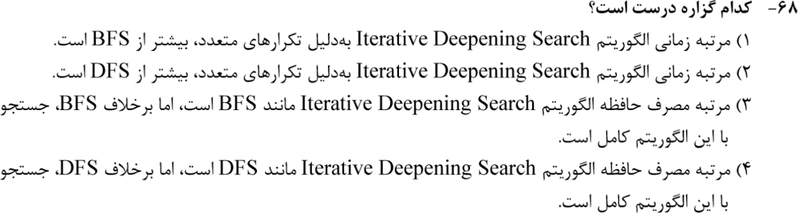

**۲. (ارشد ۱۴۰۳، سؤال ۷۲)**
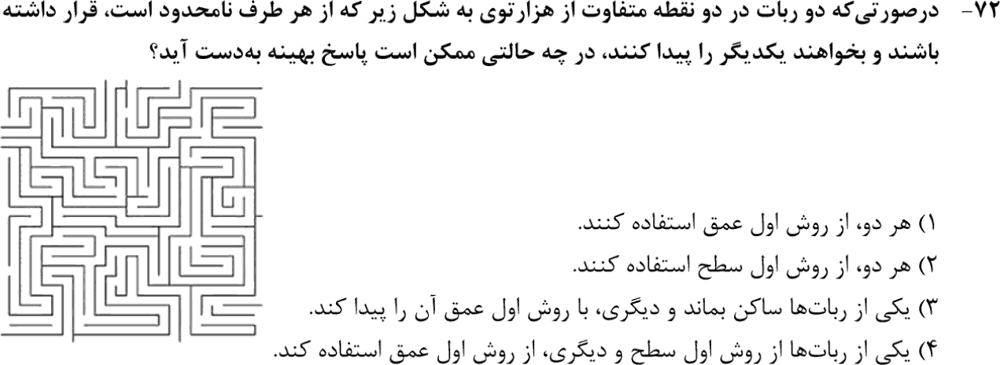

**۳. (ارشد ۱۴۰۳، سؤال ۷۵)**
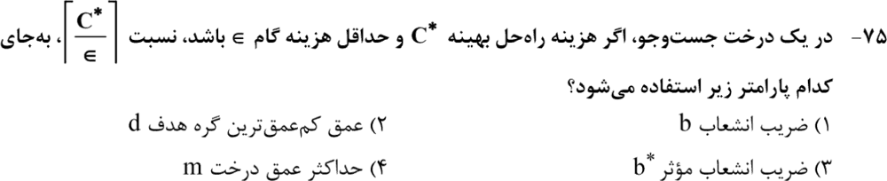

**۴. (ارشد ۱۴۰۲، سؤال ۶۹)**
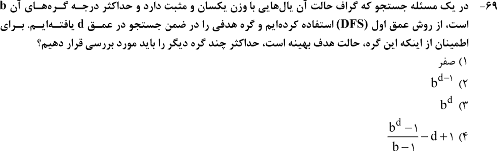

**۵. (ارشد ۱۴۰۰، سؤال ۷۵)**
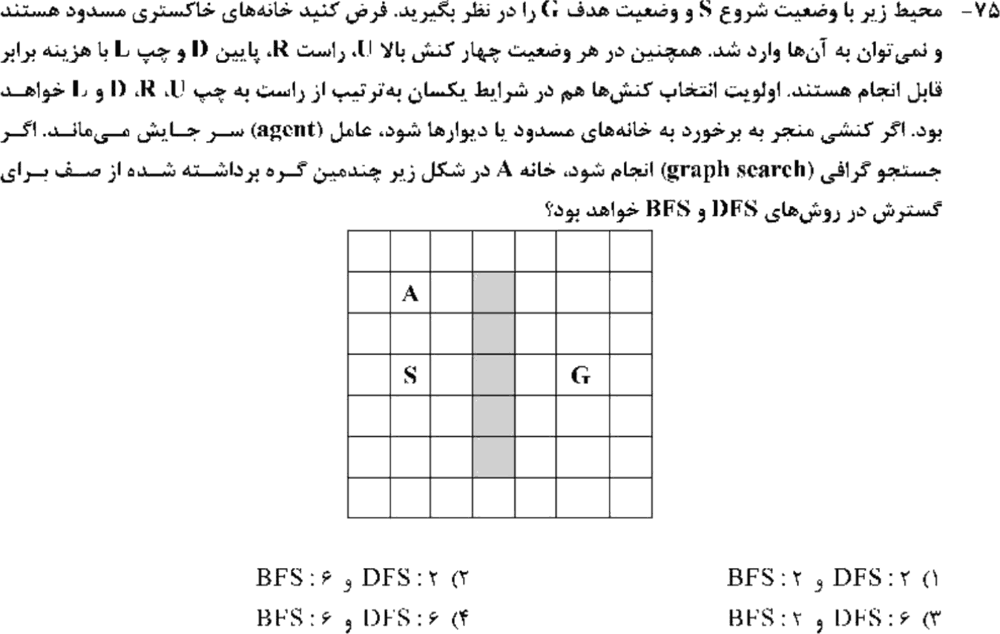

**۶. (ارشد ۱۴۰۴، سؤال ۷۱)**
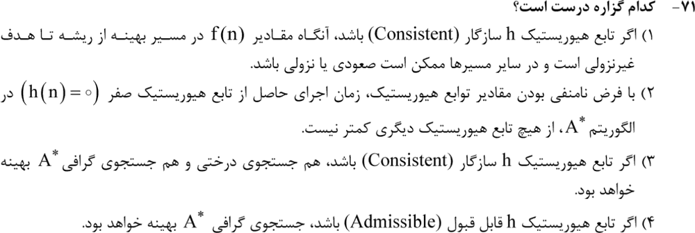

**۷. (ارشد ۱۴۰۴، سؤال ۷۴)**
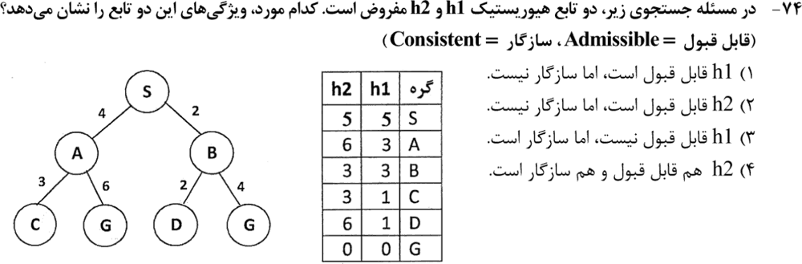

**۸. (ارشد ۱۴۰۳، سؤال ۷۱)**
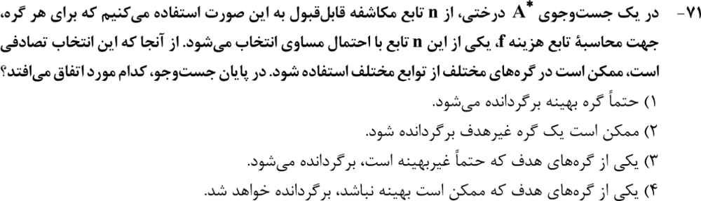

**۹. (ارشد ۱۴۰۳، سؤال ۷۴)**
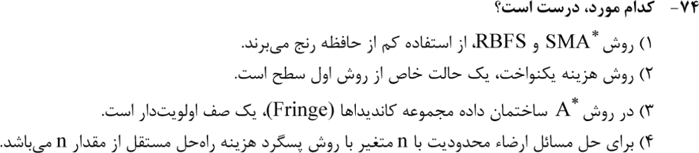

**۱۰. (ارشد ۱۴۰۲، سؤال ۷۱)**
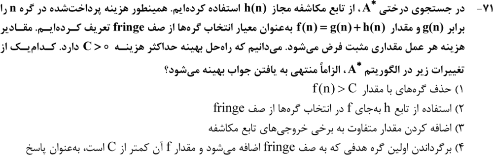

**۱۱. (ارشد ۱۴۰۲، سؤال ۷۵)**
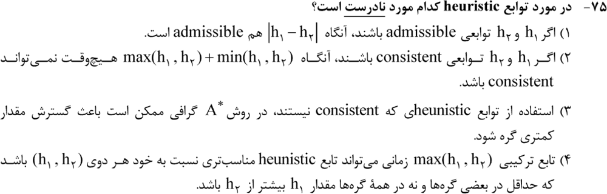

**۱۲. (ارشد ۱۴۰۱، سؤال ۷۳)**
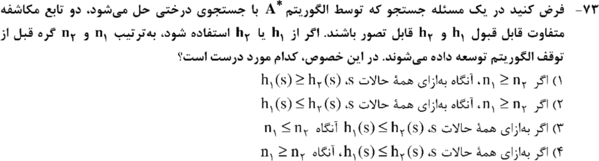

**۱۳. (ارشد ۱۴۰۰، سؤال ۷۶)**
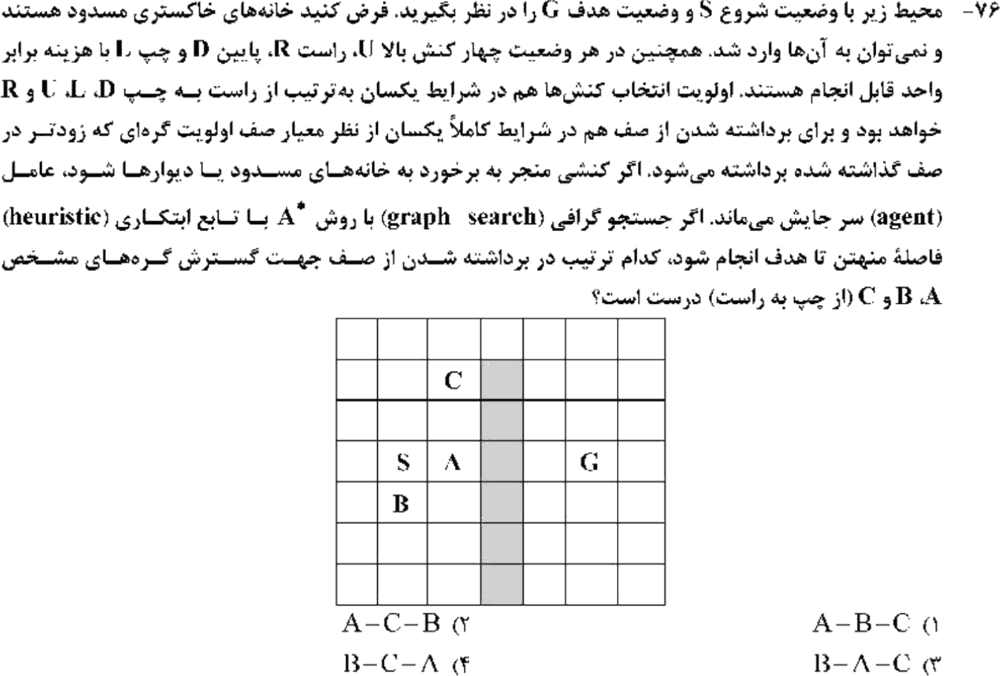

**۱۴. (ارشد ۱۳۹۹، سؤال ۱۱۹)**
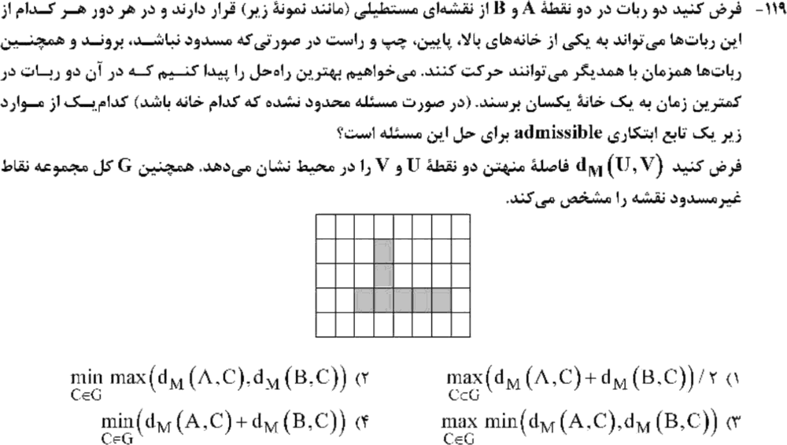

**۱۵. (ارشد ۱۳۹۹، سؤال ۱۲۲)**
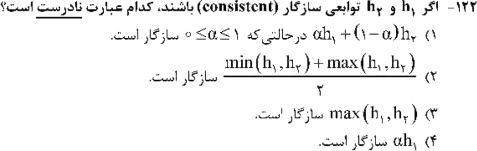

**۱۶. (ارشد ۱۳۹۹، سؤال ۱۲۷)**
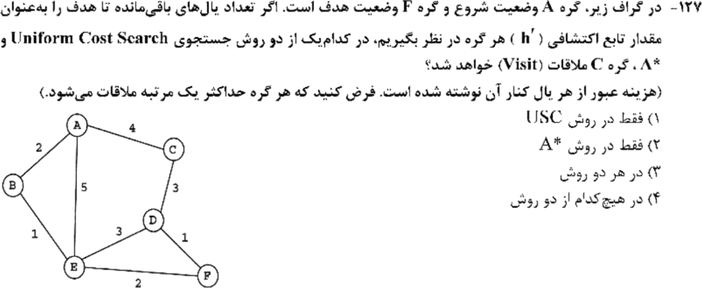

**۱۷. (ارشد ۱۳۹۸، سؤال ۱۱۸)**
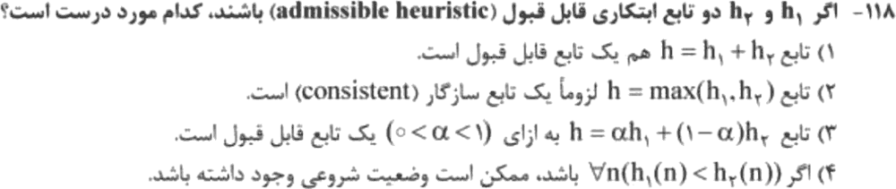

**۱۸. (ارشد ۱۳۹۸، سؤال ۱۱۹)**
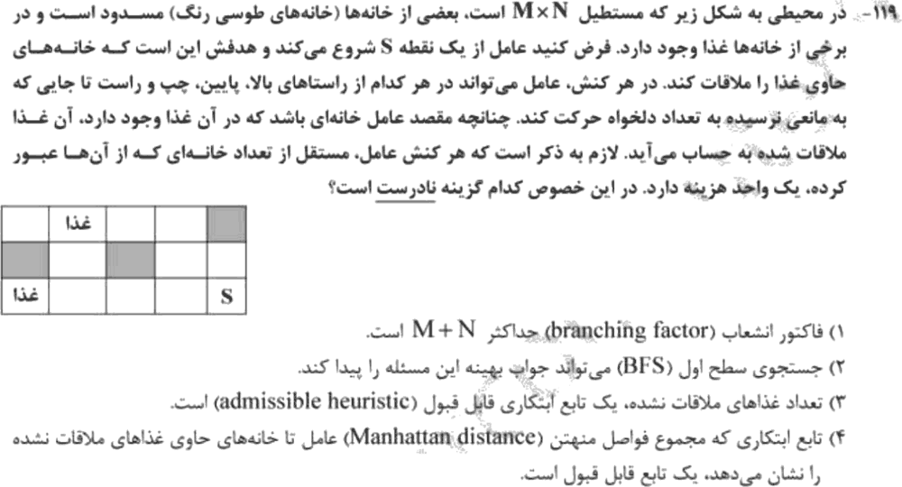

جواب‌ها و راه‌حل (کلید رسمی سازمان سنجش)

| سؤال | ۱ | ۲ | ۳ | ۴ | ۵ | ۶ | ۷ | ۸ | ۹ | ۱۰ | ۱۱ | ۱۲ | ۱۳ | ۱۴ | ۱۵ | ۱۶ | ۱۷ | ۱۸ |
|---|---|---|---|---|---|---|---|---|---|---|---|---|---|---|---|---|---|---|
| کلید | ۴ | ۲ | ۲ | ۴ | ۲ | ۳ | ۲ | ۱ | ۳ | ۱ | ۲ | ۴ | ۱ | ۲ | ۴ | ۱ | ۳ | ۴ |

**۱. گزینهٔ ۴.** IDS حافظهٔ DFS (`O(bd)`) دارد، ولی برخلاف DFS کامل است.

**۲. گزینهٔ ۲.** BFS از دو طرف (یعنی جستجوی دوطرفه) کامل و بهینه است. DFS در محیط نامحدود ممکن است هیچ‌وقت نرسد.

**۳. گزینهٔ ۲.** در پیچیدگی UCS، `⌈C*/ε⌉` جای d (عمق کم‌عمق‌ترین هدف) را می‌گیرد.

**۴. گزینهٔ ۴.** باید همهٔ گره‌های عمق کمتر از d دیده شوند: `(bᵈ − 1)/(b − 1)` گره، منهای `d − 1` گره‌ای که روی مسیر فعلی قبلاً دیده شده‌اند.

**۵. گزینهٔ ۲.**
- BFS: اول S، بعد چهار همسایه (U، R، D، L)، و بعد A (بالای خانهٔ بالایی). پس A ششمین گره است.
- DFS: با اولویت U، مستقیم از S دو خانه بالا می‌رود تا A. کلید این را **۲** شمرده، یعنی شمارش بعد از S.

**۶. گزینهٔ ۳.** سازگاری، بهینگی A* را هم در درختی هم در گرافی تضمین می‌کند. گزینهٔ ۴ غلط است (A* گرافی با h فقط قابل قبول ممکن است بهینه نباشد).

**۷. گزینهٔ ۲.** هزینه‌های واقعی: `h*(S) = 6`، `h*(A) = 6`، `h*(B) = 4`. هر دو هیوریستیک قابل قبول‌اند.
- h₁ روی همهٔ یال‌ها در هر دو جهت سازگار است.
- h₂ روی یال `B–D` سازگار نیست: `h₂(D) = 6 > 2 + h₂(B) = 5`.

**۸. گزینهٔ ۱.** هر f یک کران پایین معتبر است، پس A* درختی همچنان گرهٔ بهینه را برمی‌گرداند.

**۹. گزینهٔ ۳.** مرز در A* صف اولویت است.
- SMA* و RBFS برای **کم کردن** حافظه ساخته شده‌اند (گزینهٔ ۱ غلط).
- UCS حالت خاص BFS نیست، بلکه برعکس (گزینهٔ ۲ غلط).

**۱۰. گزینهٔ ۱.** گره با `f > C` هیچ‌وقت روی مسیر بهینه نیست (h قابل قبول است). پس حذفش بی‌خطر است.

**۱۱. گزینهٔ ۲ (غلط).** `max(h₁,h₂) + min(h₁,h₂) = h₁ + h₂` می‌تواند سازگار باشد (مثلاً وقتی یکی صفر است). پس «هیچ‌وقت» غلط است.

**۱۲. گزینهٔ ۴.** غلبه: h بزرگ‌تر (قابل قبول) گره‌های کمتری گسترش می‌دهد.

**۱۳. گزینهٔ ۱.** با فاصلهٔ منهتن تا G، گرهٔ A (هم‌سطر G، یک قدم نزدیک‌تر) f کمتری دارد و اول برداشته می‌شود. B و C بعد از آن، با شکستن تساوی بر اساس ترتیب ورود به صف.

**۱۴. گزینهٔ ۲.** دو ربات هم‌زمان حرکت می‌کنند. زمان رسیدن به خانهٔ C حداقل `max(d(A,C), d(B,C))` است و بهترین C کمینهٔ آن را می‌دهد. پس این کران پایین است.

**۱۵. گزینهٔ ۴ (غلط).** `α·h₁` برای `α > 1` ممکن است سازگار نباشد.

**۱۶. گزینهٔ ۱.** UCS: A، B (۲)، E (۳)، C (۴)، و بعد F (۵). پس C دیده می‌شود. A*: B (f = 4)، E (f = 4)، F (f = 5). C با f = 6 هیچ‌وقت برداشته نمی‌شود.

**۱۷. گزینهٔ ۳.** ترکیب محدب دو هیوریستیک قابل قبول، قابل قبول است. `h₁ + h₂` ممکن است بیش‌برآورد کند.

**۱۸. گزینهٔ ۴ (غلط).** جمع فاصله‌های منهتن تا همهٔ غذاها بیش‌برآورد می‌کند. «تعداد غذاها» قابل قبول است، چون هر کنش حداکثر یک غذا می‌خورد.

---

## 🗂 کارت خلاصهٔ فصل ۱
- IDS: حافظهٔ `O(bd)` و کامل. UCS: `⌈C*/ε⌉` جای d. دوطرفه با BFS بهینه است.
- قابل قبول: `h ≤ h*`. سازگار: `h(n) ≤ c + h(n′)` در هر دو جهت هر یال. درختی ⇐ قابل قبول کافی است؛ گرافی ⇐ سازگار.
- max و ترکیب محدب ✅؛ جمع و `αh` با `α > 1` ❌. غلبه: h بزرگ‌تر یعنی گره کمتر.
- حذف گره‌های با `f > C` بی‌خطر است. جمع فاصله‌ها تا چند هدف قابل قبول نیست.
