# فصل ۲: جستجوی محلی، و جستجوی خصمانه (مینیمکس و آلفا-بتا)

> **سهم در کنکور:** ۱۴ سؤال در ارشد ۱۳۹۸ تا ۱۴۰۴ (۷ محلی و ۷ خصمانه). سؤال‌های آلفا-بتا اجرای دستی روی درخت‌اند. سؤال‌های محلی یا مفهومی‌اند یا یک محاسبهٔ احتمال ساده.
> **زمان مطالعه:** یک بلوک ۹۰ دقیقه‌ای.

---

## درس ۱: جستجوی محلی

| روش | ویژگی |
|---|---|
| تپه‌نوردی | فقط بهترین همسایه را برمی‌دارد؛ در **بهینهٔ محلی** گیر می‌کند |
| تپه‌نوردی با **شروع مجدد تصادفی** | با احتمال یک بالاخره به بهینهٔ سراسری می‌رسد |
| شبیه‌سازی تبرید (SA) | حرکت بد را با احتمال `e^(ΔE/T)` می‌پذیرد. با زمان‌بندی دمای **لگاریتمی** (`T = C/log n`) همگرایی تضمین می‌شود |
| پرتو محلی (k‑beam) | k حالت؛ از **همهٔ** جانشین‌های آن‌ها بهترین k تا را نگه می‌دارد (این با k تپه‌نوردی مستقل فرق دارد) |
| ژنتیک | جمعیت + برش و ترکیب + جهش |

**نکته‌ها:**
- اگر کنش‌ها **برگشت‌پذیر** باشند، در پرتو محلی جمعیت هیچ‌وقت بدتر نمی‌شود (حالت‌های قبلی هم جزو جانشین‌ها هستند).
- تپه‌نوردی و پرتو محلی هر دو ممکن است در بهینهٔ محلی گیر کنند.
- مسائل **بهینه‌سازی** (n وزیر، رنگ‌آمیزی، فروشندهٔ دوره‌گرد) مناسب جستجوی محلی‌اند. **پازل ۸** مسیر می‌خواهد، نه یک حالت خوب؛ برای جستجوی محلی مناسب نیست.

### حساب شروع مجدد
اگر احتمال موفقیت هر تلاش p باشد:
- **احتمال موفقیت با حداکثر k تلاش:** `1 − (1−p)ᵏ`.
- **امید تعداد شکست‌ها قبل از اولین موفقیت:** `(1−p)/p`.
- **امید گام‌ها:** `((1−p)/p)·گام‌های هر شکست + گام‌های موفقیت`.

---

## درس ۲: مینیمکس و هرس آلفا-بتا

- **مینیمکس:** گره MAX بیشینه و گره MIN کمینهٔ فرزندان را می‌گیرد.
- **α** = بهترین مقدار تضمین‌شده برای MAX تا الان؛ **β** = بهترین مقدار برای MIN.
- **هرس:**
  - در گره **MIN**: وقتی مقدارش `≤ α` شد، بقیهٔ فرزندان هرس می‌شوند.
  - در گره **MAX**: وقتی مقدارش `≥ β` شد، بقیهٔ فرزندان هرس می‌شوند.
- **مقدار ریشه با آلفا-بتا دقیقاً همان مینیمکس است.** ولی گره‌های میانی هرس‌شده فقط **کران** هستند. مثلاً MAX هرس‌شده مقداری کمتر یا مساوی مقدار واقعی برمی‌گرداند.
- **ترتیب بهینه:** `O(b^(m/2))`. ترتیب تصادفی: حدود `O(b^(3m/4))`.

### روش اجرای دستی
از چپ به راست برو و برای هر گره بازهٔ `[α, β]` را از والد بگیر. وقتی شرط هرس برقرار شد، **بقیهٔ فرزندان همان گره** خط بخورند.
برای سؤال «مقدار برگ x در چه بازه‌ای تغییر کند تا هرس عوض نشود؟»: شرط هر هرسی را که به آن برگ وابسته است بنویس.

### تمرین فصل ۲
1. احتمال موفقیت هر تلاش ۰٫۱ است. احتمال موفقیت با حداکثر ۳ تلاش؟
2. ریشه MAX با دو فرزند MIN: `(3, 12, 8)` و `(2, 4, 6)`. چه برگ‌هایی هرس می‌شوند؟

جواب‌ها

1. `1 − 0.9³ = 0.271`
2. با `α = 3`، اولین برگ فرزند دوم ۲ است که کمتر از α است، پس ۴ و ۶ هرس می‌شوند.

---

## 📝 آزمون فصل ۲ (سؤال‌های واقعی کنکور ارشد کامپیوتر)
**زمان: ۳۵ دقیقه برای ۱۴ سؤال.**

**۱. (ارشد ۱۴۰۴، سؤال ۷۲)**
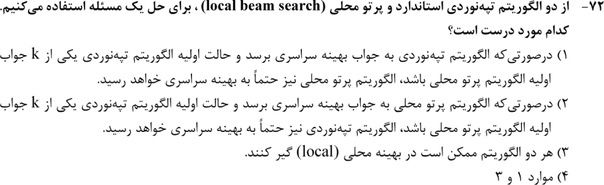

**۲. (ارشد ۱۴۰۳، سؤال ۷۰)**
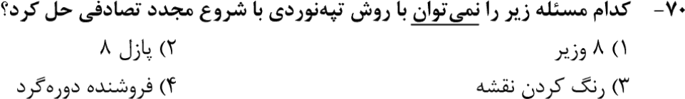

**۳. (ارشد ۱۴۰۲، سؤال ۷۳)**
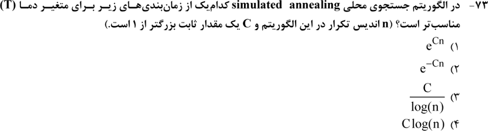

**۴. (ارشد ۱۴۰۱، سؤال ۷۴)**
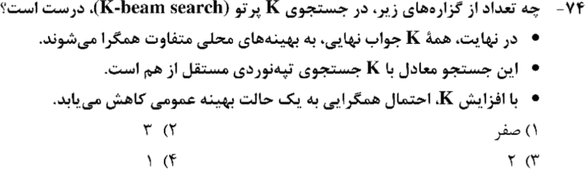

**۵. (ارشد ۱۴۰۱، سؤال ۷۵)**
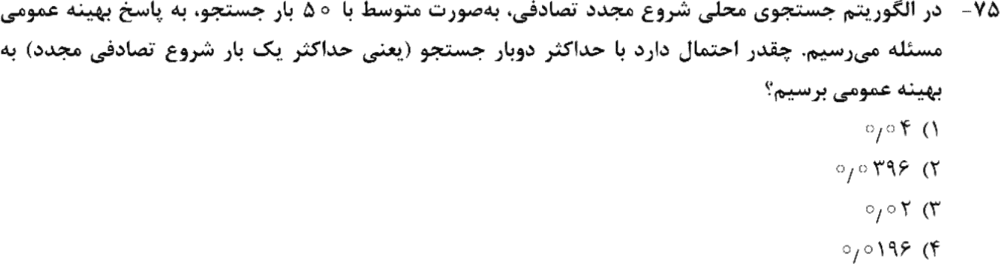

**۶. (ارشد ۱۴۰۰، سؤال ۷۸)**
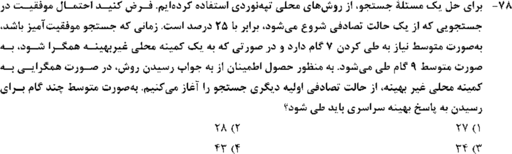

**۷. (ارشد ۱۳۹۹، سؤال ۱۲۴)**
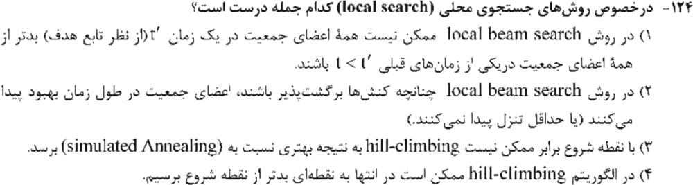

**۸. (ارشد ۱۴۰۴، سؤال ۶۹)**
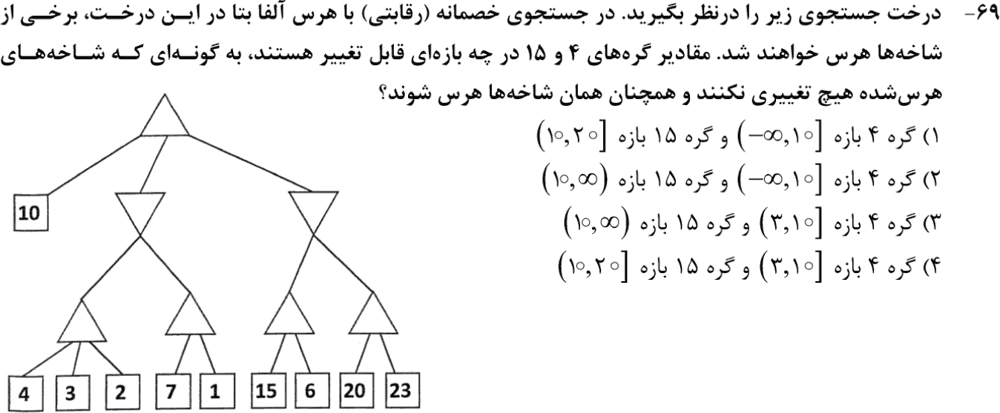

**۹. (ارشد ۱۴۰۳، سؤال ۶۸)**
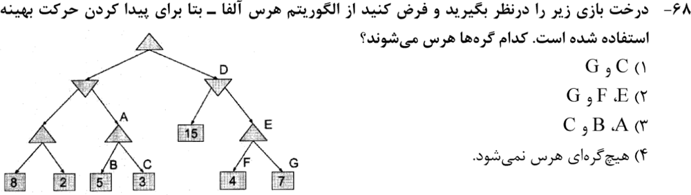

**۱۰. (ارشد ۱۴۰۲، سؤال ۶۸)**
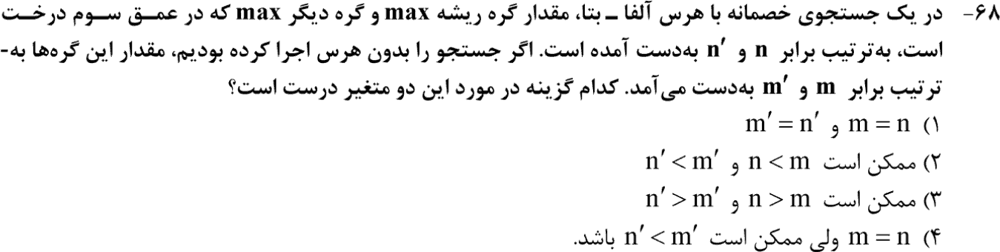

**۱۱. (ارشد ۱۴۰۲، سؤال ۷۲)**
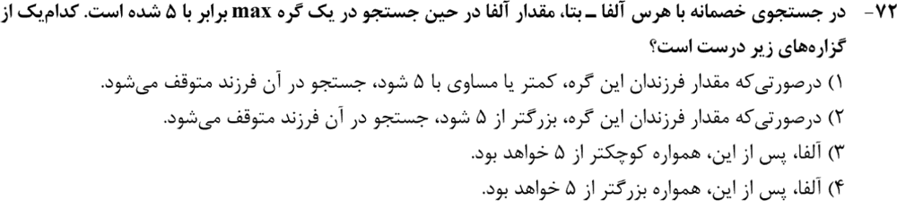

**۱۲. (ارشد ۱۴۰۰، سؤال ۷۹)**
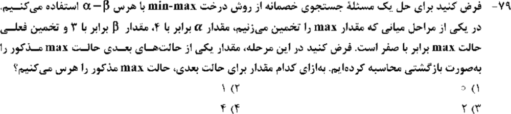

**۱۳. (ارشد ۱۳۹۹، سؤال ۱۲۰)**
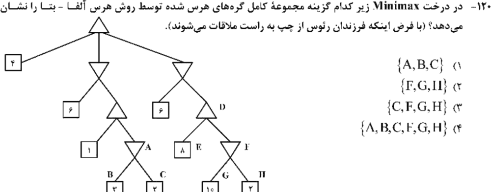

**۱۴. (ارشد ۱۳۹۸، سؤال ۱۱۵)**
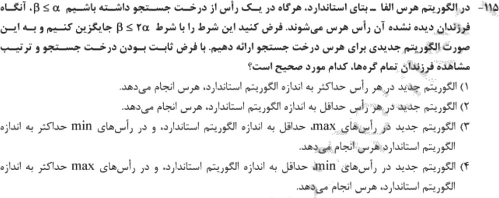

جواب‌ها و راه‌حل (کلید رسمی سازمان سنجش)

| سؤال | ۱ | ۲ | ۳ | ۴ | ۵ | ۶ | ۷ | ۸ | ۹ | ۱۰ | ۱۱ | ۱۲ | ۱۳ | ۱۴ |
|---|---|---|---|---|---|---|---|---|---|---|---|---|---|---|
| کلید | ۳ | ۲ | ۳ | ۱ | ۲ | ۳ | ۲ | ۱ | ۴ | ۴ | ۱ | ۴ | ۳ | ۲ |

**۱. گزینهٔ ۳.** هر دو ممکن است در بهینهٔ محلی گیر کنند. پرتو محلی معادل k تپه‌نوردی مستقل نیست، پس گزینه‌های ۱ و ۲ تضمین ندارند.

**۲. گزینهٔ ۲.** پازل ۸ دنبالهٔ حرکت می‌خواهد. جستجوی محلی برای پیدا کردن یک حالت بهینه است.

**۳. گزینهٔ ۳.** زمان‌بندی لگاریتمی `C/log n` همگرایی به بهینهٔ سراسری را تضمین می‌کند. `e^(Cn)` افزایشی است، و `e^(−Cn)` خیلی سریع سرد می‌شود.

**۴. گزینهٔ ۱ (هیچ‌کدام).**
- k جواب ممکن است به **یک** بهینه همگرا شوند (گزارهٔ ۱ غلط).
- پرتو محلی با k تپه‌نوردی مستقل فرق دارد، چون اطلاعات بین k حالت رد و بدل می‌شود (گزارهٔ ۲ غلط).
- افزایش k احتمال موفقیت را کم نمی‌کند (گزارهٔ ۳ غلط).

**۵. گزینهٔ ۲.** `p = 1/50 = 0.02`، پس `1 − 0.98² = 0.0396`.

**۶. گزینهٔ ۳.** امید شکست‌ها `0.75/0.25 = 3`، پس `3 × 9 + 7 = 34` گام.

**۷. گزینهٔ ۲.** با کنش‌های برگشت‌پذیر، بهترین k حالت دور بعد حداقل به خوبی دور قبل است. تپه‌نوردی هرگز بدتر از نقطهٔ شروع تمام نمی‌شود (گزینهٔ ۴ غلط).

**۸. گزینهٔ ۱.** با اجرای آلفا-بتا: ریشه بعد از برگ ۱۰، `α = 10` دارد.
- فرزند اولِ MIN اول `max(4,3,2) = 4 ≤ 10`، پس فرزند دوم (۷، ۱) هرس می‌شود.
- در MIN دوم: `max(15, 6) = 15` و `β = 15`. در فرزند بعدی برگ ۲۰ از ۱۵ بیشتر است، پس ۲۳ هرس می‌شود.
- **برای برگ ۴:** لازم است `max(x, 3, 2) ≤ 10`، یعنی `x ∈ [−∞, 10]`.
- **برای برگ ۱۵:** لازم است `max(y, 6) > 10` (وگرنه کل فرزند دوم هرس می‌شد) و `≤ 20` (تا ۲۳ هرس شود)، یعنی `y ∈ (10, 20]`.

**۹. گزینهٔ ۴.** در اجرا، هیچ شرط هرسی برقرار نمی‌شود. A مقدار ۵ می‌گیرد (`< β = 8`)، و E مقدار ۷ (`< β = 15`، `> α = 5`). مقدار ریشه ۷ است.

**۱۰. گزینهٔ ۴.** مقدار ریشه همیشه همان مینیمکس است (`m = n`)، ولی گره میانی MAX که هرس شده می‌تواند مقدار کمتری از مقدار واقعی برگرداند.

**۱۱. گزینهٔ ۱.** فرزند (MIN) با `α = 5` کار می‌کند. وقتی مقدارش `≤ 5` شد، دیگر برای پدر مهم نیست و هرس می‌شود.

**۱۲. گزینهٔ ۴.** در گره MAX، هرس وقتی است که مقدار `≥ β = 3` شود. بین گزینه‌ها فقط ۴ این شرط را دارد.

**۱۳. گزینهٔ ۳ (C، F، G، H).**
- در زیردرخت چپ: A بعد از دیدن `B = 3 ≤ α = 4`، فرزند C را هرس می‌کند.
- در زیردرخت راست: D بعد از دیدن `E = 8 ≥ β = 6`، فرزند F (همراه با G و H) را هرس می‌کند.

**۱۴. گزینهٔ ۲ (با تأثیر مثبت).** با شرط جدید `β ≤ 2α`: اگر α مثبت باشد، `β ≤ α` نتیجه می‌دهد `β ≤ 2α`، پس هر هرس قبلی هنوز انجام می‌شود و شاید بیشتر. کلید «با تأثیر مثبت» است (پذیرش چند گزینه یا حذف اثر منفی)، چون برای α منفی این استدلال برقرار نیست.

---

## 🗂 کارت خلاصهٔ فصل ۲
- تپه‌نوردی در بهینهٔ محلی گیر می‌کند؛ شروع مجدد: `1 − (1−p)ᵏ` و امید شکست‌ها `(1−p)/p`. SA با دمای لگاریتمی. پازل ۸ برای محلی مناسب نیست.
- پرتو محلی ≠ k تپه‌نوردی مستقل. با کنش برگشت‌پذیر بدتر نمی‌شود.
- آلفا-بتا: MIN با `≤ α` هرس می‌شود، MAX با `≥ β`. ریشه دقیقاً مینیمکس است؛ گره‌های میانی فقط کران‌اند.
- بازهٔ برگ: شرط هر هرس وابسته به آن برگ را بنویس.
