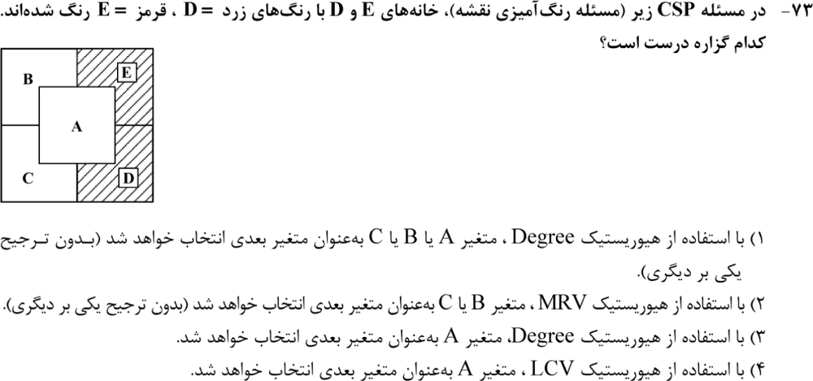
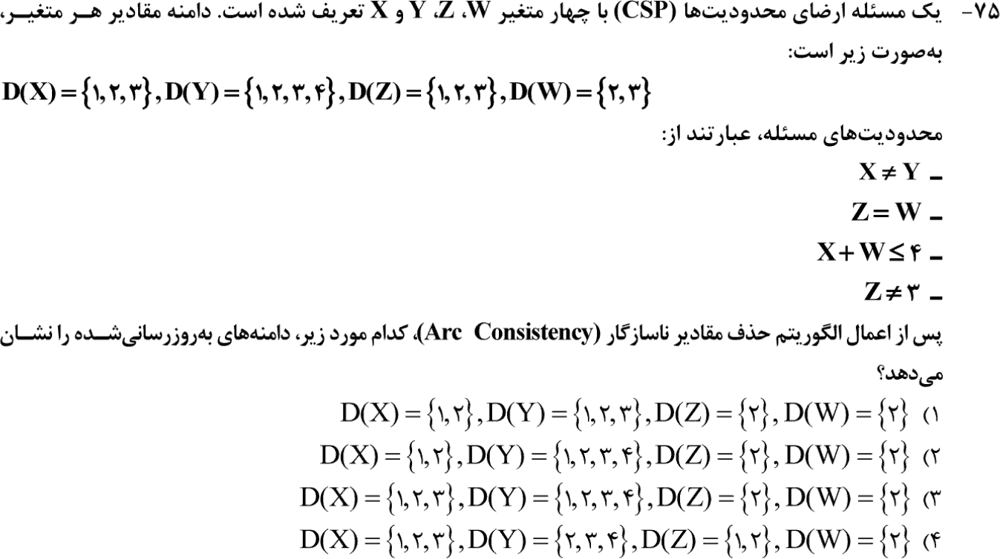
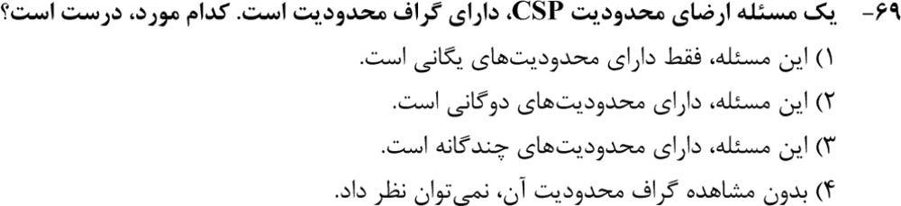
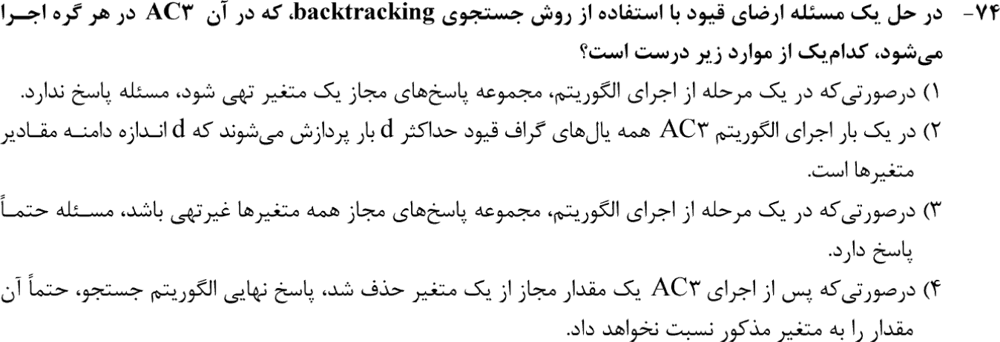
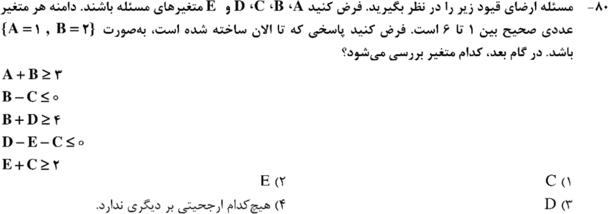
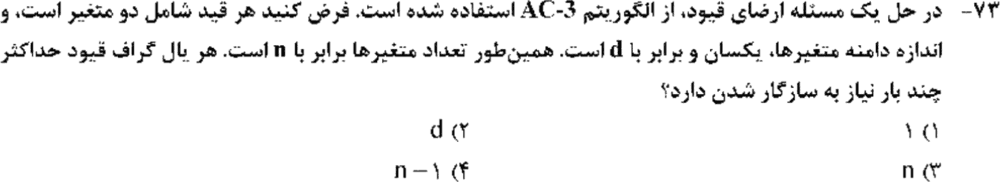
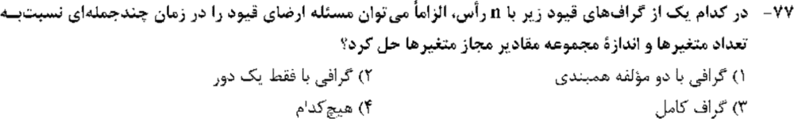
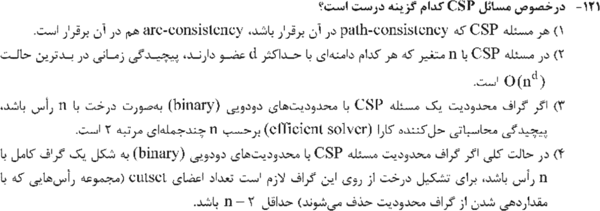
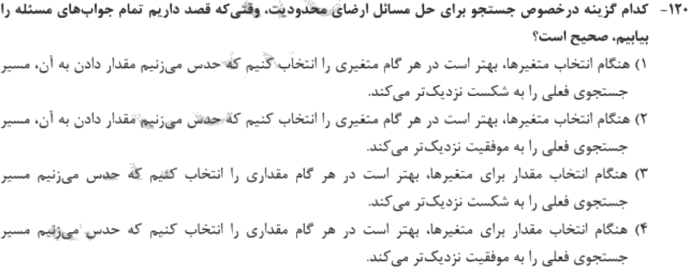

# فصل ۳: مسائل ارضای محدودیت (CSP)

> **سهم در کنکور:** ۹ سؤال در ارشد ۱۳۹۸ تا ۱۴۰۴. تیپ‌ها: اجرای سازگاری کمان (AC‑3) روی دامنه‌ها، انتخاب متغیر بعدی با MRV و Degree، و ساختار گراف محدودیت.
> **زمان مطالعه:** یک بلوک ۹۰ دقیقه‌ای.

---

## درس ۱: تعریف و گراف محدودیت
- متغیرها، دامنه‌ها، و محدودیت‌ها (یگانی، دوگانی، چندگانه).
- **گراف محدودیت** فقط برای محدودیت‌های **دوگانی** تعریف می‌شود (یال = محدودیت بین دو متغیر).
- **محدودیت یگانی** (مثل `Z ≠ 3`) را اول مستقیم از دامنه حذف کن.

---

## درس ۲: سازگاری کمان (AC‑3)
- کمان `X → Y` سازگار است اگر برای **هر** مقدار X، حداقل یک مقدار سازگار در Y باشد. مقدارهای بی‌پشتیبان را از X حذف کن.
- اگر از دامنهٔ Y چیزی حذف شد، کمان‌های `Z → Y` را (برای همهٔ همسایه‌های Y) دوباره به صف اضافه کن.
- **پیچیدگی:** هر کمان حداکثر **d** بار دوباره بررسی می‌شود (هر بار یک مقدار از همسایه حذف شده). کل زمان `O(ed³)`.
- **محدودیت‌ها:**
  - دامنهٔ تهی یعنی این **شاخه** جواب ندارد (در جستجو). کل مسئله را نمی‌شود بی‌جواب دانست، مگر AC قبل از هر انتساب اجرا شده باشد.
  - غیرتهی بودن همهٔ دامنه‌ها، وجود جواب را تضمین **نمی‌کند**.

**مثال:** دامنه‌های X، Y، Z و W به‌ترتیب `{1,2,3}`، `{1,2,3,4}`، `{1,2,3}` و `{2,3}`، با محدودیت‌های `X ≠ Y`، `Z = W`، `X + W ≤ 4` و `Z ≠ 3`.
1. از `Z ≠ 3`: `Z = {1, 2}`.
2. از `Z = W`: `Z = W = {2}`.
3. از `X + W ≤ 4`: `X = {1, 2}`.
4. Y دست نمی‌خورد (هر مقدارش با یک X متفاوت سازگار است).

---

## درس ۳: جستجوی عقبگرد و هیوریستیک‌ها

| انتخاب | هیوریستیک | ایده |
|---|---|---|
| متغیر بعدی | **MRV** (کمترین مقادیر باقی‌مانده) | «اول شکست»: زودتر بن‌بست را کشف کن |
| شکستن تساوی MRV | **Degree** | متغیری با بیشترین محدودیت روی متغیرهای **مقداردهی‌نشده** |
| مقدار بعدی | **LCV** (کم‌محدودکننده‌ترین مقدار) | برای همسایه‌ها بیشترین گزینه را باقی بگذار |

⚠️ **اگر همهٔ جواب‌ها را بخواهیم**، ترتیب مقدارها اهمیتی ندارد (همه را باید دید)، ولی ترتیب متغیرها (اول شکست) هنوز مفید است.
⚠️ LCV متغیر انتخاب نمی‌کند، مقدار انتخاب می‌کند.

---

## درس ۴: ساختار گراف و پیچیدگی
- **گراف درختی:** با یک بار سازگاری کمان جهت‌دار در `O(nd²)` حل می‌شود (یعنی خطی در n).
- **cutset دور:** اگر با مقداردهی c متغیر گراف درخت شود، زمان `O(dᶜ·(n − c)d²)`.
  - گراف با **یک دور** ⇐ `c = 1` ⇐ چندجمله‌ای.
  - **گراف کامل** با n رأس ⇐ `c ≥ n − 2`.
- **چند مؤلفهٔ همبندی** به‌خودی‌خود کمکی نمی‌کند، چون هر مؤلفه ممکن است سخت باشد.
- **کلی:** `O(dⁿ)`.

### تمرین فصل ۳
1. با `X < Y` و هر دو دامنه `{1, 2, 3}`، بعد از AC دامنه‌ها چه می‌شوند؟
2. گراف درختی با ۱۰ متغیر و دامنهٔ ۳: پیچیدگی؟

جواب‌ها

1. `X = {1, 2}` و `Y = {2, 3}`.
2. `O(10·3²)`، یعنی خطی.

---

## 📝 آزمون فصل ۳ (سؤال‌های واقعی کنکور ارشد کامپیوتر)
**زمان: ۲۰ دقیقه برای ۹ سؤال.**

**۱. (ارشد ۱۴۰۴، سؤال ۷۳)**

**۲. (ارشد ۱۴۰۴، سؤال ۷۵)**

**۳. (ارشد ۱۴۰۳، سؤال ۶۹)**

**۴. (ارشد ۱۴۰۲، سؤال ۷۴)**

**۵. (ارشد ۱۴۰۱، سؤال ۸۰)**

**۶. (ارشد ۱۴۰۰، سؤال ۷۳)**

**۷. (ارشد ۱۴۰۰، سؤال ۷۷)**

**۸. (ارشد ۱۳۹۹، سؤال ۱۲۱)**

**۹. (ارشد ۱۳۹۸، سؤال ۱۲۰)**

جواب‌ها و راه‌حل (کلید رسمی سازمان سنجش)

| سؤال | ۱ | ۲ | ۳ | ۴ | ۵ | ۶ | ۷ | ۸ | ۹ |
|---|---|---|---|---|---|---|---|---|---|
| کلید | ۱ | ۲ | ۲ | ۲ | ۱ | ۲ | ۲ | ۴ | ۱ |

**۱. گزینهٔ ۱.** در بین متغیرهای مقداردهی‌نشده (A، B، C)، هر کدام با دو متغیر مقداردهی‌نشدهٔ دیگر هم‌مرزند. پس درجه‌ها برابرند و هیچ‌کدام بر دیگری ترجیح ندارد. (با MRV، A کمترین رنگ باقی‌مانده را دارد چون هم با D و هم با E همسایه است؛ پس گزینهٔ ۲ غلط است. LCV هم متغیر انتخاب نمی‌کند.)

**۲. گزینهٔ ۲.** همان مثال درس ۲: X `{1,2}`، Y `{1,2,3,4}`، Z `{2}`، W `{2}`.

**۳. گزینهٔ ۲.** گراف محدودیت یعنی محدودیت‌های دوگانی.

**۴. گزینهٔ ۲.** هر کمان حداکثر d بار دوباره پردازش می‌شود. گزینهٔ ۱ غلط است (فقط آن شاخه جواب ندارد). گزینه‌های ۳ و ۴ هم تضمین ندارند.

**۵. گزینهٔ ۱.** با `A = 1` و `B = 2`:
- `C ≥ 2` (۵ مقدار)، `D ≥ 2` (۵ مقدار)، و E هنوز ۶ مقدار دارد.
- بین C و D تساوی MRV است. Degree: C در دو محدودیت با متغیرهای مقداردهی‌نشده است (`D−E−C` و `E+C`)، ولی D فقط در یکی. پس **C**.

**۶. گزینهٔ ۲.** d بار (درس ۲).

**۷. گزینهٔ ۲.** با یک دور، cutset یک‌عضوی داریم: `d` حالت × حل درخت، که چندجمله‌ای است.

**۸. گزینهٔ ۴.** در گراف کامل، برای رسیدن به درخت باید حداقل `n − 2` رأس حذف شود (دو رأس باقی‌مانده یک یال‌اند). درخت `O(nd²)` است که مرتبهٔ ۱ در n است، نه ۲.

**۹. گزینهٔ ۱.** برای یافتن همهٔ جواب‌ها، اول متغیری را بردار که زودتر به شکست می‌رسد (اول شکست). ترتیب مقدارها اهمیتی ندارد.

---

## 🗂 کارت خلاصهٔ فصل ۳
- گراف محدودیت = محدودیت‌های دوگانی. یگانی را اول از دامنه حذف کن.
- AC‑3: هر کمان حداکثر d بار. دامنهٔ تهی یعنی همین شاخه شکست خورده. دامنه‌های غیرتهی جواب را تضمین نمی‌کنند.
- MRV و بعد Degree (روی متغیرهای مقداردهی‌نشده) برای متغیر؛ LCV برای مقدار. همهٔ جواب‌ها: فقط اول شکست مهم است.
- درخت `O(nd²)`. یک دور ⇐ cutset ۱. گراف کامل ⇐ cutset `n − 2`.
