# فصل ۴: منطق و استنتاج، شبکهٔ بیزی، و یادگیری

> **سهم در کنکور:** ۱۳ سؤال در ارشد ۱۳۹۸ تا ۱۴۰۴ (۱۰ منطق، ۲ شبکهٔ بیزی، ۱ یادگیری) + ۴ سؤال حذف‌شده.
> **پیش‌نیاز:** گسسته فصل ۱ (منطق) و آمار و احتمال فصل ۱ (شرطی و بیز).
> **زمان مطالعه:** یک بلوک ۹۰ دقیقه‌ای.

---

## درس ۱: منطق گزاره‌ای در هوش

| مفهوم | تعریف |
|---|---|
| معتبر (valid، همیشه درست) | در همهٔ مدل‌ها درست |
| ارضاپذیر | حداقل یک مدل دارد |
| ارضاناپذیر | هیچ مدلی ندارد |
| `KB ⊨ α` | در هر مدل KB، α هم درست است ⇔ `KB ∧ ¬α` ارضاناپذیر است |

- **رزولوشن:** `(A ∨ B)` و `(¬B ∨ C)` نتیجه می‌دهند `(A ∨ C)`. رزولوشن برای **رد** کامل است: اگر مجموعه‌ای ارضاناپذیر باشد، بالاخره بند تهی تولید می‌شود. اگر اشباع شد و بند تهی نیامد، مجموعه ارضاپذیر است.
  - پس با رزولوشن هم می‌شود معتبر بودن را نشان داد و هم معتبر **نبودن** را (با اشباع بدون بند تهی).
- **بند هورن:** حداکثر یک لفظ مثبت. **بند معین:** دقیقاً یک لفظ مثبت.
  - `(¬P ∧ Q) ⇒ R` همان `P ∨ ¬Q ∨ R` است که **دو** لفظ مثبت دارد، پس هورن نیست.
  - رزولوشن دو بند هورن، هورن است. ولی رزولوشن یک بند معین با یک بند هورن، **لزوماً معین نیست** (ممکن است بند هدف بدهد).
- **CNF:** برای هر CNF، یک تفسیر هست که حداقل **نصف** بندها را درست کند (یک انتساب تصادفی، به‌طور میانگین بیش از نصف را درست می‌کند).

### احتمال روی گزاره‌ها
اگر هر گزاره با احتمال ½ درست باشد و یک شرط داده شده باشد، مقادیر اجباری را از شرط بیرون بکش و احتمال بقیه را بشمار.

---

## درس ۲: منطق مرتبهٔ اول

- **اسکولم‌سازی:** `∃y` درون `∀x` به `f(x)` تبدیل می‌شود. هر سور وجودی تابع اسکولم **جدید** خودش را می‌گیرد (`f`، `g`، …).
  - `¬∀y F(x,y) ≡ ∃y ¬F(x,y)` که می‌شود `¬F(x, g(x))`.
- **یکسان‌سازی (unification):** جایگذاری‌ای پیدا کن که دو عبارت را یکی کند. **وارسی وقوع** (occurs check): `w = I(x, w)` یکسان‌سازی **ندارد**.
- رزولوشن مرتبهٔ اول می‌تواند به پرسش «x ای پیدا کن که T(x)» هم جواب بدهد (با ثبت جایگذاری‌ها).

---

## درس ۳: شبکهٔ بیزی و نمونه‌برداری گیبس

- `P(X₁, …, Xₙ) = Π P(Xᵢ | والدین(Xᵢ))`.
- **پرسش شرطی:** `P(A | e) = Σ_پنهان P(A, e, پنهان) / Σ_A,پنهان P(…)`. همهٔ متغیرهای پنهان را جمع بزن.
- **گیبس:** هر متغیر از توزیع شرطی خودش به شرط **پوشش مارکوف** (والدین، فرزندان، والدین فرزندان) نمونه‌برداری می‌شود.
  - برای زنجیر `B → C → D`: `P(C | B, D) ∝ P(C | B)·P(D | C)`.

**مثال:** با `P(C=0 | B=1) = 0.1`، `P(D=0 | C=0) = 0.8` و `P(D=0 | C=1) = 0.1`:
`P(C=0 | B=1, D=0) = 0.08/(0.08 + 0.09) = 8/17`.

---

## درس ۴: یادگیری (در حد تست‌ها)
- **بیز ساده** با درست‌نمایی بیشینه (بدون هموارسازی): اگر یک کلمه در دادهٔ آموزشی یک کلاس **هیچ‌وقت** دیده نشده باشد، احتمال آن کلاس برای هر متنی که آن کلمه را دارد **صفر** می‌شود. هموارسازی لاپلاس این را درست می‌کند.

### تمرین فصل ۴
1. آیا `(A ⇒ B) ∨ (B ⇒ A)` معتبر است؟
2. `∀x ∃y Loves(x, y)` را اسکولم کن.
3. آیا `P(x, f(x))` و `P(y, y)` یکسان‌سازی دارند؟

جواب‌ها

1. بله.
2. `Loves(x, f(x))`
3. خیر، چون `y = x` و `y = f(x)` به `x = f(x)` می‌رسد (وارسی وقوع).

---

## 📝 آزمون فصل ۴ (سؤال‌های واقعی کنکور ارشد کامپیوتر)
**زمان: ۳۰ دقیقه برای ۱۳ سؤال.**

**۱. (ارشد ۱۴۰۴، سؤال ۷۰)**
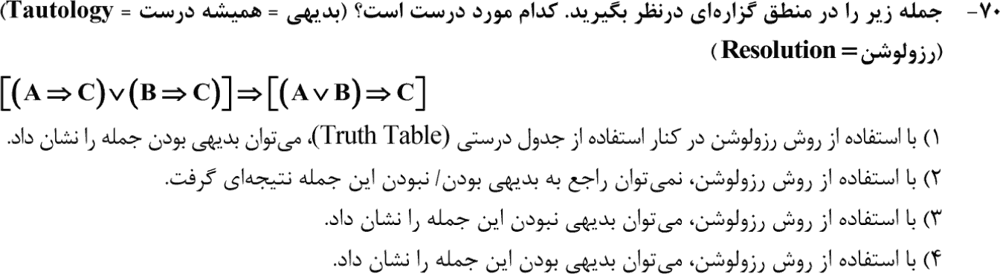

**۲. (ارشد ۱۴۰۳، سؤال ۷۳)**
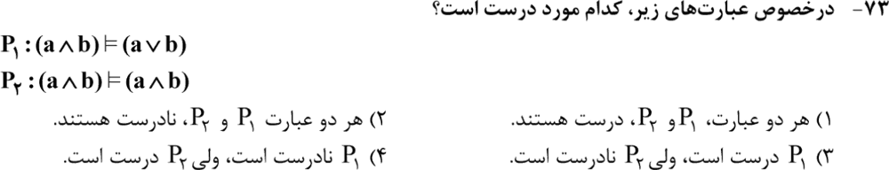

**۳. (ارشد ۱۴۰۲، سؤال ۷۰)**
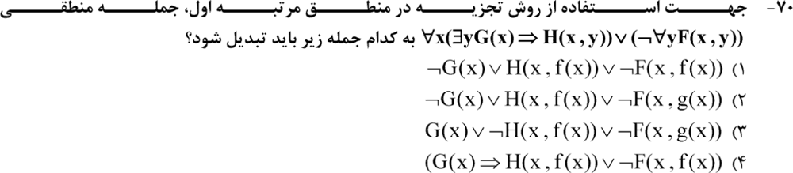

**۴. (ارشد ۱۴۰۱، سؤال ۷۶)**
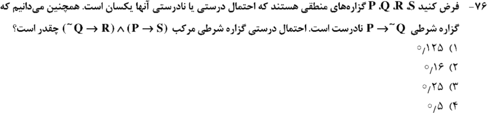

**۵. (ارشد ۱۳۹۹، سؤال ۱۲۳)**
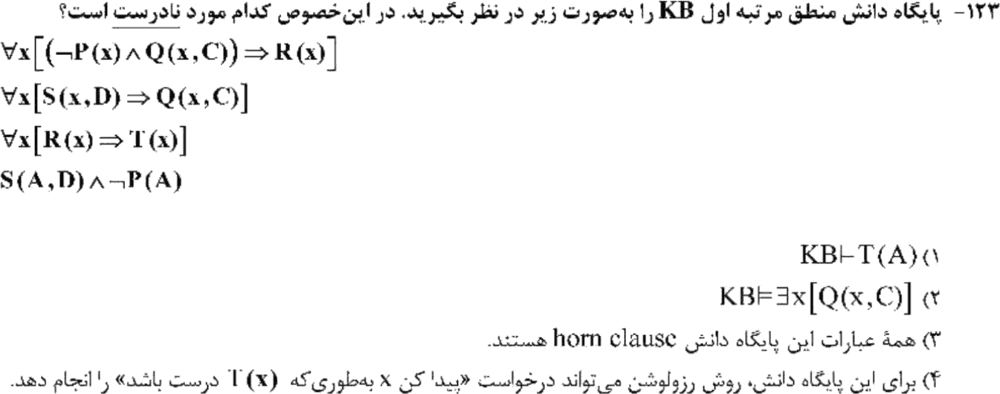

**۶. (ارشد ۱۳۹۹، سؤال ۱۲۵)**
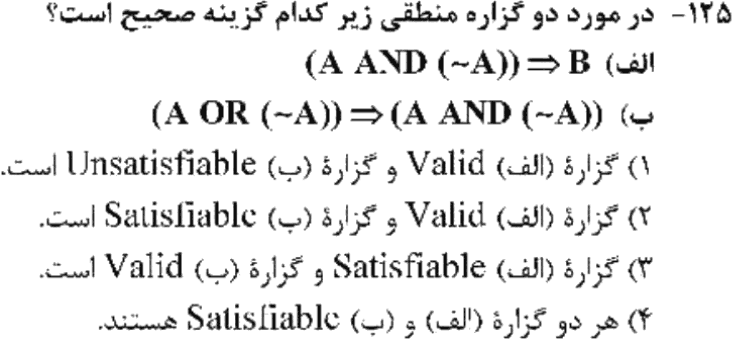

**۷. (ارشد ۱۳۹۹، سؤال ۱۲۶)**
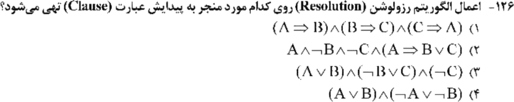

**۸. (ارشد ۱۳۹۹، سؤال ۱۲۸)**
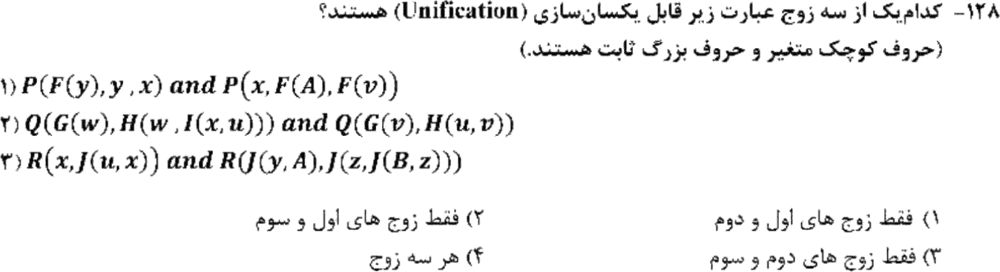

**۹. (ارشد ۱۳۹۹، سؤال ۱۲۹)**
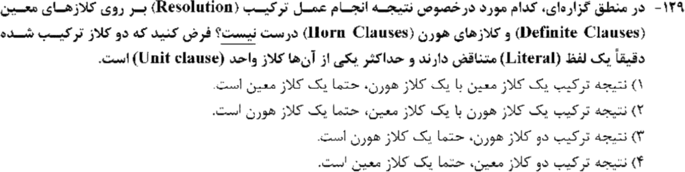

**۱۰. (ارشد ۱۳۹۸، سؤال ۱۱۶)**
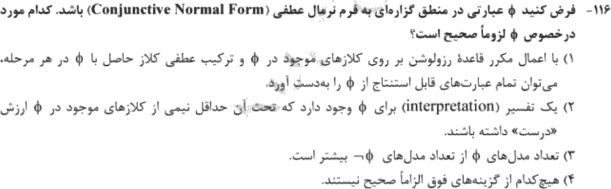

**۱۱. (ارشد ۱۴۰۱، سؤال ۷۷)**
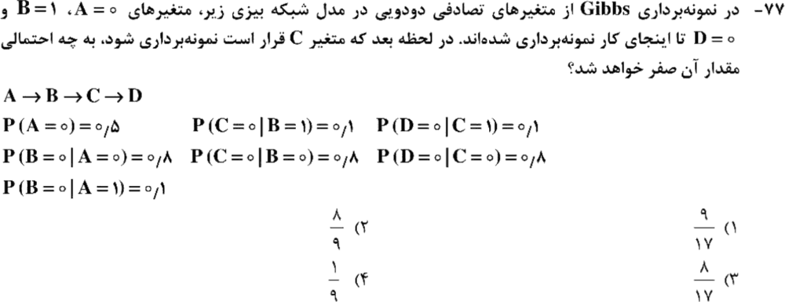

**۱۲. (ارشد ۱۴۰۱، سؤال ۷۹)**
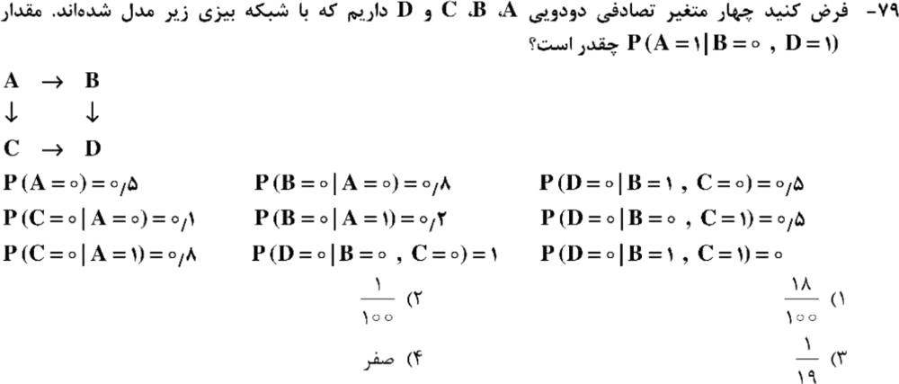

**۱۳. (ارشد ۱۴۰۱، سؤال ۷۸)**
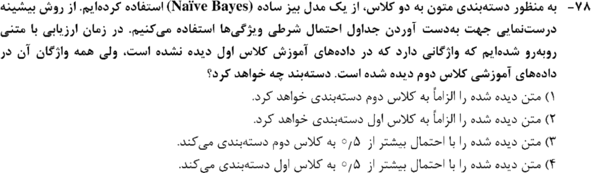

جواب‌ها و راه‌حل (کلید رسمی سازمان سنجش)

| سؤال | ۱ | ۲ | ۳ | ۴ | ۵ | ۶ | ۷ | ۸ | ۹ | ۱۰ | ۱۱ | ۱۲ | ۱۳ |
|---|---|---|---|---|---|---|---|---|---|---|---|---|---|
| کلید | ۳ | ۱ | ۲ | ۴ | ۳ | ۱ | ۲ | ۲ و ۴ | ۱ | ۲ | ۳ | ۳ | ۱ |

**۱. گزینهٔ ۳.** جمله توتولوژی **نیست**. مثال نقض: `A = 1، B = 0، C = 0`. سمت چپ درست است (چون `B ⇒ C` درست است) ولی سمت راست غلط. رزولوشن بعد از اشباع بدون بند تهی، همین را نشان می‌دهد.

**۲. گزینهٔ ۱.** هر دو درست‌اند (`a∧b` هم `a∨b` را نتیجه می‌دهد و هم خودش را).

**۳. گزینهٔ ۲.** `∃y (G(x) ⇒ H(x,y))` می‌شود `¬G(x) ∨ H(x, f(x))`. و `¬∀y F(x,y)` می‌شود `¬F(x, g(x))`، با یک تابع اسکولم **دیگر**.

**۴. گزینهٔ ۴.** `¬Q → P` نادرست است، پس `Q = 0` و `P = 0`. در نتیجه `P → S` درست است و `¬Q → R` فقط وقتی `R = 1` است. احتمال **½**.

**۵. گزینهٔ ۳ (غلط).** جملهٔ اول به `P(x) ∨ ¬Q(x,C) ∨ R(x)` تبدیل می‌شود که دو لفظ مثبت دارد، پس هورن نیست. بقیه درست‌اند:
- `S(A,D)` نتیجه می‌دهد `Q(A,C)`.
- با `¬P(A)`، `R(A)` و بعد `T(A)` نتیجه می‌شود.

**۶. گزینهٔ ۱.** الف (`False ⇒ B`) معتبر است. ب (`True ⇒ False`) ارضاناپذیر است.

**۷. گزینهٔ ۲.** `A ∧ ¬B ∧ ¬C ∧ (¬A ∨ B ∨ C)` ارضاناپذیر است. بقیه ارضاپذیرند (مثلاً گزینهٔ ۳ با `A = 1، B = 0، C = 0`).

**۸. گزینه‌های ۲ و ۴ (هر دو پذیرفته شده).**
- زوج ۱: با `x = F(y)`، `y = F(A)` و `v = y` یکسان می‌شوند.
- زوج ۳: با `x = J(B, A)`، `y = B`، `z = A` و `u = A` یکسان می‌شوند.
- زوج ۲: با `w = v` و `u = w` به `w = I(x, w)` می‌رسیم. با وارسی وقوع یکسان‌سازی **ندارد**، پس جواب گزینهٔ ۲ است. بدون وارسی وقوع گزینهٔ ۴ هم قبول شده.

**۹. گزینهٔ ۱ (غلط).** بند معین + بند هورن ممکن است بند هدف (بدون لفظ مثبت) بدهد که معین نیست.

**۱۰. گزینهٔ ۲.** یک انتساب تصادفی هر بند (غیرتهی) را با احتمال حداقل ½ درست می‌کند. پس به‌طور میانگین حداقل نصف بندها درست‌اند و چنین انتسابی وجود دارد.

**۱۱. گزینهٔ ۳.** `P(C=0 | B=1, D=0) ∝ 0.1 × 0.8` در برابر `0.9 × 0.1`، یعنی `8/17`.

**۱۲. گزینهٔ ۳.** با جمع روی C:
- `P(A=1, B=0, D=1) = 0.5 × 0.2 × (0.8 × 0 + 0.2 × 0.5) = 0.01`
- `P(A=0, B=0, D=1) = 0.5 × 0.8 × (0.1 × 0 + 0.9 × 0.5) = 0.18`

جواب: `0.01/(0.01 + 0.18) = 1/19` (رایانه‌ای هم تأیید شد).

**۱۳. گزینهٔ ۱.** یک کلمهٔ دیده‌نشده در کلاس اول، احتمال آن کلاس را صفر می‌کند. پس متن الزاماً در کلاس دوم قرار می‌گیرد.

*(سؤال‌های ۸۰ ارشد ۱۴۰۰، ۱۱۷ ارشد ۱۳۹۸، ۱۳۰ ارشد ۱۳۹۹ و ۷۴ ارشد ۱۴۰۰ در این مباحث حذف شده‌اند.)*

---

## 🗂 کارت خلاصهٔ فصل ۴
- `KB ⊨ α` ⇔ `KB ∧ ¬α` ارضاناپذیر. رزولوشن برای رد کامل است؛ اشباع بدون بند تهی یعنی ارضاپذیر.
- هورن: حداکثر یک لفظ مثبت. `(¬P ∧ Q) ⇒ R` هورن نیست. معین + هورن ⇏ معین.
- اسکولم: هر ∃ یک تابع جدید. وارسی وقوع: `w = I(x, w)` ✗.
- شبکهٔ بیزی: ضرب شرطی‌ها و جمع روی پنهان‌ها. گیبس: پوشش مارکوف. بیز ساده بدون هموارسازی: کلمهٔ دیده‌نشده یعنی احتمال صفر.
